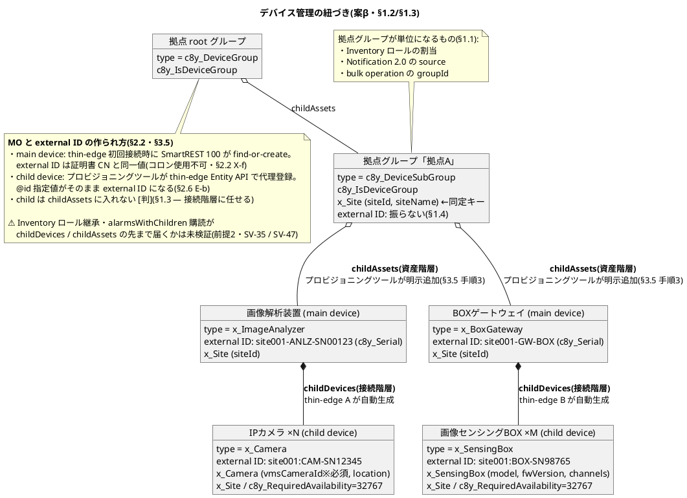
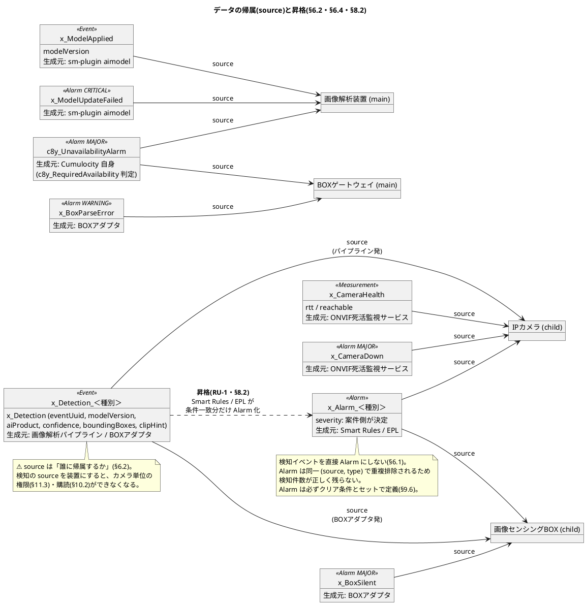
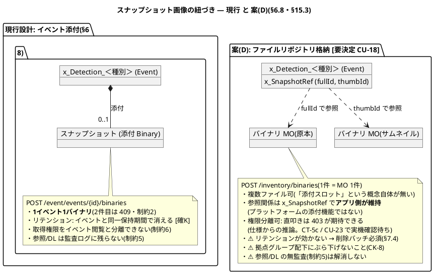

# Cumulocity利用設計書 図解(PlantUML)

`Cumulocity利用設計書.md` の「紐づき」に関する記述を PlantUML で図示したものです。
**正は設計書本文**であり、本ファイルは理解補助です。本文改訂時はこちらも追随させてください。

- 図1: デバイス管理の紐づき(資産階層と接続階層) — §1.2・§1.3・§2.2〜§2.4・§3.5
- 図2: データの帰属(source)と昇格 — §6.2・§6.4・§8.2
- 図3: イベントとスナップショット画像の紐づき — §6.8・§15.3 CU-18

描画は VS Code の PlantUML 拡張、または `java -jar plantuml.jar` で行えます。

---

## 図1 デバイス管理の紐づき — 資産階層と接続階層

設計書 §1.3 が「本書で最も間違えやすい箇所」と呼ぶ、**childAssets(資産階層・業務上の所属)と childDevices(接続階層・通信上の親子)が別物**である点を中心に描いています。実線白抜きひし形が childAssets、黒ひし形が childDevices です。

読み取りポイント:

- **childAssets はプロビジョニングツールの明示操作、childDevices は thin-edge の自動生成**。拠点あたりの明示操作は main device 2 台ぶんの 2 回だけで済む(案βの効果・§1.2)。
- 拠点グループに external ID は無く、`x_Site.siteId` が唯一の同定キー(§1.4 rev.2)。
- main device の external ID は区切りがハイフン(証明書 CN 制約)、child はコロン(§2.2 X-c)。
- 図中の「⚠未検証」は、拠点分離設計全体が依存する最重要検証項目(前提2)。

---

## 図2 データの帰属(source)と昇格

§6.2 の警告「`source` は"そのデータが誰に帰属するか"。検知イベントの source は画像解析装置ではなく対象カメラ」を図にしたものです。矢印はすべて `source`(帰属先)を指します。

読み取りポイント:

- **Measurement は死活の定期記録 1 種のみ**。検知結果は Measurement で送らない(§6.1)。
- 業務アラーム `x_Alarm_＜種別＞` だけは点線(昇格)で生まれる。デバイスが直接発報するのではなく、Edge 内の Smart Rules / EPL が `x_Detection_＜種別＞` から条件一致分を昇格させる(§8.2 RU-1)。
- `c8y_UnavailabilityAlarm` だけは生成元が Cumulocity 自身であり、デバイス側実装では制御できない。

---

## 図3 イベントとスナップショット画像の紐づき

現行設計(イベント添付・§6.8)と、検討中の案(D)(`/inventory/binaries` 格納・§15.3 CU-18)の構造の違いです。**右側の案(D)は [要決定] であり、まだ採用されていません。**

読み取りポイント:

- 現行の「1イベント1バイナリ」はイベント添付という仕組み固有の制約。案(D)はイベントから独立したバイナリ MO を参照キーで結ぶため、原本+サムネイルの複数持ちができる。
- 引き換えに、リテンション(自動削除)・MO 総数(SV-14b)・削除バッチ運用のコストを負う。
- どちらの案でも制約5(参照・DL が監査ログに残らない)は残るため、監査レコードの自前書き込みは別途必要(§15.3)。
