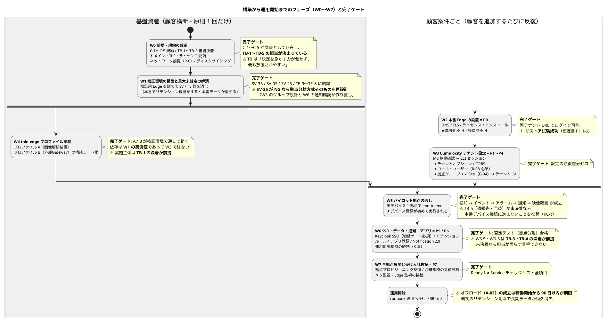
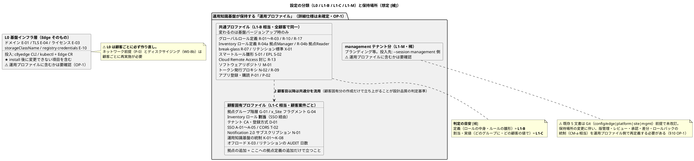
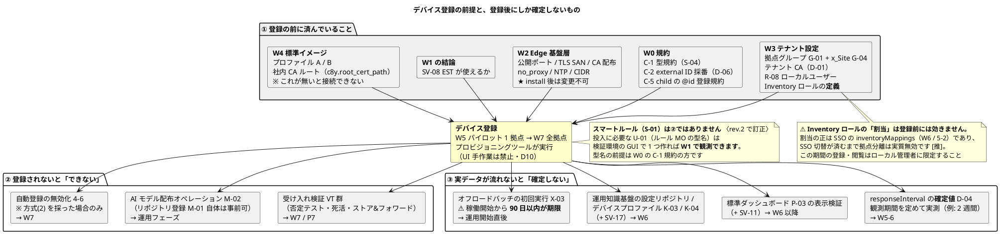

# IoT基盤 構築から運用開始までの全体フローと役割分担

rev.4 / 2026-08-31

---

## 0. 本書の位置づけと読み方

### 0.1 目的と、正となる文書

Cumulocity Edge のインストールから運用開始までについて、**「どのタイミングで」「誰が」「どの設定を」「どうやって」適用するのか**を 1 枚で見通せるようにする案内図です。手順・設定値の**正は既存の各設計書**であり、本書は重複記述をせず参照で指します。

| 文書 | 版・日付 | 役割（何の「正」か） |
|---|---|---|
| [Cumulocity利用設計書_構成改訂版.md](Cumulocity利用設計書_構成改訂版.md) | **r2 / 2026-08-26** | **Cumulocity 側設計の正**（ロール設計・オンボーディング方式・SSO 設計・設定分類）。**5 文書中で最新**であり、下記 2 文書の記述を一部覆している（→ §0.4） |
| [IoT連携チーム_担当範囲設計書.md](IoT連携チーム_担当範囲設計書.md) | rev.2 / 2026-08-19 | **担当分担と WBS の正**（W0〜W7、担当区分、TB-nn、提供物カタログ DL-nn） |
| [Cumulocity構成準拠セットアップ設定書.md](Cumulocity構成準拠セットアップ設定書.md) | rev.4 / 2026-08-18 | **適用手順の正**（P0〜P7）・設定項目定義・運用知識基盤のガードレール（§4.9） |
| [Cumulocity設定定義書.md](Cumulocity設定定義書.md) | 2026-08 | 設定項目のカタログ（API・権限・スキーマ） |
| [Cumulocity設定エクスポート投入ガイド.md](Cumulocity設定エクスポート投入ガイド.md) | 2026-08-06 | go-c8y-cli による投入の実装技法（冪等化パターン A〜E）。⚠️ **リポジトリ構成（§6.1）は旧案**。正はセットアップ設定書 §6.2 |
| `../IoTPlatform_cc/design-decisions.md` | — | **設計判断 D1〜D17 / D-a〜D-c の定義元**（本 `docs/` の外）。本書が引く D7・D10・D17・D-c はここが正 |

### 0.2 凡例

- **[文]** 既存文書に記述がある（本書が確認した事実）
- **[補]** 既存文書に記述がなく、本書が補完した整理（正式化には関係者合意が必要）
- **[推]** 既存文書の記述からの演繹。明示の記載は無い

> ⚠️ **本書の `[文]` は「社内文書に書いてある」ことのみを意味します。** その記述自体の確度（ベンダー公式で確認済みか／演繹か／未確認か）は各文書の凡例に従ってください（セットアップ設定書 §0.4 は 4 段階を使い分けています）。rev.1 は本書の記号に `[確]` を使っていましたが、設定書の `[確]`（＝ベンダー公式の逐語確認済み）と意味が衝突するため rev.2 で改称しました。

### 0.3 ID 体系の読み方 — 似た ID が別物を指します

本書は 20 種類以上の ID 体系を横断します。**先頭ゼロやハイフンの有無だけで別体系になる**ものがあるため、参照先を間違えないでください。

| 接頭辞 | 意味 | 定義元 |
|---|---|---|
| `W0`〜`W7` | 作業フェーズ | 担当範囲設計書 §3.1・§8 |
| `P0`〜`P7`（ハイフンなし） | 適用手順のフェーズ | セットアップ設定書 §5 |
| ⚠️ `P-0`〜`P-4`（ハイフン付き） | **着手前の前提。`P0`〜`P7` とは別体系** | セットアップ設定書 §1 |
| ⚠️ `P-01`〜`P-04` | **アプリケーション設定項目。上記 2 つとも別体系** | セットアップ設定書 §3 |
| `E` / `T` / `X` / `S` / `N` / `A` / `M` / `K` / `O` -nn | 設定項目 | セットアップ設定書 §3 |
| ⚠️ `G-01`〜`G-04`（先頭ゼロ付き） | **拠点グループの設定項目** | 設定書 §3・利用設計書 §6.2.3.3 |
| ⚠️ `G-1`〜`G-14`（先頭ゼロなし） | **運用知識基盤のガードレール。`G-01` とは全くの別物** | セットアップ設定書 §4.9.3 |
| `R-01`〜`R-17` | ロール定義。⚠️ **R-04a/R-06a などの細分 ID と R-10〜R-17 はセットアップ設定書 §3 には無く、利用設計書が定義元** | 利用設計書 §5.1.2〜§5.1.4 |
| `D-01`〜`D-12` | デバイスオンボーディングの設定項目 | セットアップ設定書 §3 |
| ⚠️ `D7` / `D10` / `D17` / `D-c` | **設計判断。設定項目 `D-01` とは別体系** | `design-decisions.md` |
| `C-1`〜`C-5` | 着手前に確定すべき規約 | 担当範囲設計書 §1.5 |
| `SV-nn` / `TE-nn` / `CU-nn` / `U-nn` | 未確定事項（順に 設定書／担当範囲／利用設計書／投入ガイド） | 各文書の未確定事項章 |
| `TB-1`〜`TB-5` | 未確定の担当境界 | 担当範囲設計書 §1.4 |
| `RB-nn` / `VT-nn` / `DL-nn` | runbook ／ 受入試験 ／ 提供物 | 担当範囲設計書 §10.3 / §9 / §10.1 |
| `S-1`〜`S-17` | 主体（誰が Cumulocity に触るか） | 利用設計書 §5.1.1 |
| `T1` / `T2` / `T3` | 担当対象物（Edge ／ thin-edge A ／ thin-edge B） | 担当範囲設計書 §1.1 |

### 0.4 文書間の版数の食い違い（rev.2 で反映）

**利用設計書_構成改訂版 r2（2026-08-26）が最新**であり、セットアップ設定書 rev.4（08-18）・担当範囲設計書 rev.2（08-19）の記述を次の 3 点で覆しています。本書は **r2 を正**として記述しています。古い 2 文書を単独で読むと誤ります。

| 論点 | 古い 2 文書の記述 | **r2 による確定（本書が採る）** |
|---|---|---|
| アラーム severity の一元上書き | テナントオプション `alarm.type.mapping`（設定項目 **T-03**）を投入する | **不使用に決定。T-03 は削除済み。** severity はアラーム生成元（デバイス本体・thin-edge・EPL ルール）が**生成時に確定し、運用中に変更しない**（利用設計書 §3.6.4）。旧「アラームマッピング定義」章・検証項目 CT-13b・CI 検査 CK-7 も廃止 |
| 拠点グループの同定キー | グループに external ID を振る（**G-02**） | **G-02 は rev.2 で廃止し G-04 に統合。** 拠点グループの唯一の同定キーは `x_Site.siteId` フラグメント（**G-04**）。グループ作成時に本文へ含める（後付け UPDATE にしない） |
| `C8Y_MODE=prod` の挙動 | 「エラーも出さずに何も投入せず完走する」 | **Create/Update/Delete が全てエラーになり非ゼロ終了する**（利用設計書 §6.2.1 CF-c が明示的に訂正）。結論（`ci` を使う）は同じだが、**CI が終了コードを見ていれば気付ける**点が異なる |

> ⚠️ この食い違いは未解消の文書管理課題です。設定項目 ID を引用する前に、利用設計書_構成改訂版を検索して「廃止」「不使用」「r2 で」の語が付いていないか確認してください。ID 体系の統一自体が **CU-17** として起票されています。

さらに rev.3 で反映した新情報 — **設定定義は Git ではなく運用知識基盤の「運用プロファイル」として保持する** — は、**既存 5 文書すべてと矛盾**します（5 文書とも Git・`config/` 前提で、「運用プロファイル」という語は 5 文書に登場しません）。詳細は §1.1(2)・§3・§10 の OP-1〜OP-3 を参照してください。

### 0.5 読者別の入口

| 読者 | 読む順 |
|---|---|
| 初参加の基盤エンジニア | §0.3（ID 索引）→ §3（設定の分類）→ §4（フェーズ別）→ §6（登録前後の依存） |
| 案件チーム・Keycloak 担当など、値を決める側 | §2.2（役割別やることリスト）→ §2.1（受領期限）→ §5（テーマ別） |
| プロジェクトマネージャー | §1（全体像と図）→ §4 各フェーズの**完了ゲート**行 → §10（未確定事項）→ 担当範囲設計書 §3.2 クリティカルパス |
| 経営層・顧客への説明者 | §1.0（要約）→ §1.2（図1）→ §7（顧客追加の作業パッケージ） |

---

## 1. 全体像

### 1.0 要約

顧客ごとに専用の Cumulocity Edge を 1 式立ち上げます。設定の定義は運用知識基盤が「運用プロファイル」として保持し、全顧客共通の部分と顧客固有の部分に分けてそこから各 Edge へ投入します。顧客ごとの作業は拠点定義・ユーザー・アプリ登録・デバイス登録に絞られます。最初の 1 顧客は、規約の確定から運用開始まで W0〜W7 の 7 フェーズを踏みます。工程の後戻りが効かない山が 1 つ（Edge のインストール）あり、その前に紙の作業と検証環境での実機確認を終える必要があります。

### 1.1 着手前に解いておくべき 3 つの誤解

**(1)「まずインストール」ではない。** Edge インストール（W2/P0）は**冪等化不可・後戻り不可**の工程です。ドメイン・TLS SAN・ライセンス・`storageClassName`・公開ポート・CIDR はインストール後に変更できません（設定書 P-0）[文]。その前に**規約の確定（W0）と検証環境での実機検証（W1）**が必須です。特にイベント/アラーム型規約（C-1／S-04）と external ID 採番規約（C-2／D-06）は「後から変わると全部壊れる」[文] 最優先の確定事項です。

**(2)「AI 最適設定の流し込み」の設定定義は「運用プロファイル」に置かれる — ただし経路は 2 本に分かれる。** [補]

- 設定の定義（全顧客共通の「基盤標準初期値」= L1-B 相当、顧客固有設定 = L1-C 相当）は、**運用知識基盤が「運用プロファイル」として保持します**（設定の塊のようなもの。形式・版管理などの詳細仕様は未確定）[補]。
- **経路 1（初期構築時）**: 運用プロファイルの内容を新しい Edge へ投入する経路。実行主体は基盤チーム（人 + CI）で、手段は go-c8y-cli スクリプトが現行案（→ §3.1・§3.2）。初期ベースラインの作成手法としては設定定義書 §9.4「リファレンステナント差分方式」が使えます [推]。
- **経路 2（運用開始後）**: 運用知識基盤が専用アカウント（R-06a 読取 / R-06b 書込)で Cumulocity を直接読み書きし、運用データに基づいて設定を継続改善する経路。ガードレール **G-1〜G-14**（`G-01` とは別物 → §0.3）で統制され、**初期版は「提案のみ・適用は人手承認」（G-12）**[文] です。
- ⚠️ **既存 5 文書はすべて「設定定義は Git（`config/`）で管理」前提**で書かれており、「運用プロファイル」という語は登場しません。保持場所の変更に伴い、Git 前提の統制（CM-a: PR レビュー + CI 適用、タグによる版固定）に相当する仕組みを運用プロファイル側で再定義する必要があります（**OP-1** → §10）。
- ⚠️ **鶏卵問題**: 運用知識基盤そのものの実装は IoT連携チームの担当外で未着手（**N10** で未確定）[文]。初期構築（W3）の設定の出所が運用プロファイルなら、**運用知識基盤が存在しない時点で最初の Edge をどう設定するか**（ブートストラップ経路）を先に決める必要があります（**OP-2** → §3.1）。なお `N10` は担当範囲設計書 §1.2 に「N10 で未確定」と出るのみで、**どの一覧の何番なのか出典側でも追跡できません**（→ §10）。

**(3) 顧客の追加はサブテナントではなく Edge の追加。** Edge はシングルテナント（サブテナント作成不可）[文] であり、拠点の分離は「device group + Inventory ロール」で行います（D17）。**顧客間の分離が必要になった時点で単一 Edge への集約は成立せず、顧客ごとに Edge を分けます**（D-c）[文]。つまり新規顧客向けのセットアップとは、その顧客専用の Edge 1 式を W0〜W7 で立ち上げることです。2 顧客目以降は、共通部分（L1-B 相当の運用プロファイル）を流用し、**顧客固有分（L1-C 相当）の作成だけで立ち上がる**ことが設計品質の判定基準です（既存文書の表現では「`site/` だけの作業で立ち上がる」[文]）。

### 1.2 図1 フェーズ全体像 — 基盤資産と顧客ごとの作業

⚠️ **T1（Edge）と T2/T3（thin-edge）は並行で進み、W1 と W5 で必ず合流します**（担当範囲設計書 §3.1）[文]。一本の直列ではありません。

### 1.3 図2 設定の分類と、顧客追加時に再利用できる範囲

---

## 2. 登場人物 — 「誰が」の定義

**「投入責任と決定権は別」**（担当範囲設計書 §1.3）が全体を貫く原則です。Cumulocity Edge のすべての設定は IoT連携チームが投入しますが、**値を決める権利は必ずしも IoT連携チームにありません** [文]。

> ⚠️ **rev.1 で「案件チーム」に付けていた通称「顧客担当」は rev.2 で廃止しました。** 出典に存在しない造語であり、同じ文書内の「顧客側」「顧客拠点」（＝エンドユーザー組織）と衝突するためです。**本書で「顧客」はエンドユーザー組織のみを指します。**

| 呼称（出典どおりの正式名） | 主体 ID | 役割 |
|---|---|---|
| **IoT連携チーム**（本チーム。以下「基盤チーム」） | — | Cumulocity Edge（T1）・thin-edge 2 系統（T2/T3）の設計・構築・運用。**全設定の投入責任者** |
| **案件チーム** | — | 拠点の実体を知る側。拠点コード・拠点グループ階層（G-01）の決定 |
| **案件アプリ担当**（VM2 の各アプリ担当） | — | VM2 上の業務アプリ開発。CORS 許可オリジン（T-02）・Notification 2.0 で受けたい内容（N-01）の決定 |
| **案件側**（上記を含む総称） | — | 検知種別の列挙、スマートルール/EPL 判定ロジックの**保守主体**（D7）、`responseInterval` の許容誤検知率 |
| **Keycloak 担当** | — | Keycloak 本体（realm・グループ・ユーザー）の構築・運用。issuer/clientId/JWKS/クレーム名の決定。**人の入退社の一次処理は Keycloak 側**（利用設計書 §5.4.7）[文]。⚠️ 顧客ユーザー登録の実施者の粒度は未確定（→ §5.3） |
| **インフラ/NW チーム** | — | ドメイン 2 つ・TLS SAN の値の決定（後戻り不可のため W0 前に受領） |
| **調達/ベンダー窓口** | — | ライセンス・Edge registry credentials の入手 |
| **画像解析側チーム** | — | 画像解析装置のアプリ側（Docker Compose・解析パイプライン）。筐体・OS の所有は**未確定（TB-1）** |
| **BOXアダプタ担当** | — | BOX 独自形式→標準ペイロード変換・重複排除（72h 窓）・siteId 振り分け。IF-H01 の契約相手。**担当主体が未確定（TB-2）** |
| **基盤運用側** | — | 外部Gateway の VM/OS、メタ監視・Edge 監視の担当候補（**TB-2/TB-5 で交渉中**）。⚠️ 「基盤チーム」＝IoT連携チームとは**別組織**です |
| **Edge ホスト OS / k3s 管理者** | **S-15** | Edge のインストール・アップグレード・バックアップ・障害調査。⚠️ **OS ログインは Cumulocity の認証系の外にあり、RBAC も監査ログも一切効きません**。root があれば MongoDB を直接読め、`kubectl get secret` でサービスユーザー資格情報を取得できる。保持者の限定・分掌は **CU-29** で未決 |
| **保守端末のオペレータ** | S-4 | AI モデル登録・更新オペレーションの発行。運用知識基盤の設定変更の承認導線（G-12）。⚠️ 承認者そのものは未特定（→ §8） |
| **法務/顧客** | — | external ID 仮名化要否、リテンション日数（特に AUDIT）の決定 |
| **監査担当** | S-17 | 監査ログの月次レビュー（AU-a）。ロールは R-17 |
| **顧客（エンドユーザー組織）** | S-2 / S-3 か | ⚠️ **役割が未定義**。SSO ユーザー（拠点オペレーター S-2 / 業務閲覧者 S-3）の実体は顧客側の人と推測されますが [推]、**出典 5 文書に顧客組織の作業を定めた記述はありません**。ユーザー追加依頼・拠点追加依頼（RB-1）・アラーム一次対応の窓口が未確定（→ §10） |
| **運用知識基盤** | S-8 / S-9 | **機械の主体**。Cumulocity の読み手かつ書き手（最高リスクの主体）。実装主体は未確定（N10） |
| **プロビジョニングツール** | S-11 | 機械の主体。デバイス登録はすべてこのツール（構成コード）経由。**UI からの手作業登録は禁止**（D10） |

### 2.1 値の決定権と受領期限（基盤チームが受け取る側の視点）

| 設定 | 投入 | 値の決定権 | 受領期限 |
|---|---|---|---|
| ドメイン 2 つ・TLS SAN（E-01/E-04） | 基盤チーム | インフラ/NW チーム | **W0 の前**（後戻り不可） |
| ライセンス・registry credentials（E-03/E-10） | 基盤チーム | 調達/ベンダー窓口 | **W0 の前** |
| イベント/アラーム型・ペイロード規約（C-1／S-04） | 基盤チーム起案 | 画像解析側・案件側と合意 | **最優先** |
| external ID 採番規約（C-2／D-06） | 基盤チーム起案 | 同上 + 仮名化要否は法務/顧客 | **最優先** |
| 拠点コード命名規約（C-3、英数字のみ） | 基盤チーム | 案件チーム | **W0**（W0-4） |
| リテンション日数の**サイジング用概算**（X-01） | 基盤チーム | 顧客契約・監査要件 | ⚠️ **W0 の前**。`storageClassName` は install 後に変更不可で、その算出根拠が X-01（W0-8b） |
| 拠点グループ階層（G-01） | 基盤チーム | 案件チーム | W2 の前 |
| CORS 許可オリジン（T-02） | 基盤チーム | 案件アプリ担当（VM2） | W2 の前 |
| `responseInterval` の**初期値**（D-04） | 基盤チーム | 案件側の許容誤検知率で決定 | W4 の前（構成コードに埋めるため） |
| `responseInterval` の**確定値**（D-04） | 基盤チーム | 実測（観測期間を定める。例: 2 週間） | W5 の実測後（W5-6） |
| SSO の issuer/clientId/JWKS/クレーム名（A-01/A-02） | 基盤チーム | Keycloak 担当 | W5 の前 |
| リテンション日数の**確定値**・特に AUDIT（X-01） | 基盤チーム | 顧客契約・監査要件 | W6 の前 |
| Notification 2.0 サブスクリプション定義（N-01） | 基盤チーム | 案件アプリ担当 | W6 の前 |
| スマートルール/EPL 判定ロジック（S-01/S-02） | 雛形のみ基盤チーム | **保守主体は案件側**（D7） | — |

### 2.2 役割別 やることリスト（値を出す側の視点）

§2.1 の裏返しです。**基盤チームからの提供物（DL-nn）が遅れると相手チームが止まる**関係も併記します。

| 役割 | 決めて提出するもの | 期限 | 決まらないと止まる工程 |
|---|---|---|---|
| **インフラ/NW チーム** | ドメイン 2 つの FQDN、TLS 証明書 SAN（両ホスト名）、CIDR 非衝突、公開ポート 443/8443/1883/8883、NTP | W0 | **W2 全体**（install 後は変更不可） |
| **調達/ベンダー窓口** | ライセンス、Edge registry credentials | W0 | W2 の 0-4 / 0-5 |
| **案件チーム** | 拠点コード命名規約（英数字のみ）、拠点グループ階層、siteId の採番 | W0〜W2 | W3 の 4-1、W5 のプロビジョニング |
| **案件アプリ担当** | CORS 許可オリジンの完全なリスト、Notification 2.0 で受けたいイベント/アラームの定義 | W2 / W6 | W3 の 2-2、W6 の 6-12 |
| **案件側・画像解析側** | 検知イベント種別の列挙（文法は基盤チームが固定）、判定ロジックの保守体制、許容誤検知率 | W0（規約）／W6 以降（保守） | W0 の C-1 合意 → **全工程** |
| **Keycloak 担当** | realm / clientId / issuer / JWKS URL / グループクレーム名、退場 SLA（CU-38）、**ユーザー登録の実施体制** | W5 の前 | W6 の 5-2（SSO） |
| **法務/顧客** | external ID の仮名化要否、リテンション日数（特に AUDIT） | W0（概算）／W6（確定） | W0-8b のサイジング、W6 の 6-1 |
| **他部門との交渉（TB-1〜TB-5）** | 装置筐体の所有、外部GW/BOXアダプタの担当、トークンプロキシ・オフロードバッチの実装主体、監視の担当 | **W0-1** | TB-1→W4/W5、TB-3→W6-5、TB-4→W6-6、TB-5→W7-3 |
| **基盤チーム → 他チームへの提供**（DL） | **C-4 ローカル MQTT の IF 契約**（DL-3）、拠点グループ階層と Inventory ロール（DL-7）、REST API アクセス（DL-8）、Notification 2.0 とトークン発行（DL-9） | C-4 は W0 | ⚠️ **本チームの遅れがそのまま画像解析側・BOXアダプタ側・案件アプリ側の遅れになる** [文] |

---

## 3. 設定の分類 — 「どの設定」の全体地図

分類の全体像は §1.3 の図2 を参照してください。ここでは判定基準と投入経路を述べます。

| 分類 | 内容 | 変わるタイミング | 投入手段 | 保持場所（想定 [補]） |
|---|---|---|---|---|
| **L0** 基盤インフラ層 | Edge そのもの（ドメイン・TLS・ライセンス・K8s リソース） | 環境ごとに必ず変わる | `c8yedge` CLI / `kubectl` + Edge CR | ファイル / Edge CR（⚠️ 運用プロファイルに含むかは要確認・OP-1） |
| **L1-B** 基盤標準初期値 | **全案件（全顧客）で同一**の「製品としての既定値」 | 基盤バージョンアップ時のみ | go-c8y-cli または REST 直（→ §3.2） | **運用プロファイル（共通）** |
| **L1-C** 本構成固有設定 | **この顧客・案件でのみ必要**な設定 | 案件・環境ごと | go-c8y-cli または REST 直（→ §3.2） | **運用プロファイル（顧客固有）** |
| **L1-M** management テナント | ブランディング等 | 稀 | go-c8y-cli（`--session management`） | 運用プロファイル（management 分・⚠️ 要確認） |

> **判定基準** [文]: 「この分離ができているかが、2 案件目を `site/` だけの作業で立ち上げられるかを決めます」。定義（ロールの中身、ルールの雛形）は L1-B、**割当・実値（どのグループに、どの顧客の値で）**は L1-C、と覚えるのが実用的です [補]。
>
> ⚠️ 分類の正は**利用設計書 §6.2.2 のトレース表**です。セットアップ設定書 §3.2/§3.3 の章立てとは一部相違があります（例: アプリ登録 P-01/P-02 は L1-B、CORS T-02 は L1-C）。
>
> ⚠️ 既存 5 文書の「Git 配置」（`config/edge|platform|site|mgmt`・設定書 §6.2）は**保持場所の旧前提**です。運用プロファイルへの読み替えは §3.1、統制の再定義は §10 OP-1 を参照。

### 3.1 投入の実行経路 — 「どうやって」

設定が実機に届く経路は 2 本 + GUI の例外です。**②の実体（運用プロファイルの形式・適用機構）は未確定**のため、①がブートストラップとして先に成立している必要があります [補]。

| 経路 | いつ | 実行主体 | 手段 |
|---|---|---|---|
| **① ブートストラップ投入** | 初期構築（W2〜W7）・受け入れ検証・緊急 runbook | 基盤チーム（人 + CI） | go-c8y-cli スクリプト（投入ガイドの技法一式） |
| **② 定常の設定適用** | 運用開始後（運用プロファイル → 実機） | 運用知識基盤（機械） | REST API 直（→ §3.2） |
| **③ GUI 経路** | オーサリング・確認・承認・少数の 1 回きり操作 | 人（基盤チーム・案件側） | Cumulocity Web UI。使いどころと禁止範囲は **§3.3** |

> ⚠️ **鶏卵問題** [補]: 設定定義を運用知識基盤（運用プロファイル）に置く方針では、**運用知識基盤（N10・未実装）が存在しない初期構築時に設定の出所がありません**。①の経路が運用知識基盤なしで実行できること（プロファイル内容のエクスポート、またはシード定義を直接投入できること）を設計上保証してください（**OP-2** → §10）。

①（go-c8y-cli）の実務:

| 段階 | 内容 | 参照 |
|---|---|---|
| 定義の保持 | **運用知識基盤の「運用プロファイル」**として保持 [補]。⚠️ 既存文書は Git（`config/` 配下）前提で未改訂（設定書 §6.2・利用設計書 CM-a の PR + CI 統制）。運用プロファイル側での版管理・レビュー・承認・ロールバックの等価統制は未定義（**OP-1**） | §10 |
| セッション準備 | `c8y sessions create` で **edge / management の 2 本**を作る。CI は `c8y sessions login --from-env`。⚠️ 全コマンドに `--session` を明示（取り違えると投入先を間違える・CF-d） | 投入ガイド §1.1〜§1.4 |
| モード | ⚠️ **`C8Y_MODE=ci` を使う。`prod` は Create/Update/Delete が全てエラーになり非ゼロ終了する**（§0.4 で訂正済み） | 利用設計書 §6.2.1 CF-c |
| 投入前の確認 | 投入スクリプトは必ず `--dry --dryFormat json` で先に流してレビューする | 投入ガイド §6.3 |
| 冪等化 | パターン **A** 名前ベース参照 / **B** PUT 先行→POST / **C** 存在チェック→分岐 / **D** 全削除→再作成 / **E** 409 黙殺。設定項目ごとの割り当ては設定書 §6.3 の表 | 投入ガイド §4、設定書 §6.3 |
| フェーズ開始時 | **対象リソースを GET してエクスポートし、版として固定**する（既存文書ではタグ付き Git コミット）。これが P7 の差分の基準であり、切り戻しの起点にもなる | 設定書 §5 |
| 検証 | 設定の**往復差分**（定義 vs 実機、差分ゼロが合格） | 設定書 P7 7-1 |

### 3.2 投入手段の考え方 — go-c8y-cli か REST API 直叩きか [補・要決定 OP-3]

「REST API で投入するのが良い」という助言は、**そのままの形では択一になっていない**というのが本書の整理です。前提として **go-c8y-cli は REST API の薄いラッパー**です — 全コマンドが同じ REST エンドポイントへの写像であり、`c8y api` は生 REST そのものです。プロトコルの二者択一ではなく、**「誰が実行するか」で手段が決まります**。

| 実行主体 | 推奨手段 | 理由 |
|---|---|---|
| **運用知識基盤（プログラム）**が運用プロファイルを適用する定常経路（②） | **REST API 直**（HTTP クライアント / SDK） | サーバサイド常駐プロセスが CLI バイナリを exec するのは実装として不自然（プロセス管理・出力パース・バイナリ配布・版固定の負担）。REST は製品の公式契約で OpenAPI 定義があり、閉域網でも追加バイナリが不要。**「REST API が良い」という助言はこの経路については妥当** |
| **人 + CI** が実行する初期構築・検証・緊急 runbook（①） | **go-c8y-cli** | `--dry` プレビュー・2 テナントのセッション管理・`C8Y_MODE` の安全弁・ページング・エクスポート系イディオムが既製で揃い、**投入ガイドの技法資産（冪等化パターン A〜E）がそのまま使える**。生 REST スクリプト（curl 等）への書き直しは同じ機能の自前再実装であり、得るものがない |

**どちらを選んでも消えない問題**（エンドポイント仕様の問題であり、ツール非依存）:

- `PUT /tenant/options/{category}` のマージ／置換セマンティクス（**SV-30**）— 置換なら再実行で設定が壊れる
- `loginOptions` の `id` の扱いが POST（readOnly＝除去）と PUT（required）で正反対
- `/user/inventoryroles` は直叩き必須（go-c8y-cli にも専用サブコマンドが無い領域）
- 409 の返し方がリソースごとに違う（グループ作成は 409 を返さない、等）

REST 直を選ぶ経路では、これらの処理（冪等化・リトライ・ページング・dry-run 相当のプラン表示）を**運用知識基盤側で自前実装**することになります。その負担を含めて②の実装コストを見積もってください。

**共通の受け入れ基準**（どちらの経路にも課す）: 再実行しても同じ結果になる（冪等）／適用前に差分をプレビューできる／適用後に往復差分ゼロを機械検証できる／変更に相関 ID を残す（G-8）／キルスイッチ（G-1）で止められる。

**運用開始後は書込経路を一本化することを推奨します** [補]: 定常の設定変更は運用知識基盤（②）のみとし、①の CLI 経路は初期構築と break-glass（緊急時）に限定する。二重の書込経路を常用すると、運用プロファイルと実機の間のドリフト管理が二重に必要になります。

### 3.3 GUI の使いどころ — 「人が画面からやる」操作の方針 [補・要決定 OP-4]

CLI / REST だけで全てを賄う必要はありません。判断軸は 2 つです。

1. **間違いが後から直せるか** — external ID の typo や MO の二重生成は後から直せません（三重の突合キー・拠点分離を壊す）。この種の操作は**最初の 1 台からツールで統制**します。
2. **反復するか** — 2 顧客目・2 拠点目で同じ操作を繰り返すものはツール（再現性）。1 回きりのオーサリングや確認・承認は GUI が速く、安全です。

既存文書も GUI を排除していません。むしろ**「リファレンス Edge に GUI で設定を投入（人手・1 回きり）→ エクスポートして定義化 → 新環境へはツールで複製」**が公式のパイプラインです（投入ガイド §0.1・設定定義書 §9.4）[文]。**GUI はオーサリングと確認の面、ツールは複製と反復の面**、という役割分担です。

| 区分 | 操作 | 根拠 |
|---|---|---|
| **GUI が第一候補** | 標準ダッシュボードの作成・Import/Export（P-03）／デバイスプロトコル／ブランディング（L1-M）／**スマートルールの作成・保守**（保守主体は案件側 D7。U-01 の観測手順も「GUI で 1 つ作成」が前提）／リファレンステナントでの設定オーサリング（設定定義書 §9.4）／登録後の拠点グループ表示確認（§6.7 の確認ステップ）／アラーム対応・監査ログ閲覧・棚卸しの目視部分（AC-a） | GUI が公式手段のもの + オーサリング・確認系 |
| **GUI 可（ガード付き）** [補] | デバイス登録のうち **OTP の発行・登録承認**（パイロットや少数台の拠点。事後検証スクリプト必須）／**SSO ログインモード切替（5-4）のような 1 回きりの切替操作**（実施記録を残す）／障害対応の一時変更（事後に定義と再同期） | 反復しない・後から機械検証できる |
| **GUI 不可（ツール必須のまま）** | **external ID の人手入力を伴う登録・child device 登録**（C-2/C-5 統制。typo・MO 二重生成は後から直せない）／childAssets 追加・`x_Site` / `x_Camera.vmsCameraId` / `c8y_RequiredAvailability` の付与（付与漏れが拠点分離・死活監視を壊す）／**Inventory ロールの個別割当**（GUI で割り当てても SSO の `inventoryMappings` に次回ログインで上書きされ消える）／リテンション変更（新規→旧削除の順序制約・短縮は不可逆）／ロール定義・テナントオプション（往復差分の対象） | 規約統制・不可逆・上書きされる |

**GUI 操作に課すガード** [補]:

1. GUI で変えたものは**必ずエクスポートして定義（運用プロファイル）に取り込む** — 取り込まない GUI 変更は、次回投入で消えるか、往復差分の恒常的なノイズになります
2. デバイス登録系の GUI 操作の後は**検証スクリプトで機械検証**する（external ID 形式・フラグメント・childAssets・supported operations の assert）— 人手の漏れを機械で拾う
3. 1 回きりの切替操作は**実施記録**（いつ・誰が・何を・なぜ）を残す — 操作自体は監査ログに残りますが、意図の記録は別途必要です
4. **反復が見えたらツール化**する — 「同じ GUI 操作の 3 回目からスクリプト」を目安に

> ⚠️ **既存設計との衝突**: 利用設計書 P-a / 設計判断 D10 は「登録はすべてプロビジョニングツール（構成コード）が行う。**UI からの手作業登録を禁止**」[文] としています。上の「GUI 可（ガード付き）」は、この禁止の**条件付き緩和の提案**であり、採用には関係者の合意が必要です（**OP-4** → §10）。また、Edge の Device Management 画面で **OTP 指定の個別登録が実際にできるか**は要実機確認です（一括登録ウィザードが `ENROLLMENT_OTP` 非対応 [文] であることは判明済み。個別画面は未確認）— W1 の検証項目に含めてください。

---

## 4. フェーズ別詳細 — 「いつ・誰が・何を」

各フェーズの**完了ゲート**は担当範囲設計書 §3.1 から転記しています。フェーズ間の依存の全体像は担当範囲設計書 §3.2「クリティカルパス」を参照してください。

### W0. 前提・規約の確定

**主担当**: 基盤チームが起案し、全関係者が合意
**完了ゲート**: **C-1〜C-5 が文書として存在し、TB-1〜TB-5 の担当が決まっている**

Edge に触る前の紙上の作業です。ここで確定しないと後戻り不可の W2 に進めません。

| # | 確定するもの | 決定権者 | なぜ最初か |
|---|---|---|---|
| W0-1 | ⚠️ **担当境界 TB-1〜TB-5 の決着** | **他部門との合意**（本チーム単独の記録では不可） | 決まらないと: TB-1→W4/W5 の実施主体、TB-3→W6-5、TB-4→W6-6（90 日期限）、TB-5→W7-3 が**着手不能**。「決定を急かす力が働かず、最も放置されやすい」[文] |
| W0-2 | **C-1 イベント/アラーム型・ペイロード規約**（S-04、16KB 制約含む） | 画像解析側・案件側と合意 | リテンション type フィルタ・スマートルール条件・EPL マッチング・Notification 2.0 の typeFilter・突合キーの**全ての結節点**。**後から変えると全部壊れる** |
| W0-3 | **C-2 external ID 採番規約**（D-06、仮名化要否含む） | 合意 + 法務/顧客 | 重複排除・映像クリップ突合・特徴量紐づけの**三重の役割** |
| W0-4 | **C-3 拠点コード命名規約**（英数字のみ） | 案件チーム | Notification 2.0 の subscription 名に文字種制約。**拠点グループ名とは別にトピック名用コードが要る** |
| W0-5 | **C-4 ローカル MQTT 受け口の IF 契約**（IF-S04 / IF-H01） | 基盤チーム（提供物 DL-3） | ⚠️ **本チームの提供物であり、遅れると画像解析側・BOXアダプタ側が止まる** |
| W0-6 | **C-5 child device の entity 登録規約**（`@id` 統制） | 基盤チーム | 自動登録に任せると external ID が C-2 と食い違い、**MO が二重に生える** |
| W0-7 | ドメイン 2 つの FQDN・TLS SAN・ライセンス・registry credentials の受領 | インフラ/NW、調達 | P0 の後戻り不可 |
| W0-8 | **ネットワーク前提の確認**（設定書 P-0-1〜P-0-6） | インフラ/NW | CIDR 衝突なし・公開ポート・NTP・到達性・HW 最小要件。**install 後に変更不可** |
| W0-8b | **Edge のディスクサイジング**（`storageClassName` 確定の前提、TE-22） | 基盤チーム（X-01 概算が入力） | `storageClassName` は **install 後に変更不可**。リテンション日数 × 受信レートから必要容量を算出する |
| W0-9 | thin-edge のエアギャップ配布経路の確立 | 基盤チーム | 閉域網への配布経路がないと W4 が始まらない |
| W0-10 | **配置方式の決定（案 α / β / γ）** | 基盤チーム | 外部Gateway thin-edge の台数が決まる。**出典は拠点ごとにインスタンスを分ける案 β を推奨** |
| W0-11 | 添付ワーカーの担当決定（案 A / B） | 基盤チーム × 画像解析側 | スナップショット添付の実装主体 |
| W0-12 | ベンダー照会の発行（TE-1 商用サポート / TE-2 バージョン互換） | 調達/ベンダー窓口 | 回答は W1 中でよいが、**発行は W0 で完了していること** |
| W0-13 | Keycloak の realm/clientId/issuer/JWKS/クレーム名 | Keycloak 担当 | **1 文字違いで全ユーザーがログイン不可**（受領期限は W5 の前） |

参照: セットアップ設定書 §8「着手前に必ず埋めるべき具体値」、担当範囲設計書 §1.5・§8 W0。

### W1. 検証環境の構築と重大未確定の解消

**主担当**: 基盤チーム
**完了ゲート**: **SV-35 / SV-05 / SV-25 / TE-3〜TE-8 に結論が出ている**

検証用 Edge を先に構築し（設定書 P0 の 0-1）、実機でしか分からない未確定事項をここで消化します。**本番でリテンション検証をすると本番データが消えます** [文]。

| 検証項目 | 優先度 | NG だとどうなるか |
|---|---|---|
| **SV-35** `alarmsWithChildren` が device group の `childAssets` を辿るか | **最高** | ⚠️ **拠点分離方式そのもの（D17）が破綻**。§1.1(3) の大前提が崩れ、W3 のグループ設計と W6 の通知購読が作り直し |
| **SV-05** Edge 上での Notification 2.0 の実動作 | **最高** | メール不採用のため**通知の唯一の手段**。動かないとアラームが人にもアプリにも届かない |
| **SV-17** 運用知識基盤の書込対象にデバイスを含めるか（設計判断・実機不要） | **最高** | 含めなければ K-03〜K-05 / R-06 書込側が**丸ごと不要**になりリスクが激減 |
| **SV-08** テナント CA / EST 登録が Edge で使えるか | 高 | デバイス登録方式 D-01 の根幹。NG なら方式(2) 自己署名 CA へフォールバック |
| **SV-30** `PUT /tenant/options/{category}` のマージ／置換セマンティクス | 高 | 置換なら**再実行で設定が壊れる**。本書 §3.1 の冪等投入の前提そのもの |
| **U-01** スマートルール MO の `type` / `fragmentType` の実値 | — | GUI でルールを 1 つ作って観測すれば解消。**実デバイスは不要** |
| **SV-11** Cockpit ダッシュボード Import/Export の Edge 対応 | 中 | P-03 の投入方式が変わる |
| **SV-37** Edge のホスト側から admin パスワードを復旧できるか | — | 成立すれば W3 のエスクロー作業の必要性が下がる |

### W2. 本番 Edge の設置 = P0

**主担当**: 基盤チーム（実作業者は S-15 Edge ホスト OS / k3s 管理者）★**冪等化不可**
**完了ゲート**: **両テナント URL でログイン可能 ＋ リストア試験成功**

| 工程 | 内容 |
|---|---|
| 0-2〜0-4 | DNS 登録（`<domain>` と `management-<domain>`）、TLS 証明書発行（**SAN に両ホスト名**）、ライセンス・registry credentials の受領 |
| 0-5 | `c8yedge install`（**最終ドメイン・パスワード・ライセンス・TLS を全て引数で渡す**）。完了条件 = 両テナント URL でログイン可能 |
| 0-6〜0-7 | 閉域網対応（`c8yedge-operator-config` ConfigMap の `ca.crt` / `no_proxy`）、社内 CA ルート証明書の配布 |
| ゲート | **スナップショット取得 + リストア試験。試験成功まで W3 に進まない** [文]（工程自体は設定書では P1 1-6。W2 の完了ゲートとして前倒しで実施する） |

> ⚠️ 設定書の **0-1 は「検証環境 Edge の構築」**であり、本書では W1 に配置しています。本番の設置は 0-2 から始まります。

⚠️ 以下は W2 に入る前に潰し切ること。**`c8yedge install` の後では変更できません**（担当範囲設計書 §4.7 の前提のうち 1〜6）:

1. 公開ポート **443 / 8443 / 1883 / 8883** が LoadBalancer で開いている
2. TLS 証明書の **SAN に両ホスト名**（ワイルドカードは 1 ラベル階層しかカバーしない）
3. 社内 CA ルートを thin-edge の信頼ストアに配布（Edge operator 側にも同じ CA が必要）
4. `no_proxy` に両テナントドメイン + Pod CIDR + Service CIDR
5. **NTP**（TLS 有効期限判定・JWT 検証・イベントと映像の突合が同時に壊れる）
6. **CIDR 衝突なし**

加えて `storageClassName`（P-0-6）も install 後は変更できません。7 番目の前提「Messaging Service の稼働」だけは install 後の確認事項です（W3 の 1-5）。
**デバイス接続開始後にドメイン変更に気づくと拠点に人を出す作業になります** [文]。

### W3. Cumulocity テナント設定 = P1〜P4

**主担当**: 基盤チーム
**完了ゲート**: **設定の往復差分ゼロ**（定義 vs 実機）

| 順 | 工程 | 設定 | 補足 |
|---|---|---|---|
| 1 | P1 1-1〜1-3 | Edge CR エクスポート、admin パスワードと break-glass の**エスクロー保管**（封緘・保管場所・**開封手順**の文書化まで） | ⚠️ 開封権限者が未確定（→ §10） |
| 2 | P1 1-4 | **マイクロサービス配備の確認と是正**（Apama-ctrl / Smartrule が稼働しているか。無ければ CR を修正・SV-09） | W6 の EPL・スマートルールの前提。**ここで見ないと W6 で詰まる** |
| 3 | P1 1-5 | **Messaging Service の稼働確認**（N-03） | Notification 2.0 の前提。Included だが**実際に動いていることを確認** |
| 4 | P1.5 | CLI セッション準備（edge / management の 2 本） | ⚠️ **`C8Y_MODE=ci` を使う**（`prod` は全 Create/Update/Delete がエラーで非ゼロ終了 → §0.4） |
| 5 | P2 | テナントオプション・**CORS（T-02）**・フィーチャートグル | CORS のオリジン値は案件アプリ担当から受領済みであること |
| 6 | P3 3-1〜3-3 | グローバルロール定義（R-01〜R-03 / R-10 / R-17）、**Inventory ロールの「定義」**（R-04a 拠点Manager / R-04b 拠点Reader） | ⚠️ **「割当」は W6 の SSO が正**（下の注記） |
| 7 | P3 3-4〜3-7 | サービスユーザー（R-05 / R-06a / R-06b / R-09 等）、break-glass（R-07）、**証明書アップロード用ローカルユーザー（R-08）** | R-08 はデバイス登録の必須前提。⚠️ **SSO ユーザーでは証明書アップロードができない** [文]。R-06 の 2 アカウントは SV-17 の確定が前提 |
| 8 | P3 3-8 | **パスワードポリシー / TFA（A-05）** | SSO を迂回できる最強権限の経路を保護する。⚠️ **管理者アカウントの有効期限は無期限に**（期限切れロックは復旧不能ケースになりうる・SV-37） |
| 9 | P4 4-1 / 4-2 | **拠点 device group 階層（G-01）+ グループの `x_Site` フラグメント（G-04）** | ⚠️ **G-04 は作成時に本文へ含める**（後付け UPDATE にしない）。**旧 G-02（グループの external ID）は廃止**（→ §0.4）。`POST /inventory/managedObjects` は 409 を返さないため、409 黙殺では重複を防げません |
| 10 | P4 4-3 | **テナント CA 作成（D-01）** | `c8y features enable --key certificate-authority` → CA 作成。SV-08 の結論が前提 |

> ⚠️ **Inventory ロールの「割当」がいつ効くかは、出典 2 文書が食い違っています。** 設定書は G-03 を「SSO の `inventoryMappings` で管理（手動割当は上書きされる）」とし P4 に工程を置かず、担当範囲設計書は W3-7 に「定義と割当」を置いています。**実務上は、SSO 切替（W6 の 5-4）が完了するまで拠点分離は実質効きません** [推]。この期間の登録・閲覧はローカル管理者に限定してください。食い違い自体は §10 に起票しています。

> **rev.2 での削除**: rev.1 はここに `alarm.type.mapping`（T-03）の投入を置いていましたが、**利用設計書 r2 で不使用に決定**したため削除しました（→ §0.4）。severity はアラーム生成元が生成時に確定します。

この時点では実デバイスは 1 台もつながっていません。**グループ・ロール・CA・CORS はデバイス登録の「前」に済ませる側の設定**です。

### W4. thin-edge プロファイルの実装

**主担当**: 基盤チーム（⚠️ **実施主体は TB-1 の決着が前提**。装置の OS を誰が持つかが未確定）
**完了ゲート**: **プロファイル A / B が検証環境で通しで動く**
**依存**: **W1 の実測値**（W3 ではありません。**W3 と並行**して進みます）

プロファイル A（画像解析装置向け）/ B（外部Gateway 向け）の構成コード化。デバイス側はすべて構成コードで管理し、**手動 `tedge config set` は禁止**（D10）[文]。`responseInterval` の**初期値**（D-04）はこの前に案件側と確定しておきます（確定値は W5 の実測後）。

⚠️ 配置方式（案 α / β / γ、W0-10）が W0 で決着していることが前提です。作業内容の詳細は担当範囲設計書 §5〜§7 を参照してください。

### W5. パイロット拠点の通し

**主担当**: 基盤チーム + 案件チーム + 現場
**完了ゲート**: **検知 → イベント → アラーム → 通知 → 映像確認 の end-to-end が成立**
⚠️ **TB-5（通報先・当番）が未決着なら、本番デバイスの接続開始に進まないことを推奨**（KC-c）[文]

実デバイス 1 拠点で end-to-end を通します。**デバイス登録が初めて実行されるのはここ**です。

| ステップ | 実施者 |
|---|---|
| 拠点コード（siteId）の採番・階層の決定 | 案件チーム（決定）→ 基盤チーム（投入） |
| 機器の設置・配線（画像解析装置・カメラ・BOX） | 案件/顧客側・画像解析側（⚠️ 筐体所有は TB-1 未決着） |
| main device の証明書エンロール（`c8y deviceregistration register-ca` → デバイス上で `tedge cert download c8y` → `tedge connect c8y`） | 基盤チーム（⚠️ **装置 OS 上の作業。TB-1 決着まで実施主体が未確定**） |
| main device を拠点グループの `childAssets` へ追加 | プロビジョニングツール |
| child device（カメラ・BOX）の明示登録（`@id` 指定・証明書なし・代理登録） | プロビジョニングツール |
| `x_Camera.vmsCameraId`・`c8y_RequiredAvailability`・`x_Site` の付与 | プロビジョニングツール |
| 死活監視サービスの対象リスト反映・起動 | 基盤チーム |
| supported operations の確認（**child には何も出ていないこと**） | 基盤チーム |
| **BOX 1 系統の疎通**（BOX イベントが正しい拠点配下に着く） | ⚠️ **BOXアダプタ担当（TB-2 未決着 — 実施主体なし）** + 基盤チーム |
| `responseInterval` の実測に基づく確定（観測期間を定める。例: 2 週間） | 基盤チーム + 案件側 |

> **rev.2 での訂正**: rev.1 は「W5 で型名（U-01）が実測でき、初めてスマートルールを投入できる」と書いていましたが誤りでした。**U-01 はスマートルール自身の managed object の型**であり、検証環境で GUI からルールを 1 つ作って観測すれば **W1 で解消できます**（実デバイス不要）。スマートルール投入の型名前提は **W0 の C-1／S-04 規約**の方です。

### W6. SSO・データ・通知・アプリ = P5 / P6

**主担当**: 基盤チーム + Keycloak 担当 + 案件アプリ担当
**完了ゲート**: **否定テスト（拠点分離）合格**
⚠️ **6-13（トークン発行プロキシ）・6-10（オフロードバッチ）は TB-3・TB-4 の決着が前提。未決着なら担当が居らず着手できません** [文]

| 工程 | 設定 | 分担・ゲート |
|---|---|---|
| P5 5-1〜5-2 | **Keycloak SSO（A-01〜A-04）** | 値は Keycloak 担当から受領。投入は基盤チーム（`/tenant/loginOptions` を API 直叩き）。⚠️ **5-2 は 4-1（拠点グループ）に依存** — `inventoryMappings` にグループの MO ID が要るため、グループ未作成では投入できません |
| P5 5-3 → 5-4 | 切替前ゲート → ログインモード切替 | **SSO ユーザー 1 名でロール付与を確認（5-3）に合格するまで、切替（5-4）を実行しない** [文]。⚠️ `mappings` に **R-17（監査担当）を含めること**（出典の A-02 定義は R-01〜R-03 / R-10 のみで R-17 が未反映） |
| P5 5-5 | フォールバック確認 | break-glass（3-6）で入れることを確認。切り戻しは RB-8（ただし SV-04 未解消） |
| P6 6-1 | リテンション（X-01） | **新規作成 → 旧削除の順**（逆にすると失敗時にルールゼロで放置され、短縮方向は不可逆）[文]。AUDIT 日数は顧客契約から |
| P6 6-3 | **業務アプリ登録**: EXTERNAL アプリ登録（P-01）+ テナント購読（P-02） | アプリ本体は VM2 側（案件アプリ担当）。Cumulocity 側の登録・CORS・ロールは基盤チームが投入。⚠️ **EXTERNAL 登録か Cumulocity にバンドルを載せるかは SV-24 で未決**（EXTERNAL が現行案） |
| P6 6-4 | EPL apps（S-02） | Apama-ctrl 購読が前提（W3 の 1-4 で確認済みのこと） |
| P6 6-6 | スマートルール（S-01） | 雛形は基盤チーム、**判定ロジックの保守は案件側**（D7）。投入前に U-01（ルール MO の型名）を W1 で観測しておく |
| P6 6-7 | アラーム自動クリア（S-03） | クリア条件はアラーム定義とセットで（利用設計書 §3.6.4） |
| P6 6-8 | 標準ダッシュボード（P-03） | Cockpit の JSON Import/Export（**GUI 手作業**）。6-3 の完了が前提。**Edge での可否は SV-11 要検証** |
| P6 6-9 | ソフトウェアリポジトリ（M-01） | AI モデル配布の受け皿。受け手は保守端末（DL-10） |
| P6 6-12 | **Notification 2.0 サブスクリプション（N-01）** | 「何を受けたいか」は案件アプリ担当が決定。4-1（グループ）と C-1（型規約）が前提 |
| P6 6-13 | **トークン発行プロキシ（N-02 / R-09）** | ⚠️ **実装主体は TB-3（未割当）**。6-12 と 5-2 の完了が前提 |
| P6 6-14 | コンシューマのライフサイクル管理（N-04） | 棚卸し手順を runbook 化 |
| P6 6-11 | **運用知識基盤の統制（K-01〜K-08）**: 設定リポジトリ・デバイスプロファイル・ガードレール | SV-17（書込対象の確定）が前提。R-06 の 2 アカウントは W3 で作成済み |
| P6 6-10 | オフロードバッチの配備と初回実行（X-03） | ⚠️ **実装主体は TB-4（未割当）**。**稼働開始から 90 日以内に成立していないと、最初のリテンション削除で長期データが恒久的に失われる** [文] |

### W7. 全拠点展開と受け入れ検証 = P7

**主担当**: 基盤チーム + 現場（監視接続は TB-5 の決着先）
**完了ゲート**: **Ready for Service チェックリスト全項目**（担当範囲設計書 §10.2）

| 工程 | 内容 |
|---|---|
| W7-1 | W5 の拠点プロビジョニング手順を**全拠点に反復** |
| W7-2 | 受け入れ試験 VT 群の全実施 |
| 7-1 | **設定の往復差分**（定義 vs 実機、差分ゼロが合格） |
| 7-4 | ⚠️ **合算規模の負荷試験**（Wide シナリオ。8 CPU / 16GB で約 1,200 接続クライアントが目安。SV-14） |
| VT-5 | **Inventory ロールの否定テスト**（拠点 A の資格情報で拠点 B を API 直叩きして 403/404） |
| VT-6 | `ROLE_NOTIFICATION_2_ADMIN` が R-09 以外に付いていないことの機械検査 |
| 7-11 | **運用知識基盤キルスイッチ（G-1）を実際に発動して止まることを確認** |
| W7-3 | ⚠️ **メタ監視・Edge 監視の接続**（前提: **TB-5 決着**）。Edge の Prometheus エンドポイントを監視系に接続し、**基盤自身の異常が実際に人に通報されることを試験で確認**。メール不採用のため**これが唯一の経路** |
| W7-4 | Ready for Service チェック |

> ⚠️ **自動登録の無効化（4-6）について**: これは**方式(2)（自己署名 CA + 自動登録）を採用した場合にのみ**必要な後処理です。本構成の採用方式(1)（テナント CA + EST）では原則不要です。方式(2) にフォールバックした場合は、一括オンボーディング完了後に必ず無効化してください。rev.1 は条件を「一括登録 CSV を使った場合」と書いていましたが誤りでした。

---

## 5. テーマ別の分担早見表

本書が扱う代表的な 4 テーマ（デバイス登録・業務アプリ登録・IdP ユーザー登録・ロール設定）を縦串で整理します。

### 5.1 デバイス登録

| 観点 | 内容 | 参照 |
|---|---|---|
| 方式 | **テナント CA + EST 証明書エンロール**（D-01 方式(1)）[文]。thin-edge 公式も推奨。child device（カメラ・BOX）は**証明書なし**で main device の接続に相乗りする代理登録 | 利用設計書 §3.3.3 |
| いつ | 準備（CA 作成）= W3 / P4 4-3、実登録 = W5（パイロット）→ W7（全拠点） | 設定書 P4 |
| 誰が | **すべてプロビジョニングツール（構成コード）経由。UI 手作業は禁止**（D10・P-a）。拠点の実体情報（siteId・階層）は案件チームが決定。現地設置は案件/顧客側。⚠️ 装置 OS 上の作業の実施主体は TB-1 未決着 | 利用設計書 §3.3.4 |
| 必要ロール | CA 操作・証明書アップロードに `ROLE_TENANT_ADMIN` または `ROLE_TENANT_MANAGEMENT_ADMIN`（R-08）。一括登録には `ROLE_DEVICE_CONTROL_ADMIN` | 利用設計書 §3.3.4 P-c / P-d |
| 前提 | R-08（**SSO 対象外のローカルユーザー**）が存在、テナント CA 作成済み、EST が Edge で動く（SV-08 — W1 で検証） | §6.1 |
| 一括登録 CSV | main device の初期投入にのみ使う。**child device には使わない**。UI の一括登録ウィザードは `ENROLLMENT_OTP` 非対応 | 利用設計書 §3.3.3 |
| 事後処理 | ⚠️ 自動登録の無効化は**方式(2) を採った場合のみ**。**テナント CA は毎年 10 月 2 日 02:00 に自動更新**（RB-4） | 設定書 §4.2 |
| GUI の余地 | **OTP 発行・登録承認・拠点グループ表示の確認は GUI でも可**とする提案あり（ガード付き・**OP-4**）。⚠️ external ID の人手入力を伴う登録と child device 登録は**最初の 1 台からツール必須**（既存文書は UI 手作業登録を全面禁止・D10） | §3.3 |
| 顧客側にお願いすること | 設置場所・電源・ネットワークの提供、機器の調達・設置（カメラ等） | — |

### 5.2 業務アプリの登録

| 観点 | 内容 | 参照 |
|---|---|---|
| 方式 | VM2 ホストの Web アプリは **`type: EXTERNAL` のアプリケーション登録**（P-01）+ テナント購読（P-02）+ CORS（T-02）。⚠️ **Cumulocity にバンドルを載せる案との二択が SV-24 で未決** | 設定書 §3・P6 6-3 |
| マイクロサービス | Edge は Microservice Hosting が Included。有効化に **10〜15 分**、最低 4 vCPU / 8 GB RAM が必要 | 設定定義書 §1.0 |
| いつ | CORS = W3 / P2（オリジン確定が前提）、アプリ登録・購読 = W6 / P6 6-3、ダッシュボード = 6-8 | 設定書 §5 |
| 誰が | アプリ本体の開発・ホスティング = 案件アプリ担当（VM2）。**Cumulocity 側の登録・CORS・ロールは基盤チームが投入** [文] | 担当範囲設計書 §1.2 |
| 対象アプリ | 紐づけ確認アプリ（P-01/P-02/T-02 と閲覧ロール R-02）、生体認証SA・他アセット（N-01〜N-04 とサービスユーザー R-05）、業務端末の Cockpit（R-03） | 担当範囲設計書 §1.2・§10.1 |
| 認証の原則 | アプリの REST 呼び出しは**エンドユーザーの OIDC トークンで行い、サービスユーザー代行は禁止**（AX-2）。代行は Notification 2.0 と同型の RBAC バイパスになる | 利用設計書 §5.1.11 |
| 分類 | P-01 / P-02 は **L1-B**（全顧客共通）、CORS T-02 は **L1-C**（顧客固有） | 利用設計書 §6.2.2 |

### 5.3 IdP（Keycloak）へのユーザー登録

| 観点 | 内容 | 参照 |
|---|---|---|
| プロトコル | **OAuth2 authorization code grant + JWT のみ。SAML は非対応**（公式に明記）[文] | 設定定義書 §3.4 |
| Cumulocity 側のユーザー作成 | SSO の `onNewUser.dynamicMapping` により、**ロールは毎ログイン時に Keycloak のグループクレームから再計算されます**（手動編集は次回ログインで上書きされ消える）[文]。初回ログイン時にユーザーが自動作成される点は明示記述が見つからず [推] | 利用設計書 §5.1.6 |
| いつ | Edge 側でロール定義（W3 / P3）→ **拠点グループ作成（W3 / P4 4-1）** → 対応するグループを Keycloak に作成（ガード 6 の順序）→ SSO 投入（W6 / 5-2）→ 検証ユーザーで確認（5-3）→ 切替（5-4）。⚠️ **5-2 はグループの MO ID を要求するため 4-1 に依存**。切替前に最低 1 名の検証ユーザーが必要 [補] | 設定書 P5 |
| 誰が | **Keycloak 本体（realm・グループ・ユーザー作成）= Keycloak 担当**。Cumulocity 側の `authConfig` 投入 = 基盤チーム。**人の入退社の一次処理は Keycloak 側にある**ことは確定済み [文] | 利用設計書 §5.4.7 |
| ⚠️ 未確定 | ①**実施者の粒度**（Keycloak 担当が直接登録するのか、顧客側の管理者に委任するのか）②**入社側（joiner）の手順**（利用設計書 AC-b は**退場 SLA のみ**を定義）。いずれも **CU-38**（Keycloak 担当との合意事項）の一部として確定させること [補] | → §10 |
| 定期作業 | **AC-a 四半期棚卸し**（ローカルユーザーの実機 vs Git 突合、ロール割当の設計一致、Inventory ロール割当 vs 拠点一覧、最終ログイン 90 日超の休眠検出） | 利用設計書 §5.4.7 |
| SSO 対象外 | デバイス認証（X.509）・サービスユーザー・break-glass（R-07）・**R-08** はローカル認証のまま [文] | 利用設計書 §5.1.6 ガード 5 |

### 5.4 ロール設定

| 観点 | 内容 | 参照 |
|---|---|---|
| グローバルロール（**L1-B**） | 5 種: **R-01** 基盤運用者 / **R-02** 拠点オペレーター / **R-03** 業務閲覧者 / **R-10** 保守（AI モデル）/ **R-17** 監査担当。W3 / P3 3-1 で基盤チームが投入 | 利用設計書 §5.1.2 |
| Inventory ロール（定義は **L1-B**） | 2 種: **R-04a 拠点Manager**（Alarms ALL / Events READ / Inventory ALL / Measurements READ）、**R-04b 拠点Reader**（すべて READ）。投入は `c8y api` で `/user/inventoryroles` を直接叩く（go-c8y-cli にサブコマンドが無い） | 利用設計書 §5.1.3 |
| 割当（**L1-C**） | **Inventory ロールは拠点グループに割り当てる**（デバイス個別に割り当てない — 親グループ→サブグループ→デバイスへ継承）。SSO ユーザーへの割当は **Keycloak グループ経由の `inventoryMappings`（A-03、W6 / 5-2）が唯一の正**で、個別手動割当は次回ログインで消えます | 利用設計書 §5.1.3 IR-a / IR-b |
| 原則 | **顧客ユーザーに付与してよいグローバル権限は「Own user management READ」と「アプリケーションアクセス」だけ。データに触る権限はすべて Inventory ロール経由** [文] | 利用設計書 §5.1.2 |
| 付与禁止 | `ROLE_REMOTE_ACCESS_ADMIN`（AX-4）、`ROLE_AUDIT_ADMIN`（R-14 以外）、`ROLE_INVENTORY_UPDATE`（**そもそも存在しない**・AX-5） | 利用設計書 §5.1.2 |
| 誰が | ロール体系の設計・投入 = 基盤チーム。**「誰が拠点 A の担当か」という業務判断 = 案件チーム／顧客**（拠点の実体を知る側）。**Keycloak グループへの反映 = Keycloak 担当**。実施者の粒度は §5.3 と同じく CU-38 で要確定 | 担当範囲設計書 §1.2 |
| 注意 | `Events READ` は**スナップショット画像のダウンロード権限を含む**。`Inventory ALL` は**削除権限（cascade でグループごと）を含む**。⚠️ **Inventory ロールは Notification 2.0 には効きません**（RBAC バイパス） | 利用設計書 §5.1.3 |
| 未確認 | 継承が `childDevices` の先まで届くか（**SV-47**） | → §10 |

---

## 6. デバイス登録との依存関係 — 「登録前」と「登録後」

### 6.1 図3 デバイス登録をはさむ依存関係

### 6.2 登録の「前」に済んでいなければならない設定（チェックリスト）

- [ ] **C-1 型規約（S-04）・C-2 external ID 採番規約（D-06）・C-5 `@id` 登録規約**（W0）— デバイス側実装とプロビジョニングツールの入力
- [ ] **SV-08 の結論**（W1）— EST が Edge で使えるか。NG なら方式(2) へフォールバック
- [ ] **Edge 基盤層の前提**（W2）— §4 W2 の 1〜6（**`c8yedge install` 後は変更不可**）
- [ ] **拠点グループ階層 G-01 + `x_Site` フラグメント G-04**（W3）— 登録時に `childAssets` 追加先が必要
- [ ] **テナント CA（D-01）**（W3）— 証明書エンロールの前提
- [ ] **R-08 ローカルユーザー**（W3）— CA 操作・証明書アップロードは **SSO ユーザーでは不可**
- [ ] **Inventory ロールの「定義」**（W3）— ただし**割当が効くのは SSO 切替後**（§4 W3 の注記）
- [ ] **W4 の標準イメージ**（社内 CA ルート `c8y.root_cert_path` を含む）— 無いと TLS 接続できない
- [ ] 一括登録 CSV を使う場合は **SV-07** の結論

### 6.3 デバイスが登録されないと確定しない設定

分けて考えると整理しやすくなります（図3 の ② と ③）。

| 区分 | 設定 | 理由 | タイミング |
|---|---|---|---|
| ② 登録が必要 | 受け入れ検証 VT 群 | 実デバイス必須 | W7 / P7 |
| ② | AI モデル配布オペレーション（M-02） | 配布先デバイスが登録済みであること（リポジトリ登録 M-01 自体は事前可） | 運用フェーズ |
| ② | 自動登録の無効化（4-6） | **方式(2) を採った場合のみ**。一括オンボーディング完了が条件 | W7 |
| ③ 実データが必要 | `responseInterval` の**確定値**（D-04） | 過大＝検知漏れ、過小＝アラーム氾濫。観測期間を定めて実測 | W5-6 |
| ③ | 標準ダッシュボード（P-03）の表示検証 | 実データがないと確認できない（+ SV-11） | W6 以降 |
| ③ | 運用知識基盤の設定リポジトリ・デバイスプロファイル（K-03 / K-04） | 対象デバイスの確定（SV-17）と実デバイスが前提 | W6 |
| ③ | オフロードバッチの初回実行（X-03） | 実データの蓄積が対象。**稼働開始から 90 日以内が期限** | 運用開始直後 |

> **rev.2 での訂正**: rev.1 はスマートルール（S-01）・EPL（S-02）を「② 登録が必要」に分類していましたが誤りでした（→ §4 W5 の注記）。

---

## 7. 顧客（案件）を追加するときの作業パッケージ

D-c により**顧客追加 = 新しい Edge 1 式の立ち上げ**です。

### 7.1 再利用できるもの・できないもの

| 再利用**できる**（基盤資産） | 顧客ごとに**再実施が必要** |
|---|---|
| C-1〜C-5 の規約（W0-2〜W0-6） | **W0-8 ネットワーク前提**（CIDR・ポート・NTP・到達性・HW） |
| SV / TE の技術的結論（W1）— ⚠️ **同一 Edge バージョン・同一プロファイルである限り**。W0-12（バージョン互換 TE-2）が動けば再検証が要る | **W0-8b ディスクサイジング**（`storageClassName` は install 後に変更不可） |
| L1-B 相当の**共通運用プロファイル**一式 | **SV-14 合算スケールの再試算**（台数依存のため流用不可） |
| W4 の thin-edge プロファイル A / B | L0 一式（ドメイン・TLS・ライセンス）と L1-C 一式 |

> rev.1 は「W0/W1 の大半は再利用できる」と書いていましたが、**W0 のネットワーク前提とディスクサイジングは顧客ごとに再実施が必要**です（rev.2 で訂正）。

### 7.2 作業パッケージ（チェックリスト）

- [ ] 1. ドメイン 2 つ・TLS 証明書・ライセンス・registry credentials の新規取得 — **L0** / 決定: インフラNW・調達 / 実施: 基盤チーム
- [ ] 2. **W0-8 ネットワーク前提の確認 + W0-8b ディスクサイジング** — **L0** / 決定: インフラNW + X-01 概算 / 実施: 基盤チーム
- [ ] 3. Edge インストール（P0 0-2〜0-7） — **L0** / 実施: 基盤チーム（S-15）
- [ ] 4. P1（1-1〜1-6: CR エクスポート・**エスクロー**・MS 稼働確認・Messaging Service 確認・**リストア試験**）+ P1.5（CLI セッション） — 実施: 基盤チーム
- [ ] 5. **共通運用プロファイル（L1-B 相当）の流し込み** — **L1-B** / 運用知識基盤の保持資産 / 実施: 基盤チーム（経路は §3.1 ①。OP-2 の決着が前提）
- [ ] 6. **CORS（T-02）** — **L1-C** / 決定: 案件アプリ担当 / 実施: 基盤チーム ※P2。**デバイス登録より前**
- [ ] 7. 拠点グループ階層 G-01 + `x_Site` G-04 — **L1-C** / 決定: 案件チーム / 実施: 基盤チーム
- [ ] 8. テナント CA 作成・デバイス登録（§5.1 の流れ） — **L1-C** / 実施: 基盤チーム + 現場
- [ ] 9. SSO 設定（A-01〜A-05）+ Keycloak 側の realm / グループ / ユーザー — **L1-C** / 決定: Keycloak 担当 / 実施: 基盤チーム + Keycloak 担当
- [ ] 10. アプリ登録・購読（P-01 / P-02） — 決定: 案件アプリ担当 / 実施: 基盤チーム
- [ ] 11. Notification 2.0 サブスクリプション（N-01） — **L1-C** / 決定: 案件アプリ担当 / 実施: 基盤チーム
- [ ] 12. リテンション AUDIT 日数の顧客値（X-01） — **L1-C** / 決定: 顧客契約・法務 / 実施: 基盤チーム
- [ ] 13. スマートルール実値（S-01） — **L1-C** / 決定・保守: 案件側 / 実施: 基盤チーム（雛形提供）
- [ ] 14. 運用知識基盤の統制値（K-01〜K-08: 除外タグ・変更ウィンドウ・承認者） — **L1-C** / 決定: 案件・顧客と合意 / 実施: 基盤チーム
- [ ] 15. オフロード先の用意とバッチ配備（X-03） — **L1-C** / 実施: **TB-4 担当（要割当）**
- [ ] 16. 全拠点プロビジョニング（W7-1） — 実施: 基盤チーム + 現場
- [ ] 17. **P7 検証**（往復差分・否定テスト・**合算規模の負荷試験**・キルスイッチ実発動） — 実施: 基盤チーム
- [ ] 18. **メタ監視・Edge 監視の接続**（W7-3） — 実施: **TB-5 の決着先**
- [ ] 19. Ready for Service チェック（担当範囲設計書 §10.2） — 実施: 基盤チーム

**顧客内の「拠点」追加**は Edge 追加ではなく RB-1（拠点プロビジョニング runbook）です。「2 拠点目が `config/site/sites/` の追加だけで立つ」ことが判定基準 [文]（既存文書の Git 前提での表現。運用プロファイル管理では「顧客固有プロファイルへの拠点定義の追加だけで立つ」と読み替え [補]）。

---

## 8. 運用知識基盤の関与タイミング

| フェーズ | 作業 | 実施者 |
|---|---|---|
| W0〜W1 | **SV-17（優先度 最高）**: 書込対象に画像解析装置・カメラを含めるかの設計判断。含めなければ K-03〜K-05 / R-06 書込側が**丸ごと不要**。**SV-20**: 必要データ期間の確定（90 日超ならオフロードが唯一のデータ源） | 基盤チーム + 運用知識基盤側 |
| W3 / P3 | 読取・書込の 2 アカウント作成（R-06a / R-06b）。**分析処理のバグが本番デバイスの設定を壊せない**よう、分析は読取専用で常時稼働させ、書込は承認経路のみ | 基盤チーム |
| W6 / P6 6-11 | ガードレール実装（G-1〜G-14）: 値のホワイトリスト検証（G-3）・`creationRamp` による流量制御（G-4）・段階ロールアウトと打ち切り基準（G-5）・入力データの鮮度ゲート（G-6）・デバイスプロファイルとの排他（G-7）・相関 ID（G-8）・クールダウン（G-9）・除外タグ `x_NoAutoConfig`（G-10）・変更ウィンドウ（G-11） | 基盤チーム（ガードレール）／運用知識基盤側（本体 — N10 未確定） |
| W7 / P7 7-11 | **キルスイッチ（G-1）を実際に発動して止まることを確認**（①書込アカウントの即時無効化 ②一括オペレーションのキャンセル ③PENDING オペレーションの一括削除） | 基盤チーム |
| 運用開始後 | 設定の継続最適化。**初期版は「提案のみ・適用は人手承認」（G-12）**。完全自動化は運用実績を積んでから | 運用知識基盤 + 承認者 |

> ⚠️ **承認者が特定されていません** [補]。出典は「保守端末の既存の承認導線を通す」と**経路**を述べるのみです。保守要員のロール R-10 は**テナントオプションやリテンションを変更する権限を持たない**（それは R-01）ため、**承認者と適用者の分掌**を K 系の「承認者」設定と併せて確定してください（→ §10）。

---

## 9. 運用開始後の定常運用

運用開始後の作業は担当範囲設計書 §10.3 の runbook（RB-nn）に移行します。⚠️ **runbook は基盤チームが「用意する」提供物（DL-11）であり、「実行する」主体は基盤運用側です。その担当は TB-2 / TB-5 が未決着のため確定していません。**

| 作業 | 実施者 |
|---|---|
| **RB-1** 拠点の追加（プロビジョニング）／**RB-2** カメラ・BOX の増設・撤去／**RB-12** 装置の交換（同一 siteId で再登録） | 基盤運用（⚠️ TB-2 / TB-5 未決着 — 実行主体が未確定） |
| **RB-8** SSO からローカル認証への切り戻し（緊急時） | 基盤運用。⚠️ **SV-04 未解消**のため W1 で手順検証を推奨 [補] |
| **RB-13** R-08 ローカルユーザーのライフサイクル管理 | 基盤運用 |
| **RB-4** テナント CA の自動更新（毎年 10/2 02:00）への追随 | 基盤運用 |
| **AC-a** アカウントの四半期棚卸し（ローカルユーザー突合・ロール割当・休眠検出） | 基盤運用者（R-01） |
| **AU-a** 監査ログの月次レビュー | 監査担当（S-17 / R-17） |
| **X-03 オフロードの成立確認** | TB-4 担当。⚠️ **稼働開始から 90 日以内（期限厳守）** |
| Edge 本体のアップグレード・計画停止・ホスト OS 運用 | **S-15 Edge ホスト OS / k3s 管理者**（⚠️ 保持者の限定・分掌は CU-29 で未決） |

---

## 10. 本フローの成立を脅かす未確定事項

着手順に影響するものを、出典の優先度つきで挙げます。**期限と決着責任者の列は本書が [補] として置いたもの**で、出典側には期限の定めがありません。`OP-nn` は rev.3 で本書が起票した新規項目です。

| ID | 内容 | 影響 | 決着期限 | 決着させる責任者 |
|---|---|---|---|---|
| **SV-35** | `alarmsWithChildren` が device group の `childAssets` を辿るか | **最高**。NG なら**拠点分離方式 D17 そのものが破綻**し、§1.1(3) の大前提が崩れる | W1 | 基盤チーム（実機検証） |
| **SV-05** | Edge 上での Notification 2.0 の実動作 | **最高**。メール不採用のため**通知の唯一の手段** | W1 | 基盤チーム |
| **SV-17** | 運用知識基盤の書込対象にデバイスを含めるか | **最高**。K 系・R-06 書込の要否。P3 / P6 の前提 | W1 | 基盤チーム + 運用知識基盤側 |
| **SV-14** | 全拠点合算のスケール | **最高**。顧客ごとに再試算が必要（流用不可） | W0（試算）／W7（実測） | 基盤チーム |
| **SV-04** | SSO からローカル認証へ戻す手順の実在性 | 最高。W6 切替の安全網 | W1 | 基盤チーム |
| **SV-08** | テナント CA / EST 登録が Edge で使えるか | 高。デバイス登録方式 D-01 の根幹 | W1 | 基盤チーム |
| **SV-30** | `PUT /tenant/options/{category}` のマージ／置換セマンティクス | 高。**置換なら再実行で設定が壊れる**（§3.1 の冪等投入の前提） | W1 | 基盤チーム |
| **SV-24** | 紐づけ確認アプリを EXTERNAL 登録にするか Cumulocity にバンドルするか | 高。§5.2 の方式 | W6 の前 | 基盤チーム + 案件アプリ担当 |
| **SV-11** | Cockpit ダッシュボード Import/Export の Edge 対応 | 中。P-03 の投入方式 | W6 の前 | 基盤チーム |
| **SV-34** | メタ監視・Edge 監視の通報先と当番 | 高。**基盤自身の異常を検知する唯一の経路** | **W5 の前**（KC-c） | 基盤運用側との交渉 |
| **SV-47** | Inventory ロールの継承が `childDevices` の先まで届くか | 中。§5.4 の権限設計 | W1 | 基盤チーム |
| **TB-1** | 画像解析装置の筐体・OS の所有と構成管理 | **W4 の標準イメージ・W5 のプロビジョニングの実施主体が決まらない** | **W0-1** | 画像解析側との交渉 |
| **TB-2** | 外部Gateway の VM/OS 所有と BOXアダプタの担当 | **BOX 系統の E2E（Ready for Service 必須項目）の実装主体が不在** | **W0-1** | 基盤運用側との交渉 |
| **TB-3** | トークン発行プロキシ（N-02）の担当 | **W6 の 6-13 に着手できない**（通知経路全体が止まる） | **W0-1** | 基盤チーム内で割当 |
| **TB-4** | オフロードバッチ（X-03）の担当 | **W6 の 6-10 に着手できない**。⚠️ **稼働開始から 90 日以内が期限**のため、W0 で決まらないと期限を消費する | **W0-1** | 基盤チーム内で割当 |
| **TB-5** | メタ監視（IF-F02）と Edge 監視（O-01）の担当 | **W7-3 に着手できない**。KC-c は W5 前の決着を推奨 | **W0-1** | 基盤運用側との交渉 |
| **CU-38** | Keycloak 担当との合意事項一式（退場 SLA・可用性目標）+ **顧客ユーザー登録の実施体制と joiner 手順**（→ §5.3） | W6 の SSO 運用 | W5 の前 | 基盤チーム + Keycloak 担当 |
| **CU-29** | **S-15（Edge ホスト OS / k3s 管理者）の統制** — 保持者の限定・分掌・踏み台経由のセッション記録。「技術的に監査不能」を法務に明示するか | 高。**全データへの無監査経路** | W2 の前 | 基盤チーム + 法務 |
| **CU-18** | Edge 上にマイクロサービスを置くか（画像配信 S-16 / R-14 / M-04 / X-04 の存否が決まる） | **最高**。新たな実装主体の要否 | W6 の前 | 基盤チーム + 案件側 |
| **CU-17** | ID 体系の統一（設定書 §3 への吸収） | 中。§0.3 / §0.4 の混乱の根本原因 | — | 文書管理 |
| **N10** | 運用知識基盤の実装主体 | §1.1(2) の経路の実体。本書の [補] 部分の正式化に必要。⚠️ **ID の追跡先が出典側でも不明** | — | 未定 |
| **OP-1**（本書起票） | **設定定義の保持場所**: 運用知識基盤の「運用プロファイル」として保持する方針（rev.3 で反映）。⚠️ **既存 5 文書はすべて Git・`config/` 前提**で、運用プロファイルの形式・版管理・レビュー・承認・差分・ロールバックの統制が未定義 | **最高**。§3 全体と CM-a 統制の前提 | W1 | 基盤チーム + 運用知識基盤側 |
| **OP-2**（本書起票） | **初期構築のブートストラップ経路**: 運用知識基盤（N10・未実装）に初期投入が依存すると W3 が着手不能。運用知識基盤なしで投入できる経路（シード定義 + go-c8y-cli 等）の保証 | **最高**。W2〜W3 の成立条件 | W1 の前 | 基盤チーム |
| **OP-3**（本書起票） | **投入手段の使い分けの確定**（②運用知識基盤 = REST 直／①人 + CI = go-c8y-cli、という §3.2 の推奨案を採るか） | 高。①②両経路の実装方式 | W1 | 基盤チーム + 運用知識基盤側 |
| **OP-4**（本書起票） | **GUI 使用範囲の確定**: §3.3 の 3 区分（GUI 第一候補／ガード付き可／ツール必須）を採るか。⚠️ デバイス登録の GUI 緩和は **D10・P-a（UI 手作業登録の禁止）の条件付き変更**にあたる。Edge の DM 画面で OTP 指定の個別登録が可能かの実機確認（W1）を含む | 中。W5 以降の運用スタイル | W1 | 基盤チーム + 案件側 |

### 10.1 本書が発見した、出典側の未整理事項 [補]

| # | 内容 | 提案 |
|---|---|---|
| 1 | **Inventory ロールの「割当」の位置づけが 2 文書で食い違う**（設定書: SSO が正で P4 に工程なし／担当範囲設計書: W3-7 に「定義と割当」） | W3〜W6 の間の拠点分離の扱いを明文化し、どちらが正かを確定する（→ §4 W3 の注記） |
| 2 | **A-02 の `mappings` 定義に R-17（監査担当）が含まれていない**（利用設計書自身が「投入対象に R-17 を追加すること」と宿題を残している） | W6 / 5-2 の投入前に A-02 の定義を更新する |
| 3 | **`A-03` の指すものが 2 文書で衝突**（設定書 5-4 は「ログインモード切替 = A-03」、利用設計書は「`inventoryMappings` = A-03 / ログインモード切替 = A-04」） | CU-17 の一部として整理する |
| 4 | **エスクローの開封権限者が未定義**（保管手順は P1 1-3 にあるが、誰が開封を承認するかの記述がない） | RB に開封手順を追加し、承認者を決める |
| 5 | **運用知識基盤の変更承認者が未特定**（G-12 は「保守端末の既存の承認導線」と経路のみ。R-10 では設定適用権限が不足） | 承認者と適用者の分掌を K 系の設定と併せて確定（→ §8） |
| 6 | **顧客（エンドユーザー組織）の役割が 5 文書のどこにも定義されていない** | ユーザー追加依頼・拠点追加依頼・アラーム一次対応の窓口と手順を決める（→ §2） |
| 7 | **工数・期間・必要人数の記述が 5 文書に存在しない**（唯一あるのは `responseInterval` の観測期間「例: 2 週間」のみ） | 各フェーズの目安期間と体制を別途見積もる。**W2 が後戻り不可である以上、W0 / W1 に確保すべき期間は PM が最初に必要とする情報** |
| 8 | **障害時のエスカレーション導線がない**（切り戻しは RB-8 のみ） | 「インストール失敗時」「投入が途中で落ちた時」「本番事故時」の連絡先と判断者を決める |
| 9 | 担当範囲設計書 §4.1 が「§4.5 でデバイス接続に効く前提を再掲」と書いているが、実体は **§4.7**（参照切れ） | 出典側の修正 |

---

## 11. 本書の維持

- **維持責任者**: IoT連携チーム（本書の記載内容に責任を持つ担当者を 1 名指名してください [補]）
- **同期ルール**: 本書は参照専用の案内図であり、**参照先が改版されると静かに腐ります**。§0.1 の文書表に記した版数のいずれかが上がったら、次を再確認してください。
  1. §0.1 の版・日付
  2. §0.4 の食い違い一覧（新たな上書きが発生していないか）
  3. §4 の工程番号（P0〜P7 の工程が増減していないか）
  4. §0.3 の ID 索引（新しい ID 体系が増えていないか）
  5. §10 の未確定事項（解消済みのものを落とす）
- **本書へのリンク**: セットアップ設定書 §0.1 と担当範囲設計書 §0.2 の「既存文書との関係」表に本書を追加することを推奨します [補]。入口を名乗る文書がどこからもリンクされていないと、新規参加者が到達できません。

---

## 12. 改訂履歴

| rev | 日付 | 内容 |
|---|---|---|
| 1 | 2026-08-30 | 初版。セットアップ設定書 rev.4 / 担当範囲設計書 rev.2 / 利用設計書_構成改訂版 / 設定定義書 / 投入ガイドの記述を統合 |
| **2** | **2026-08-30** | **4 観点のレビュー結果を反映。**〈事実訂正〉①**利用設計書 r2 を正とする方針を明示**（§0.4 新設）— `alarm.type.mapping`（T-03）の投入を削除、グループ external ID（G-02）を `x_Site`（G-04）に置換、`C8Y_MODE=prod` の挙動を訂正 ②**U-01 の取り違えを訂正**（W5 依存ではなく W1 で解消可能。スマートルールを「登録後」分類から除外）③P0 の工程番号を 0-2〜0-4 に訂正（0-1 は検証環境構築）④自動登録の無効化（4-6）の条件を「方式(2) の場合」に訂正 ⑤アプリ登録 P-01/P-02 を L1-B に修正 ⑥§5.3 の「記述がない」を撤回し利用設計書 §5.4.7（入退社の一次処理は Keycloak 側・AC-a / AC-b）を反映 〈追加〉⑦**ID 体系の索引**（§0.3）— `G-01`/`G-1`、`P-0`/`P0`/`P-01` の衝突警告を含む ⑧**全フェーズの完了ゲート** ⑨W0 に TB-1〜TB-5 決着（W0-1）・ネットワーク前提・ディスクサイジング・C-3〜C-5・配置方式決定を追加 ⑩W1 に SV-35 / SV-05 / SV-30 を追加 ⑪W3 に P1 1-4 / 1-5・A-05 を追加 ⑫W6 に 6-7 / 6-9 / 6-14・R-17 マッピングを追加 ⑬W7 に負荷試験・メタ監視接続を追加 ⑭**投入の実行経路**（§3.1）⑮**役割別やることリスト**（§2.2）⑯S-15・BOXアダプタ担当・顧客組織を登場人物に追加 ⑰§9 に実施者列 ⑱§10 に期限・責任者列と 10 件の未確定を追加、出典側の未整理事項（§10.1）を新設 ⑲**PlantUML の図 3 点**（フェーズ全体像・設定分類・登録依存）⑳読者別の入口・維持ルール 〈変更〉㉑通称「顧客担当」を廃止（出典に無い造語で「顧客側」と衝突）㉒凡例の `[確]` を `[文]` に改称（設定書の `[確]` と意味衝突） |
| **3** | **2026-08-31** | **設定定義の保持場所に関する新情報を反映。**①設定定義は Git ではなく**運用知識基盤の「運用プロファイル」として保持**する方針を全体に反映（§1・§3・図2 を改稿。「運用プロファイル」は既存 5 文書に無い語のため [補] 扱いとし、矛盾を **OP-1** として起票）②投入経路を実行主体で再整理（§3.1: ①ブートストラップ = go-c8y-cli／②定常適用 = 運用知識基盤の REST 直）し、**鶏卵問題を OP-2** として起票 ③**§3.2「投入手段の考え方」を新設** — go-c8y-cli は REST のラッパーであり二者択一ではない。REST 直は②に妥当、①は go-c8y-cli 維持を推奨（**要決定 OP-3**）④往復差分・拠点追加判定などの表現から Git 前提を外し、読み替えを注記 |
| **4** | **2026-08-31** | **GUI 使用方針を追加。**①**§3.3「GUI の使いどころ」を新設** — 判断軸（後から直せるか・反復するか）と 3 区分（GUI 第一候補／ガード付き可／ツール必須）、GUI 操作に課すガード 4 点 ②デバイス登録の **OTP 発行・登録承認を「GUI 可（ガード付き）」として提案**。ただし既存設計 D10・P-a（UI 手作業登録の禁止）との衝突を明示し **OP-4** として起票（Edge DM 画面での OTP 指定個別登録の可否は W1 で実機確認）③§3.1 の経路③を「GUI 例外」から「GUI 経路」に改め §3.3 へ接続 ④§5.1 に「GUI の余地」行を追加 |
