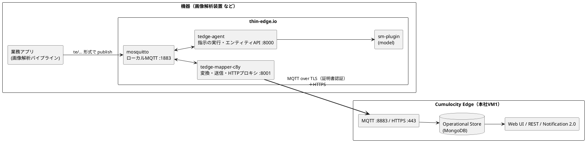
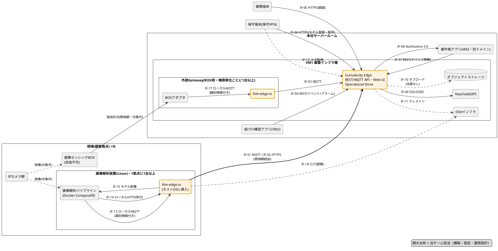
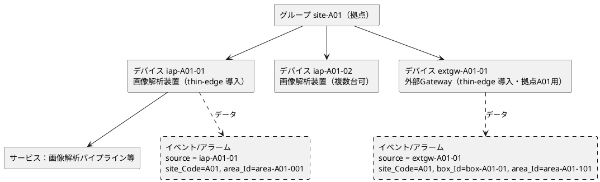
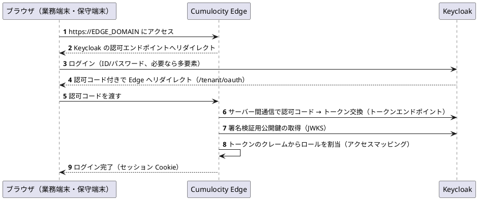
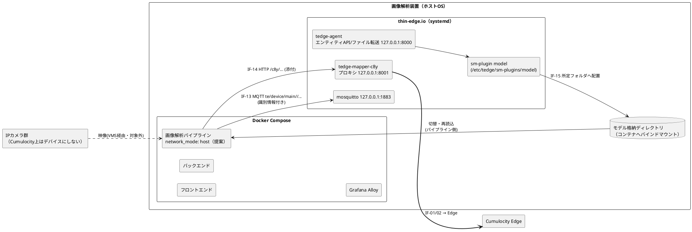
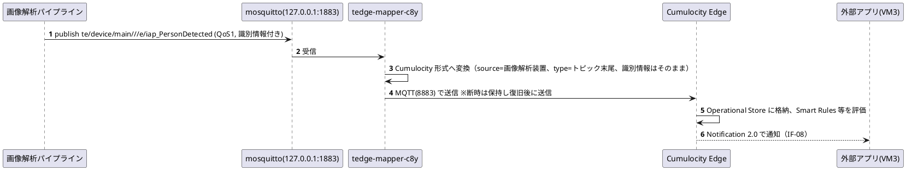
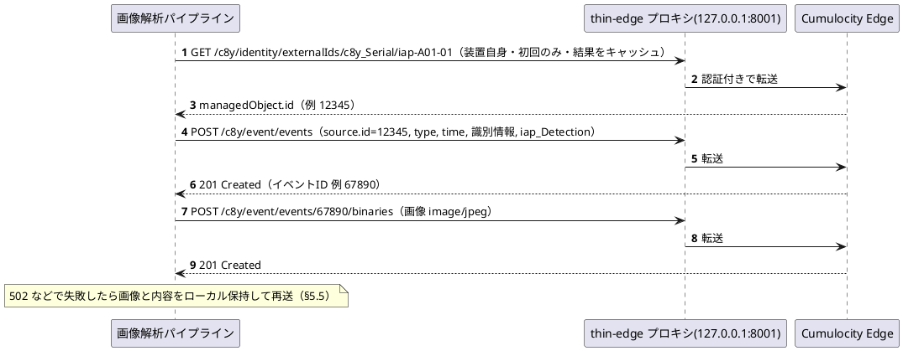
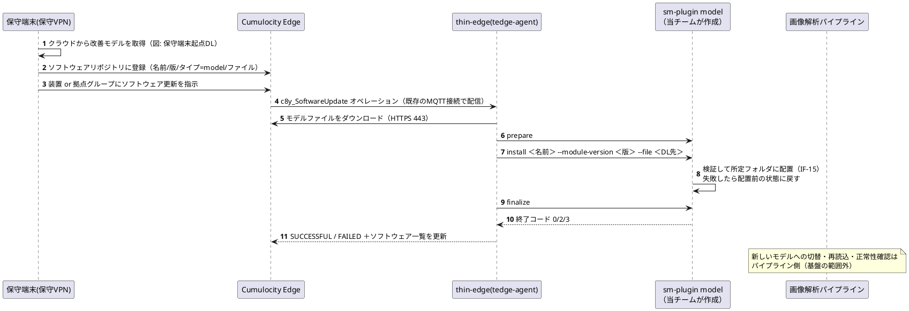
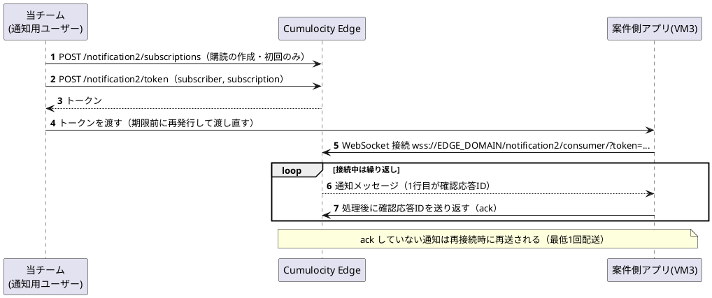
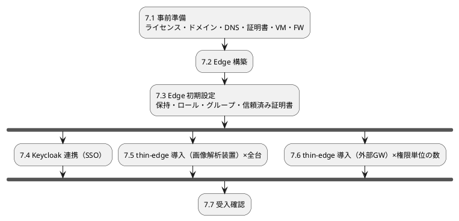

# Cumulocity Edge / thin-edge.io 設計書（基本設計・セットアップ設計・インターフェース設計）

| 項目 | 内容 |
|---|---|
| 版数 | 0.7（ドラフト・レビュー用） |
| 位置づけ | **社内の他案件が IoT 関連プロジェクトの基盤として利用する「IoT 基盤」（Cumulocity Edge＋thin-edge）の設計書**。drawio 図はこの基盤を使った**参照構成**（画像解析の案件）であり、本書に出てくる拠点・カメラ・BOX・識別情報の項目などは参照構成での例。利用案件が設計時に決めることは §3.4 |
| 作成日 | 2026-09-23 |
| 改版履歴 | 0.1 初版／0.2 **カメラを Cumulocity のデバイスとして扱わない方針に変更**（カメラ情報は画像解析パイプライン・BOXアダプタがまとめて親機器の情報として thin-edge の twin API で送る）、**カメラの死活監視を対象外に変更**、**画像解析装置を1拠点に複数台置ける前提に変更**（§4.5、§5、§6.2.1〜6.2.5、§7、§10 ほか）／0.3 **Cumulocity Edge で管理するデバイスを thin-edge を導入した端末（画像解析装置・外部Gateway）だけに変更**。子デバイスは使わず、**カメラ・画像センシングBOX はデバイスにしない**。どの拠点・BOX・カメラのデータかは、パイプライン・BOXアダプタが**各メッセージのペイロード JSON に識別情報（`site_Code`・`box_Id`・`cam_Id`）として入れ**、REST API で読んだときに判別できるようにする（§6.2.4）。0.2 の配下カメラ一覧（`cam_List`）と IF-16 は廃止／0.4 **IoT 基盤としての位置づけを明記**し、**基盤が提供するものと利用案件が設計時に決めることを分離**（§3.4 新設、§10 に区分列を追加）。**外部Gateway は権限を分けたい単位ごとに配置**する方針に変更（単位は利用案件が決める。外部IDは `extgw-<単位>-<連番>`）。Q-25 は解決／0.5 **「カメラの死活監視は行わない」の範囲を明確化**。基盤の機能として監視しない（thin-edge からカメラを確認しない・カメラは Edge の可用性監視の対象外）という意味で、画像解析パイプライン等が自分で把握したカメラの状態を識別情報付きのデータとして送るのはかまわない。送ったデータは他のデータと同じく Operational Store に保存される（§1、§3.1、§3.4、§4.5.3、§5.2.2）。**図をすべて Mermaid から PlantUML に変更**（§0.3 新設）／0.6 確認事項の回答を反映。**担当境界（Q-01）**：BOXアダプタは当チーム担当外、sm-plugin `model` は当チームが作成（thin-edge に該当する標準プラグインが無いため）し、基盤の責任は**AIモデルを所定フォルダに配置するまで**（切替・再読込はパイプライン側）、エクスポートジョブは不要。**オフロード（IF-10）は当面行わない**（Q-12 解決）。**メール通知は行わない**（Q-17 解決）。**データ（イベント・添付画像）の確認は画面ではなく紐づけ確認アプリで行う**（Q-19 解決）。図中の他文書参照は本書内で整理（Q-21 解決）。**カメラ・BOX の台帳は持たず、参照構成の識別情報を `cam_Id`（カメラ）から `area_Id`（カメラが映している範囲＝エリア）に変更**（Q-27 解決）。**命名規約（案）を §4.5.4 に記載**（Q-05）。**外部アプリ（紐づけ確認アプリ・案件側アプリ）は利用者本人の権限で読む方式に決定**（Q-10。外部トークンの受け付けの PoC 項目と、拠点のインベントリロールを SSO のアクセスマッピングで付ける方針を §6.2.8・§7.4 に記載）（§1、§3、§4.4〜4.9、§5、§6、§7、§9、§10 ほか）／0.7 **Notification 2.0（IF-08）の設定手順を追加**。購読の作成とトークンの発行は基盤の技術ユーザーだけが行い、案件側アプリにはトークンだけを渡す。購読はテナント全体ではなくグループ（または装置）単位で作る。読まれない通知が溜まるとデータ登録が失敗し得るため、基盤で滞留を監視する（§4.4.1、§4.6.2、§6.2.9、§6.2.12、§7.3.1、§7.7、§8、§10 Q-11、付録B） |
| 担当範囲 | Cumulocity Edge、thin-edge.io（画像解析装置内蔵分・外部Gateway分） |
| 入力とした資料 | [cumulocity-iot-architecture.drawio](cumulocity-iot-architecture.drawio)（ページ「全体構成(配置構成・レビュー反映)」）**のみ**。同フォルダの他文書は参照していない |
| 前提にした製品仕様 | Cumulocity Edge **2026** 公式ドキュメント／thin-edge.io **2.0.1** 公式ドキュメント（2026-09-23 時点で確認） |

---

## 0. この文書の読み方

### 0.1 誰のための文書か

- **当チーム（Cumulocity Edge / thin-edge 担当＝IoT 基盤の担当）**：構築・設定・インターフェース提供の拠り所
- **IoT 基盤を利用する案件の設計者**：基盤が何を提供し、案件側で何を決める必要があるか（§3.4）を確認するため
- **他チーム（画像解析パイプライン、BOXアダプタ、紐づけ確認アプリ、案件側アプリ、Keycloak、基盤運用）**：Cumulocity Edge や thin-edge を知らなくても「自分たちは何を用意し、どの口に何を渡せばよいか」がわかるように書いています。
  - まず **§1（1枚要約）→ §2（用語と仕組みの解説）→ §6（インターフェース）** を読んでください。

### 0.2 記述の根拠を示すタグ

本書は図だけを入力にしているため、「図に書いてあること」と「本書が補ったこと」を必ず区別します。

| タグ | 意味 |
|---|---|
| 【図】 | drawio 図に明記されている事項 |
| 【仕様】 | 製品の公式ドキュメントに記載されている事項（製品として「できること」） |
| 【提案】 | 本書が置いた設計案。**チーム内・関係チームの合意が必要** |
| 【要確認】 | 未確定。§10 の確認事項一覧に対応する ID（Q-xx）を付記 |

> 注意：【仕様】は「製品としてできること」であり、「本プロジェクトでそう使う」とは限りません。本プロジェクトとしての採用は【提案】で示します。

### 0.3 図の表記

本書の図はすべて **PlantUML**（` ```plantuml ` のコードブロック）で記載しています。図として表示するには PlantUML に対応したビューア（例：VS Code の PlantUML 拡張）が必要です。

---

## 1. 1枚要約（まずここだけ読めば全体がわかる）

- **Cumulocity Edge** は本社サーバールームの VM1 に置く「IoT プラットフォーム本体」です。機器の台帳（どの拠点にどの画像解析装置があるか）、機器から届くイベント・アラーム・計測値の保管（〜90日目安。長期保存への移し替え＝オフロードは当面行わない）、画面（Web UI）、外部システム向け API（REST / MQTT / Notification 2.0）を提供します。【図】
- **thin-edge.io** は機器側に入れる「通信エージェント」です。機器内のアプリが**ローカルの MQTT に投げたデータを Cumulocity 形式に変換して送り届け**、回線断の間は預かって復旧後に送ります（ストア&フォワード）。Cumulocity からの指示（ソフトウェア＝AIモデルの更新など）も受け取って実行します。【図】
- thin-edge は **2か所** に置きます。【図】
  1. **画像解析装置（各拠点に1台以上。カメラ数に応じて複数台可）の中**：画像解析パイプラインのイベント/アラームとスナップショットを送る。配布された AIモデルを所定のフォルダに配置する（切替・再読込はパイプライン側）。
  2. **外部Gateway（本社VM1。権限を分けたい単位ごとに1台以上）の中**：thin-edge を入れられない機器（参照構成では改造できない旧機器「画像センシングBOX」）のイベントを、アダプタ（BOXアダプタ）経由で受けて送る。
- **Cumulocity Edge で管理するデバイスは、thin-edge を入れた端末（画像解析装置・外部Gateway）だけ**です。その下にあるカメラや画像センシングBOX はデバイス（子デバイスを含む）にせず、デバイス管理・Cockpit の階層にも出しません。カメラ・BOX の台帳も持ちません。参照構成では、カメラの代わりに**カメラが映している範囲を「エリア」**と考えて識別します。どの拠点・BOX・エリアのデータかは、画像解析パイプラインと BOXアダプタが**送信する各メッセージのペイロード JSON に識別情報（`site_Code`・`box_Id`・`area_Id`）として入れ**、後から REST API で読んだときに判別できるようにします（§4.5、§6.2.4）。**カメラの死活監視は基盤としては行いません**（thin-edge からカメラの状態を確認しにいく機能は持ちません）。画像解析パイプライン等が自分で把握したカメラの状態を、識別情報付きのイベント等として送るのはかまいません（§5.2.2）。画像解析装置は1拠点に複数台置いてもかまいません。
- 本書は **IoT 基盤**の設計書です。権限を分ける単位（拠点・部署など）と外部Gateway の配置、識別情報の項目、イベント/アラームの種類などは、**基盤を利用する案件が設計時に決めます**（§3.4）。
- 当チームが外部に提供する**入口（インターフェース）は 17 本**（§6。IF-16 は欠番。IF-10 オフロードは当面使わない）。他チームは原則として次の3種類の口だけを使えばよいように設計しています。
  - 機器内アプリ → **thin-edge のローカル MQTT（127.0.0.1:1883）** と **ローカル HTTP（127.0.0.1:8000 / 8001）**
  - 本社アプリ・画面 → **Cumulocity Edge の HTTPS（443）**（REST API・Web UI・Notification 2.0）
  - 認証 → **Keycloak（SSO/OIDC）**
- 「利用可能になるまで」の手順は §7。大きくは **①Edge構築 → ②Edge初期設定 → ③Keycloak連携 → ④thin-edge導入（装置/外部GW）→ ⑤受入確認** の順です。
- 未確定事項は **§10 に 21 件**（ほか解決済み 6 件）。基盤として決めるものと、利用案件（参照構成）が決めるものを区分しています。基盤として特に **サイジング（Q-06）、スナップショット送信方式（Q-04）、外部アプリの認可方式の PoC（Q-10）、命名規約（Q-05）** は早期に決める必要があります。

---

## 2. はじめての人向け：Cumulocity Edge と thin-edge.io の基礎

### 2.1 Cumulocity Edge とは

**ひとことで言うと**：クラウド版 Cumulocity（IoT プラットフォーム）と同じソフトウェアを、**自社のサーバー1台（単一ノード）で動かす版**です。【仕様】

| 観点 | 内容 |
|---|---|
| 何ができるか | デバイス管理（機器台帳・死活・構成・ソフトウェア配布）、データ保管（イベント/アラーム/計測）、画面（Cockpit / Device Management / Administration）、REST・MQTT API、ルール処理（Smart Rules / Streaming Analytics）、通知 API（Notification 2.0）【仕様】 |
| 中身 | Kubernetes（K3s）上で動くコンテナ群。**Edge Operator** というプログラムが、設定ファイル（カスタムリソース：CR）の内容どおりに全体を構築・維持する【仕様】 |
| データベース | 内部の MongoDB（図の「Operational Store」）。**外部から直接アクセスはできず、必ず API 経由**【図】【仕様】 |
| クラウド版との主な違い | テナントは1つだけ（マルチテナント不可）、単一サーバー（冗長化は仮想化基盤側に依存）、アップグレード時は停止を伴う、処理性能は CPU コア数に比例して頭打ちがある【仕様】 |
| テナント | **management**（プラットフォーム管理用）と **edge**（業務で使う本体）の2つが作られる。業務は **edge テナント** で行う【仕様】 |

### 2.2 thin-edge.io とは

**ひとことで言うと**：機器（Linux）に入れる、軽量な「IoT 通信エージェント」のオープンソース実装です。機器内のアプリは Cumulocity の API を直接知らなくてよく、**thin-edge のローカル MQTT に決まった形式で投げるだけ**で Cumulocity に届きます。【仕様】

thin-edge は次の部品で構成されます。【仕様】

| 部品 | 役割 | たとえると |
|---|---|---|
| mosquitto（MQTT ブローカー） | 機器内の「掲示板」。アプリも thin-edge 部品もここに読み書きする。既定で 127.0.0.1:1883 | 社内の郵便受け |
| tedge-mapper-c8y | 掲示板の `te/...` 形式のメッセージを Cumulocity 形式に**変換**し、Cumulocity への MQTT 接続（ブリッジ）で送る。Cumulocity REST API への**認証付きプロキシ**（既定 127.0.0.1:8001）も持つ | 通訳 兼 郵便局 |
| tedge-agent | Cumulocity からの指示（ソフトウェア更新、再起動、ログ取得等）を実行する。エンティティ登録 API とファイル転送サービス（既定 127.0.0.1:8000）も持つ | 現場作業員 |
| sm-plugin（ソフトウェア管理プラグイン） | 「このタイプのソフトウェアはこう入れる」を決める実行ファイル。`/etc/tedge/sm-plugins/<タイプ名>` に置く | 作業手順書 |
| tedge（CLI） | 設定・証明書作成・接続・試験送信などのコマンド | 操作パネル |

### 2.3 2つの関係



ポイント：

- **接続は常に機器側から張る**（機器 → Edge）。Edge から機器への指示（オペレーション）も、機器が張った MQTT 接続の上を流れてくる。したがって拠点側に「Edge からの着信」用のポート開放は不要。【仕様】【図】（凡例「既存の拠点発MQTT接続で配信」）
- 機器内アプリは **Cumulocity の URL・認証情報を持たない**。認証は thin-edge が機器証明書で行う。【仕様】

### 2.4 Cumulocity のデータモデル（本システムでの使い方）

| Cumulocity の概念 | 説明 | 本システムでの例 |
|---|---|---|
| Inventory / Managed Object（MO） | 台帳の1行。機器・グループ等すべてが MO。内部IDは数値 | 画像解析装置、外部Gateway、拠点グループ |
| 外部ID（External ID） | 機器側が名乗る名前と MO を結びつける別名。thin-edge は種別 `c8y_Serial` で登録する | `iap-A01-01`、`extgw-A01-01` |
| デバイス / 子デバイス | 自分で接続する機器＝デバイス。親の接続を借りて登録される機器＝子デバイス | 画像解析装置・外部GW＝デバイス。**子デバイスは使わない**（カメラ・BOX はデバイスにしない。§4.5） |
| フラグメント | MO やイベントに付ける独自の項目（JSON）。名前は自由に決められる | イベントに付ける「どの拠点・BOX・エリアか」（`site_Code`・`box_Id`・`area_Id`） |
| サービス | デバイス上で動くソフトの状態（up/down）を表す MO | 画像解析パイプラインの稼働状態 |
| グループ | MO を束ねるフォルダ。**権限（インベントリロール）の単位**にもなる | 拠点ごとのグループ【図】（凡例 D17） |
| イベント（Event） | 「起きたこと」の記録。**バイナリ（画像）を添付できる** | 検知イベント＋スナップショット【図】 |
| アラーム（Alarm） | 対応が必要な状態。重大度（CRITICAL/MAJOR/MINOR/WARNING）と状態（ACTIVE/ACKNOWLEDGED/CLEARED）を持つ。**同じ機器・同じタイプのアラームが ACTIVE 中に再発すると、新規作成ではなく件数（count）が増える** | 侵入アラーム、パイプライン停止 |
| 計測（Measurement） | 数値の時系列 | 処理 fps、推論遅延 |
| オペレーション（Operation） | Cumulocity から機器への指示。PENDING → EXECUTING → SUCCESSFUL/FAILED | ソフトウェア更新（AIモデル配布）【図】 |
| ソフトウェアリポジトリ | 配布するソフトの名前・版・タイプ・ファイルの一覧 | AIモデル（タイプ `model`）【図】【提案】 |
| 保持ルール（Retention rules） | データ種別ごとの最大保持日数。超えると自動削除 | イベント/アラーム 〜90日目安【図】 |

### 2.5 用語集

| 用語 | 意味 |
|---|---|
| MQTT | 軽量なメッセージ通信プロトコル。「トピック」という宛名に publish（投函）し、subscribe（購読）した相手に届く |
| retain（保持） | ブローカーがトピックの最後のメッセージを保持し、後から購読した相手にも渡す機能。thin-edge では**機器登録とアラーム**で使う |
| QoS | 配送保証レベル。0＝投げっぱなし、1＝最低1回届ける（重複あり得る）、2＝ちょうど1回 |
| エンティティ / トピックID | thin-edge が管理する機器・サービスの単位と、その識別子（例：thin-edge を入れた端末自身 `device/main//`、その上で動くサービス `device/main/service/<名前>`） |
| 識別情報 | 本書の用語。カメラ・BOX をデバイスにしない代わりに、どの拠点・BOX・エリアのデータかを判別するために、各メッセージのペイロードに入れる項目（`site_Code`・`box_Id`・`area_Id`。§6.2.4） |
| エリア | 本書（参照構成）の用語。**カメラが映している範囲**。カメラの代わりにエリアを `area_Id` で識別する（カメラの台帳は持たない。§4.5.4） |
| ストア&フォワード | 回線断の間はデータを手元に貯め、復旧後に送ること |
| Edge Operator / CR | Edge を構築・維持する管理プログラム／その設定書（`c8yedge.yaml`） |
| c8yedge | Edge のインストール・設定・アップグレード用 CLI（K3s も自動導入） |
| Smart Rules | 画面から設定できる簡易ルール（例：計測値がしきい値を超えたらアラームを作る）。メール・SMS で知らせるルールもあるが本システムでは使わない（§4.8） |
| Streaming Analytics | ストリーム処理エンジン（Apama）。複雑なルールを書ける |
| Notification 2.0 | 外部アプリが WebSocket で Cumulocity の変更通知を受け取る API。受信確認（ack）付きで取りこぼしにくい |
| グローバルロール / インベントリロール | 機能単位の権限／グループ（拠点）単位のデータ権限 |
| 信頼済み証明書（Trusted certificates） | 機器証明書を発行した CA を Cumulocity に登録する仕組み。「自動登録」を有効にすると、その CA 発行の証明書を持つ機器は初回接続で自動登録される |

---

## 3. システム全体における位置づけ

### 3.1 担当範囲

| 区分 | 対象 | 根拠 |
|---|---|---|
| **当チーム担当（構築・設定・運用設計）** | Cumulocity Edge 本体（VM1）／画像解析装置内の thin-edge.io／外部Gateway内の thin-edge.io | ユーザー指示・【図】 |
| **当チームが提供する境界（IF）** | §6 の IF-01〜IF-18 | 本書 |
| 境界の相手（他チーム担当） | 画像解析パイプライン、**BOXアダプタ**、紐づけ確認アプリ、案件側アプリ、Keycloak、Otel基盤、保守端末運用（オブジェクトストレージはオフロードを行わないため当面連携しない） | 0.6 版で整理（Q-01） |
| 担当の整理（Q-01） | **sm-plugin `model`**：当チームが作成する。thin-edge に AIモデルを所定フォルダに置く標準プラグインが無いため。当チームの責任は**モデルを所定フォルダに配置するまで**で、切替・再読込はパイプライン側（§6.2.3）／**BOXアダプタ**：当チーム担当外。当チームは受け口（IF-17）を提供する／**エクスポートジョブ**：不要（オフロードの予定がない。§6.2.11） | 0.6 版で決定。装置一覧の管理と装置のグループ所属作業は【要確認 Q-01】（本書では当チームと仮置き【提案】） |
| 対象外 | IPカメラ、サイトVMS、Genetec Security Center、ベクトルDB、AIモデル改善サービス、フロントエンド/バックエンド/Alloy の中身 | 【図】（当チーム担当外） |
| 利用案件が決めること | 権限単位と外部GW の配置、識別情報の項目、イベント/アラームの種類など（§3.4） | IoT 基盤としての位置づけ |
| 対象外（方針） | **カメラの死活監視**（基盤としては行わない。パイプライン等が把握した状態を送るのは可。§5.2.2）。**カメラ・画像センシングBOX の Cumulocity 上のデバイス化**（行わない。デバイスは thin-edge を入れた端末のみ。§4.5） | 0.2・0.3 版での方針決定 |

### 3.2 全体構成と IF 番号



### 3.3 主なデータの流れ（ユースケース）

| # | ユースケース | 経路（IF） | 詳細 |
|---|---|---|---|
| UC-1 | 検知イベント・アラームを本社へ届ける | IF-13 → IF-01 | §6.2.1 |
| UC-2 | スナップショット付きイベントを届ける | IF-14 → IF-02 | §6.2.2 |
| UC-3 | AIモデルを配布し、装置の所定フォルダに配置する（切替・再読込はパイプライン側） | IF-04 → IF-01/IF-02 → IF-15 | §6.2.3 |
| UC-4 | どの拠点・BOX・エリアのデータかを、後から REST API で判別する（カメラ・BOX はデバイスにしない） | IF-13 / IF-14 / IF-17 のペイロード → IF-06 / IF-07 | §6.2.4 |
| UC-5 | 旧機器 BOX のイベントを届ける | IF-17 → IF-03 | §6.2.5 |
| UC-6 | 画面で機器の管理・モデル配布・設定を行う（イベント・添付画像・識別情報の確認は画面では行わず、紐づけ確認アプリ＝UC-7 で行う） | IF-04 / IF-05（＋IF-09） | §6.2.6 |
| UC-7 | 外部アプリがデータを参照・通知を受ける（紐づけ確認アプリでのイベント・添付画像の確認を含む） | IF-06 / IF-07 / IF-08（＋IF-09） | §6.2.7〜6.2.9 |
| UC-8 | 短期保存データを長期保存へ移す（**当面行わない**） | IF-10 | §6.2.11 |

### 3.4 IoT 基盤が提供するもの／利用案件が設計時に決めること【提案】

本書は IoT 基盤の設計書です。基盤は「仕組みと規約」を提供し、それを使って何をどう分けるかは各利用案件が設計時に決めます。本書で拠点・カメラ・BOX などを使って書いている箇所は、参照構成（図の画像解析の案件）での例です。

| 観点 | IoT 基盤（本書・当チーム）が提供・規定するもの | 利用案件が設計時に決めること | 参照構成での例 |
|---|---|---|---|
| デバイスの単位 | 「Cumulocity のデバイス＝thin-edge を入れた端末」という原則。端末の接続・証明書・設定の方式（§4.5、§5、§7.5） | どこに何台の端末を置くか | 拠点ごとに画像解析装置を1台以上 |
| 権限の単位 | グループ＋インベントリロールで権限を分ける仕組みと、ロールの雛形（§4.4） | **権限を分けたい単位**（拠点・部署・顧客など）と、単位ごとのグループ・ロール | 単位＝拠点 |
| 外部Gateway の配置 | 外部GW の構成と導入手順（§5.3、§7.6）。外部GW は権限の単位ごとに置けるという方針 | **権限単位ごとに外部GW を何台置くか**、どの機器をどの外部GW に送らせるか | 拠点ごとに外部GW（`extgw-A01-01` など） |
| 配下機器の識別 | 「識別情報をすべてのメッセージのペイロードに、トップレベルの文字列項目で入れる」規約と、REST での読み方（§6.2.4） | 識別情報の項目名と値 | `site_Code`・`box_Id`・`area_Id` |
| データの種類 | イベント・アラーム・計測・画像添付の送り方（IF-13／14／17）、命名規約（§4.5.4） | イベント/アラーム/計測のタイプ名、アラームの使い方（§6.2.1 の案A/B/C） | `iap_PersonDetected` など。装置は案A、BOX 由来は案C |
| 配下機器の台帳 | 基盤では持たない（Cumulocity にカメラ・BOX 等の台帳は作らない） | 台帳を持つか。持つならどこで管理し、アプリがどう参照するか | **持たない**。カメラの代わりに、カメラが映している範囲（エリア）を `area_Id` で識別する（§4.5.4） |
| 監視 | thin-edge を入れた端末の死活監視（可用性） | 配下機器の通信断などを通知するか（通知するならイベント等で送る） | カメラは基盤では監視しない（パイプラインが把握した状態を送るのは可。§5.2.2）。BOX は【要確認 Q-26】 |
| ソフトウェア配布 | AIモデル用の sm-plugin `model`（所定フォルダへの配置まで）と配布手順（§6.2.3） | 配布するソフトのタイプ・内容・段階配布の要否。配置されたモデルへの切替・再読込 | AIモデル（タイプ `model`）。切替・再読込はパイプライン |
| 外部アプリ連携 | REST API・Notification 2.0・SSO の提供（§6.2.7〜6.2.10） | 購読するデータ、アプリ側の権限制御 | 紐づけ確認アプリ、案件側アプリ |

---

## 4. Cumulocity Edge 設計

### 4.1 役割

| 機能 | 本システムでの使い方 | 根拠 |
|---|---|---|
| デバイス管理（**メイン機能**） | thin-edge を入れた端末（画像解析装置・外部GW）の台帳、死活（可用性）、構成、ソフトウェア（AIモデル）配布。カメラ・BOX は台帳に載せず、データのペイロードの識別情報で判別する（§4.5） | 【図】【提案】 |
| イベント/アラーム処理・通知 | Smart Rules / Streaming Analytics による通知・加工。外部へは Notification 2.0 | 【図】 |
| Operational Store | Inventory・イベント・アラーム・計測（**短期保持〜90日目安**）。スナップショットも同じ MongoDB に保存され、保持期間で消える（初期版） | 【図】 |
| 外部アクセスの入口 | REST / MQTT API（Operational Store への直接アクセスは不可） | 【図】 |
| Web UI | Cockpit 等でイベント/アラーム/添付画像を確認 | 【図】 |
| 単一テナント集約 | 全拠点を単一 Edge・単一テナント（edge テナント）に集約。拠点区分はグループ＋インベントリロール | 【図】（凡例 D17） |

**使わない機能（本書の想定）**：クラウドテナント接続（`spec.cloudTenant`）。閉域網のため不要。【提案】

### 4.2 サーバー要件とサイジング

#### 4.2.1 最低要件【仕様】（Edge 2026）

| 項目 | 最低要件 | 本案件での注意 |
|---|---|---|
| CPU | 8 コア、x86-64。**MongoDB のため AVX 命令対応かつ x86-64-v3 以上が必須**（AVX2 は不要） | VM の場合、仮想化基盤が AVX を VM に見せる設定になっているか確認（`lscpu` で `avx` を確認）【要確認 Q-22】 |
| メモリ | 16 GB | カスタムマイクロサービスを載せる場合はその分を上乗せ |
| ディスク | 150 GB（大半は `/var/lib/rancher/` 配下の永続ボリューム） | **スナップショットで大きく増える**（§4.2.3） |
| OS | K3s が動く最近の x86-64 Linux | c8yedge が K3s を導入する |
| Kubernetes | 単一ノードのみサポート（c8yedge 利用時は K3s を自動導入） | 自前 Kubernetes の場合は 1.34.x、LoadBalancer・既定 StorageClass 必須、80/443 を塞ぐ Ingress 不可 |
| 配置 | 専用 VM | 図の凡例「実配置では Cumulocity Edge は専用VM分離」【図】。**外部GWの thin-edge と同居させない**（どちらも 1883 番ポートを使うため）【提案】 |

#### 4.2.2 性能の目安【仕様】

- 公式ベンチマーク（8 スレッド / 16 GB）：少数クライアント高頻度で **約 25,000 計測/秒**、1 クライアント 1 件/秒 の多数接続で **約 1,200 接続**。16 スレッド / 32 GB でほぼ倍。
- 公式の比較表では「CPU コアあたり約 100 tps で頭打ち」とも記載。**実データでの負荷試験が前提**。
- 本システムの MQTT 接続数は **画像解析装置の総台数 ＋ 外部GW 1** と少ない（カメラ・BOX はデバイスにしない。装置を1拠点に複数台置いても数百接続程度）。負荷を決めるのは**件数/秒と添付画像サイズ**。

#### 4.2.3 容量試算の考え方【提案】

MongoDB の容量（CR の `spec.mongodb.resources.requests.storage`、**既定 75 GB、インストール後は増やせるが減らせない**【仕様】）は次式で見積もります。

```
必要容量 ≒ Σ（1日あたり件数 × 1件あたりサイズ）× 保持日数 × 余裕率
  イベント本体      ： 件数/日 × 約1〜2KB
  スナップショット  ： 画像付きイベント件数/日 × 画像サイズ   ← 支配的
  アラーム・計測・オペレーション・監査ログ：別途加算
```

**試算例（数値はすべて仮定）**：拠点 20、1拠点あたり画像付きイベント 500 件/日、画像 200 KB、保持 90 日
→ 20 × 500 × 200 KB × 90 日 ≒ **180 GB**（画像のみ）。既定 75 GB・最低ディスク 150 GB を超えるため、**実数値（Q-06）が出るまでディスクと MongoDB 容量は確定させない**。JPEG はほぼ圧縮されない点にも注意。【要確認 Q-06】

### 4.3 ネットワーク設計

#### 4.3.1 ドメイン名と DNS

| 名前 | 用途 | 根拠 |
|---|---|---|
| `<EDGE_DOMAIN>`（例 `iot-edge.example.jp`） | edge テナント（業務用）。機器の接続先・画面・API すべてこれ | 【仕様】 |
| `management-<EDGE_DOMAIN>` | management テナント（メールサーバー設定・ブランディング等の管理用）。**「management.」ではなく「management-」（ハイフン）** | 【仕様】 |

- ドメイン名は**ライセンスの発行条件**（製品サポートに会社名とドメインを申請して発行）。後から変える場合はライセンスも取り直し。【仕様】【要確認 Q-24】
- ドメイン規則：少なくとも1つのドット、英数字とドット・ハイフンのみ、最上位ドメインは 2〜6 文字 等。【仕様】
- 名前解決は **社内 DNS への登録を推奨**（公式も DNS 登録を優先推奨）。各端末の hosts ファイル運用は拠点数が多いと破綻しやすい。【仕様】【提案】
- Edge 内部（Kubernetes の Pod）から **Keycloak のホスト名を解決できる必要**がある（SSO のトークン取得は Edge サーバーから Keycloak への通信）。ホストの `/etc/hosts` は Pod に反映されない可能性があるため、**社内 DNS で解決できるようにする**。【提案】【要検証】

#### 4.3.2 公開ポート

Edge の LoadBalancer サービス `cumulocity-ontoplb` の公式サンプル出力には `443`、`8443`、`1883`、`8883`（以下省略あり）が現れます。Operator のメトリクスは `3443`。【仕様】

| ポート | 用途 | 本システムでの扱い |
|---|---|---|
| 443/TCP | HTTPS：Web UI、REST API、Notification 2.0（WSS）、thin-edge の HTTP 通信 | **許可**（利用元は §6.3） |
| 8883/TCP | MQTT over TLS（機器接続） | **許可**（画像解析装置・外部GW から） |
| 1883/TCP | MQTT 平文 | **閉域網 FW で遮断**（平文のため使わない）【提案】 |
| 8443/TCP | 公式サンプルに出現。用途は本書では未確認 | 不要なら遮断【要確認 Q-18】 |
| 3443/TCP | Operator の Prometheus 形式メトリクス `https://<EDGE_DOMAIN>:3443/metrics` | Otel 基盤からのみ許可（IF-11）【提案】 |

構築後に `kubectl get service cumulocity-ontoplb --namespace=c8yedge` で**全ポートを確認して FW 設計を確定**します。

#### 4.3.3 サーバー証明書（TLS）

| 方式 | 内容 | 評価 |
|---|---|---|
| A. 社内 CA 発行の証明書を設定 | CN にワイルドカード、または SAN に `<EDGE_DOMAIN>` と `management-<EDGE_DOMAIN>` を列挙。鍵と証明書チェーン（サーバー → 中間 → ルートの順）を PEM で設定【仕様】 | **推奨**【提案】。社内 CA を各端末・装置に配れば警告なしで使える |
| B. 自己署名（未指定時に Edge が自動生成）【仕様】 | 手間はないが、**全ての接続元（ブラウザ、thin-edge、外部アプリ）に個別に信頼設定が必要** | 検証環境のみ |

thin-edge 公式にも「Cumulocity Edge に接続する場合、機器のローカル証明書ストアの更新が必要」と明記されています。【仕様】

### 4.4 テナント・組織設計【提案】

| 項目 | 設計 |
|---|---|
| テナント | edge テナント1つ（management テナントは管理専用、日常利用しない）【図】【仕様】 |
| 拠点の表現 | 拠点ごとに**グループ**を作成（例：`site-A01`）。その拠点の画像解析装置（1台以上）を所属させる【図】【提案】 |
| 権限 | 機能はグローバルロール、拠点データはグループに対するインベントリロールで制御【図】 |
| 外部Gateway | **権限を分けたい単位ごとに外部GW を置き、その単位のグループに所属させる**。外部GW が受け持つ機器（BOX）のデータは、すべてその外部GW のデータになるため、権限の単位＝外部GW の単位になる。単位（拠点・部署など）は**利用案件が設計時に決める**（§3.4）。参照構成では単位＝拠点（例：`site-A01` に `extgw-A01-01`）【提案】 |

#### 4.4.1 ロール設計（案）【提案】

| ロール（案） | 種別 | 主な権限 | 付与対象 |
|---|---|---|---|
| 基盤管理者 | グローバル | テナント管理全般 | 当チーム（SSO）＋緊急用ローカル admin |
| 保守要員 | グローバル | ソフトウェアリポジトリ登録（Inventory/Binary 作成）、デバイス制御（オペレーション発行）、一括オペレーション | 基盤運用会社（保守端末）【図】 |
| 閲覧者 | グローバル＋インベントリ | 担当拠点のイベント/アラーム・添付画像・機器情報の参照（紐づけ確認アプリ・案件側アプリ経由。画面での確認はしない） | 紐づけ確認アプリ・案件側アプリの利用者。拠点ごとのインベントリロールは SSO のアクセスマッピングで付ける（§6.2.8） |
| アラーム対応者 | インベントリ | 担当拠点のアラーム更新（確認・クリア） | 監視担当 |
| 通知連携（技術ユーザー） | グローバル | Notification 2 の管理（ADMIN）だけ | 基盤の通知用ローカルユーザー（§4.6.2）**だけ**。案件側アプリ・利用者には付けない（§6.2.9） |

- SSO 利用者は**最低限「自分のユーザー管理（Own user management）の READ」**を持つロールが必要（無いとログインできない）。【仕様】
- 具体的な権限ビットの割付は詳細設計で確定。【要確認 Q-09】

### 4.5 デバイス（Inventory）モデルとカメラ・BOX の扱い【提案】

#### 4.5.1 方針

- **Cumulocity Edge で管理するデバイスは、thin-edge を入れた端末（画像解析装置・外部Gateway）だけ**とする。**子デバイスは使わない**。
- その下にある**カメラ・画像センシングBOX はデバイスにしない**。デバイス管理・Cockpit の一覧や階層に出てこない。
- どの拠点・BOX・エリアのデータかは、**画像解析パイプラインと BOXアダプタがプログラムで、送信する各メッセージのペイロード JSON に識別情報として入れる**（`site_Code`・`box_Id`・`area_Id`。§6.2.4）。thin-edge はペイロードをそのまま Edge へ運ぶ。
- 後から REST API でイベント・アラーム等を読めば、送信元（source）＝画像解析装置 または 外部GW と、ペイロードの識別情報から、どの拠点・BOX・エリアのデータかがわかる。
- カメラ・BOX の台帳は持たない。基盤（Cumulocity）では持たない方針で、参照構成でも持たない（0.6 版の決定）。参照構成では、カメラの代わりに**カメラが映している範囲を「エリア」**として `area_Id` で識別する（§4.5.4）。
- 下図は参照構成（権限単位＝拠点）の例。画像解析装置も外部GW も、その拠点のグループに入る。



カメラ・BOX は上の図の台帳（実線）には現れず、データ（破線）の中の識別情報としてだけ現れる。

#### 4.5.2 「つながっているから自動登録される」ことはないか

Cumulocity Edge はネットワーク上の機器を探しに行きません。Edge に機器（MO）ができるのは次の場合だけです。【仕様】

1. 機器が**自分の証明書で Edge に接続**したとき（画像解析装置・外部GW）。カメラ・BOX は Edge に接続しない（カメラの映像は VMS・パイプライン・BOX との間、BOX のデータは BOXアダプタとの間だけ）。
2. **thin-edge が子デバイス・サービスとして登録**したとき。明示登録（エンティティ API／登録メッセージ）と、**自動登録**（`te/device/<名前>/...` のように main 以外の機器名のトピックにデータが送られると、thin-edge が子デバイスを自動で作る）がある。
3. 人やツールが REST API・画面で作ったとき。

したがって、カメラ・BOX を出さないための条件は次のとおりです。【提案】

- パイプラインも BOXアダプタも、**thin-edge を入れた端末自身のトピック `te/device/main//...` にだけ**送る。カメラ名・BOX名をトピックに入れない（識別はペイロードの `area_Id`・`box_Id` で行う）。
- thin-edge の子デバイス登録（エンティティ API／登録メッセージ）を使わない。
- thin-edge の**自動登録を無効化**（`agent.entity_store.auto_register=false`）し、誤ったトピックに送られても子デバイスが作られないようにする。無効時に未登録トピックのメッセージがどう扱われるか（破棄か保留か）は受入時に確認する。【要検証】
- カメラ・BOX を REST・画面で手作業登録する運用をしない。
- 受入確認（AT-08）で「カメラ・BOX がデバイス一覧・グループ階層に現れない」ことを確認する。

#### 4.5.3 この方針による影響

| 観点 | 影響 | 対応 |
|---|---|---|
| 画面 | デバイス一覧・階層は画像解析装置と外部GW だけになり見通しがよい。反面、カメラ・BOX 単位の画面遷移はできない。イベント一覧では装置・外部GW のイベントとして並ぶ | データ（イベント・添付画像・識別情報）の確認は画面ではなく紐づけ確認アプリで行う（0.6 版の決定）ため、画面の制約は運用上の問題にならない。画面は機器の管理・モデル配布・設定に使う |
| 権限（画像解析装置のデータ） | 装置を拠点グループに入れるので、拠点単位の権限は効く。エリア（カメラ）単位の権限は付けられない | エリア単位の権限が不要であることを確認【要確認 Q-15】 |
| 権限（BOX のデータ） | BOX のデータは受け持つ外部GW のデータになるので、**権限を分けられるのは外部GW の単位まで**。1台の外部GW に複数の単位（例：複数拠点）の BOX を集めると、その単位では分けられない | **権限を分けたい単位ごとに外部GW を置く**（§4.4）。単位は利用案件が設計時に決める（§3.4） |
| 検索 | イベントは `fragmentType=<項目名>&fragmentValue=<値>` で**識別情報の値で絞り込める**（**値が文字列のフラグメントに限る。1回に指定できるのは1項目**）【仕様】。**アラームにはこの絞り込みが無い** | 識別情報は必ず文字列のトップレベル項目にする（§6.2.4）。2項目目以降の条件とアラームは、送信元＋期間で取得してアプリ側で絞る（§6.2.7） |
| アラーム | 「同じ機器・同じタイプ」の ACTIVE なアラームは1件にまとまる。**画像解析装置では別エリアの同種アラームが、外部GW では配下の全 BOX の同種アラームが1件に合算され、クリアも一括**になる | アラームの使い方を利用案件が決める（§6.2.1）【要確認 Q-15】 |
| 死活 | カメラ・BOX の可用性は Edge の可用性機能では見えない | カメラは方針どおり基盤では監視しない（パイプライン等が把握した状態は識別情報付きのデータとして送れる。§5.2.2）。BOX の通信断を知る必要があるかは【要確認 Q-26】 |
| 負荷 | カメラ・BOX 分の MO・ハートビートが不要になり、Edge が軽くなる | − |

#### 4.5.4 命名規約（案）【提案】【要確認 Q-05】

名前の**形式は基盤の規約**として決め、**具体的な名前（接頭辞・タイプ名・識別情報の項目）は利用案件が決めます**（§3.4）。表中の具体名は参照構成での案です。デバイスの**外部IDは登録後に変更できない**【仕様】ため、命名規約は最初の装置を登録する前に確定させます。

**(1) 共通ルール（基盤の規約）**

| # | ルール | 理由 |
|---|---|---|
| N-1 | Cumulocity 上の**項目名（フラグメント名）とタイプ名**は `<接頭辞>_<名前>` とし、名前は英単語の先頭を大文字にしてつなげる（例 `iap_PersonDetected`、`site_Code`） | 名前の由来（どこが送ったデータか）が接頭辞でわかる |
| N-2 | **ID・値**（外部ID、識別情報の値、グループ名）はハイフンでつなぐ（例 `iap-A01-01`、`area-A01-001`、`site-A01`）。装置上のファイル名・プロセス名にもなる名前（サービス名・ソフトウェア名）は**小文字とハイフン**（例 `iap-pipeline`、`person-detector`） | 項目名（`_`）と値（`-`）を見た目で区別する |
| N-3 | 使える文字は**英数字と `_`・`-` だけ**。空白・日本語・`/`・`+`・`#`・`.` は使わない（日本語は `text` と表示用の項目の値にだけ使う） | タイプ名は MQTT のトピック（`te/device/main///e/<タイプ名>`）の一部になり、`/` は階層の区切り、`+`・`#` はワイルドカードとして扱われる【仕様】。`.` は入れ子の項目の指定と紛らわしい |
| N-4 | **大文字・小文字を書き分けない**（`area_Id` と `area_id` を混在させない） | 大文字・小文字が違うと別の項目・別のタイプとして扱われ、値検索や通知のタイプ指定に一致しなくなる |
| N-5 | `c8y_` で始まる名前を独自の項目・タイプに使わない | Cumulocity 標準の項目（`c8y_Position` など）が使う接頭辞で、衝突すると標準機能に影響する |
| N-6 | 一度使い始めた名前・値は**変えない・別の意味で使い回さない** | データは名前・値で検索されるため、変えると過去のデータとつながらなくなる |

**(2) 外部ID・グループ・サービス（基盤が決める）**

| 対象 | 形式（案） | 例 | 備考 |
|---|---|---|---|
| 画像解析装置（外部ID `c8y_Serial`） | `iap-<拠点コード>-<連番2桁>` | `iap-A01-01` | **機器証明書の CN ＝ この ID**【仕様】。thin-edge のトピックIDは `device/main//` |
| 外部Gateway（外部ID `c8y_Serial`） | `extgw-<権限単位コード>-<連番2桁>` | `extgw-A01-01` | 権限単位ごとに1台以上。単位コードは利用案件が決める。トピックIDは `device/main//` |
| グループ | `<単位の種類>-<単位コード>` | `site-A01` | 権限単位ごとに1つ。参照構成では単位＝拠点 |
| サービス（thin-edge） | `<接頭辞>-<名前>` | `iap-pipeline` | `te/device/main/service/<サービス名>`。パイプラインの稼働状態（§6.2.1） |

**(3) タイプ名（イベント・アラーム・計測）**：形式は基盤、具体名は利用案件

| 種別 | 形式（案） | 参照構成の例 |
|---|---|---|
| 接頭辞 | 送信元の種類ごとに1つ | `iap`＝画像解析パイプライン、`box`＝BOXアダプタ |
| イベント | `<接頭辞>_<何が起きたか>` | `iap_PersonDetected`、`iap_CameraStatusChanged`、`box_Detection` |
| アラーム | `<接頭辞>_<異常の内容>Alarm`。§6.2.1 の案B（個別にクリアしたいもの）は末尾に `_<識別情報の値>` を付ける | `iap_IntrusionAlarm`、案B：`iap_IntrusionAlarm_area-A01-001`、`box_ErrorAlarm_box-A01-01` |
| 計測 | `<接頭辞>_<測る対象>` | `iap_StreamStats` |

**(4) フラグメント名**

| 種類 | 形式（案） | 例 | 置き方 |
|---|---|---|---|
| 識別情報 | `<対象>_<属性>` | `site_Code`、`box_Id`、`area_Id`、`area_Name` | トップレベルに文字列で置く（§6.2.4） |
| 業務データ | `<接頭辞>_<名前>` のオブジェクト。中の項目名は先頭を小文字にしてつなげる | `iap_Detection`（`eventUid`・`score`・`modelName`・`modelVersion`）、`box_Event`（`eventUid`）、`iap_CameraStatus`（`state`・`reason`） | 識別情報以外の中身はここにまとめる |
| 一意キー | `eventUid` | UUID、または BOX の再送でも変わらない値 | 業務データのフラグメントの中（§6.2.1） |

**(5) 識別情報の値（参照構成）**

| 対象 | 項目 | 値の規約（案） |
|---|---|---|
| 拠点 | `site_Code` | 拠点コード（例 `A01`）。グループ名 `site-<拠点コード>` と同じコード |
| BOX | `box_Id` | `box-<拠点コード>-<連番2桁>`（例 `box-A01-01`） |
| エリア | `area_Id` | `area-<拠点コード>-<連番3桁>`（例 `area-A01-001`）。**拠点コードを含めて全拠点で一意**にする（値検索は1回に1項目のため、`area_Id` だけで絞れるようにする）。パイプライン由来でも BOX 由来でも、同じエリアは同じ値 |
| エリア名 | `area_Name` | 表示用の名前（例 `正門`）。任意 |

**エリアで識別するときの注意**【提案】【要確認 Q-15】

- **1つのメッセージには1つのエリアだけ**を入れる。`area_Id` は1つの文字列にし、配列にしない（配列にすると値検索できない）。1台のカメラが複数のエリアを映す場合や、複数のカメラが同じエリアを映す場合に、どのエリアとして送るかの決め方は利用案件が決める。
- どのカメラ（BOX のチャネル）がどのエリアを映しているかの対応は、Cumulocity には持たない。**パイプライン・BOXアダプタがそれぞれ自分の設定として持つ**（実質的にはここが対応表になる）。
- カメラの向きを変えたり、カメラを交換したりしても、同じ `area_Id` が同じ範囲を指すように運用する。範囲が変わるなら新しい `area_Id` を振る（N-6）。
- **エリアだけではカメラを特定できない**。カメラ単位の情報（映像ストリームの fps、カメラの状態など）を送る場合や、紐づけ確認アプリで VMS の映像を探すためにカメラを特定する必要がある場合は、識別情報ではなく業務データのフラグメントの中にカメラを特定できる値を入れる（例 `iap_Detection.vmsCameraId`）。

**(6) ソフトウェア（AIモデル）**

| 項目 | 規約（案） |
|---|---|
| タイプ | `model`（sm-plugin のファイル名と同じ。§6.2.3） |
| 名前 | モデル名。小文字とハイフン（例 `person-detector`）。装置上のフォルダ名にもなる |
| 版 | `<メジャー>.<マイナー>.<パッチ>`（例 `1.4.0`）。同じ名前・版のまま中身を差し替えない |

### 4.6 認証・認可設計

#### 4.6.1 利用者（人）の認証：Keycloak による SSO【図】



- Cumulocity の SSO は **OAuth2 認可コードフロー**、トークンは JWT。**SAML は不可**。【仕様】
- 手順 6〜7 のとおり **Edge サーバー自身が Keycloak に HTTPS 接続する**ため、Edge が Keycloak の TLS 証明書を信頼する設定（Operator の ConfigMap `c8yedge-operator-config` の `ca.crt`）と名前解決が必要。【仕様】
- 案件側アプリ（VM3）と Edge は**同じ Keycloak にそれぞれ独立にログイン**し、セッションはドメインごとに別。【図】
- 署名鍵は **RSA のみ対応**（楕円曲線鍵は不可）。Keycloak レルムの有効な署名鍵が RS256 であることを確認する。【仕様】

設定値の詳細は §7.4。

#### 4.6.2 ローカルアカウント（SSO を使わないアカウント）【提案】

| アカウント | テナント | 用途 | 管理 |
|---|---|---|---|
| `admin` | edge | 緊急用（SSO 障害時の復旧）。日常利用禁止 | パスワードを金庫保管、利用時は記録 |
| `admin` | management | ブランディング等の管理設定（メールサーバーは設定しない。Q-17） | 同上 |
| プロビジョニング用 | edge | 機器登録補助（グループ所属付け等）。自己署名証明書方式を採る場合は `tedge cert upload c8y` に「Tenant Manager」ロールが必要【仕様】 | 最小権限 |
| 監視用 | edge | IF-12 のメタ監視 | 読み取りのみ |
| 通知用（例 `svc-n2`） | edge | Notification 2.0 の購読の作成・トークンの発行（§6.2.9、§7.3.1） | 通知連携ロールだけを付ける。このロールを持つのはこのユーザーだけ |

- SSO ユーザーは Basic 認証で REST API を使えないため、**自動化処理は必ずローカルの技術ユーザー**を使う（thin-edge 公式のトラブルシュートにも「SSO ユーザーは REST API を使えない」旨の記載）。【仕様】
- ログイン画面を「SSO のみ」に切り替えると、画面から Basic ログインの選択肢が消える。**SSO が安定稼働するまで切り替えない**。切り替え後に SSO が壊れた場合は、緊急用ローカル admin で REST API を Basic 認証で直接呼んでログイン設定を戻す手順を、事前に検証環境で確認しておく。【提案】【要検証】

#### 4.6.3 機器の認証：X.509 クライアント証明書【仕様】【提案】

| 方式 | 手順 | 評価 |
|---|---|---|
| **A. プロジェクト用デバイス CA ＋自動登録（推奨）** | ①デバイス CA 証明書を Edge の「信頼済み証明書」に1回だけ登録し自動登録を有効化 ②各装置で `tedge cert create-csr` → CA で署名 → 装置に配置 ③`tedge connect c8y` で初回接続時に自動登録 | 装置の台数に比例する Edge 側作業が発生しない（装置を増設しやすい）。**推奨**【提案】 |
| B. 装置ごとの自己署名証明書 | 各装置で `tedge cert create` → `tedge cert upload c8y --user <Tenant Manager 権限のユーザー>` | 装置ごとに Edge への登録作業と高権限アカウントが必要 |
| C. Cumulocity 認証局（`tedge cert download c8y`） | Cumulocity 側で証明書を発行する新しい方式 | **Edge で利用可能かは未確認**【要確認 Q-08】 |

- 証明書の置き場所：`/etc/tedge/device-certs/tedge-certificate.pem`（鍵：`tedge-private-key.pem`）。【仕様】
- 中間 CA を使う場合のチェーンの持たせ方、証明書有効期間と更新手順は検証で確定。【要確認 Q-08】

### 4.7 データ保持設計【図】【提案】

| データ | 保持（案） | 備考 |
|---|---|---|
| イベント（＋添付スナップショット） | 90 日 | 添付はイベントと同じ MongoDB に入り、保持期間で消える【図】 |
| アラーム | 90 日 | |
| 計測 | 90 日（要件次第で短縮） | |
| オペレーション | 90 日 | モデル配布の証跡。長期保管が必要になったら §6.2.11 を参照 |
| 監査ログ | 要件確認 | |

- 保持ルールは Administration アプリで**データ種別ごとに明示設定**する（既定値に頼らない）。【提案】
- **オフロード（IF-10）は当面行わない**（0.6 版の決定。§6.2.11）。したがって**保持期間を過ぎたデータ（添付画像を含む）は Edge から消え、どこにも残らない**。保持日数は、業務で過去のデータを参照する必要がある期間から決める。【提案】

### 4.8 イベント/アラーム処理と通知【図】

| 仕組み | 使いどころ（案） |
|---|---|
| Smart Rules | 画面設定で済む単純なルール（例：計測値のしきい値超過でアラームを作る）。**メール通知は行わない**（0.6 版の決定。Q-17 解決）ため、メール・SMS で知らせるルールは使わず、management テナントのメールサーバーも設定しない。人への通知が必要になったら、Notification 2.0 を受ける案件側アプリで行う |
| Streaming Analytics | 複数イベントの相関、しきい値判定など Smart Rules で書けないもの（Edge に同梱）【仕様】 |
| Notification 2.0 | 外部アプリ（VM3）へのリアルタイム通知（IF-08）【図】。Edge には土台の Messaging Service が同梱【仕様】 |

### 4.9 ソフトウェアリポジトリ（AIモデル配布）【図】【提案】

- 保守端末がクラウドから改善モデルを取得 → Edge のソフトウェアリポジトリに登録 → ソフトウェア更新オペレーションを発行 → thin-edge の sm-plugin が適用（失敗時ロールバック）。【図】
- 本書では、**基盤（当チーム）の責任を「AIモデルを装置の所定フォルダに配置するまで」**とする。配置したモデルへの切替・再読込・正常性の確認はパイプライン側が行う（0.6 版の決定。§6.2.3）。図の「失敗時ロールバック」は、基盤側では「配置に失敗したら配置前の状態に戻す」を指す。
- リポジトリ登録項目（案）：名前＝モデル名、版＝モデル版、**ソフトウェアタイプ＝`model`**、ファイル＝モデル本体をアップロード。【提案】
- 複数拠点への配布は「一括オペレーション」でグループ単位に実行できる。段階配布の要否は要検討。【仕様】【要確認 Q-16】

### 4.10 監視・ログ・バックアップ・アップグレード【仕様】

| 項目 | 内容 |
|---|---|
| メトリクス | Operator が `https://<EDGE_DOMAIN>:3443/metrics`（Prometheus 形式）を公開 |
| ログ | Operator が Fluent Bit / Fluentd でログを収集・永続化。診断用一括取得：`kubectl get edge c8yedge -n c8yedge --output jsonpath='{.status.helpCommands.downloadLogs}' \| sh` |
| バックアップ（c8yedge 導入時） | **`/var/lib/rancher/k3s` を保全**（ファイル単位またはVMスナップショット） |
| リストア | 同じ OS を用意 → ディレクトリを元の位置に復元 → **バックアップ時と同じ版**で `sudo c8yedge install --version <版>`（別の版の上に戻すのは非サポート） |
| アップグレード | 同一メジャー内は `c8yedge upgrade`、閉域網は `c8yedge upgrade -s "<オフラインパッケージ>"`。**メジャー版は1つずつしか上げられない** |
| 停止時間 | アップグレードは全Pod入れ替え（recreate）で**停止を伴う**。停止中は機器側のストア&フォワード（§5.5）で吸収する |

---

## 5. thin-edge.io 設計

### 5.1 配置パターン

| | パターンA：画像解析装置内蔵 | パターンB：外部Gateway |
|---|---|---|
| 場所 | 各拠点の画像解析装置（1拠点に1台以上。1台あたりのカメラ数は §5.2.2） | 本社 VM1。**権限を分けたい単位ごとに1台以上**（単位は利用案件が決める。図の「全拠点分を集約」は1台にまとめた場合の例） |
| 主デバイスID | `iap-<拠点>-<番号>` | `extgw-<権限単位>-<番号>` |
| 子デバイス | **なし**（カメラはデバイスにしない。ペイロードの `area_Id` で識別） | **なし**（BOX・カメラはデバイスにしない。ペイロードの `box_Id`・`area_Id` で識別） |
| データ送信元 | 画像解析パイプライン（Docker コンテナ） | BOXアダプタ |
| Edge への経路 | 閉域網経由【図】 | サーバールーム内 LAN（図のラベル「MQTT(ローカル)」をこう解釈）【提案】 |
| 追加機能 | スナップショット添付、AIモデルの配置 | なし（BOX データの中継のみ） |
| 導入形態 | **ホスト OS に直接導入（systemd）**。図で Docker Compose の枠外に描かれているため【図】【要確認 Q-02】 | ホスト OS に直接導入【提案】 |

### 5.2 パターンA：画像解析装置内の構成



#### 5.2.1 コンテナから thin-edge への接続方式【提案】【要確認 Q-03】

thin-edge の MQTT・プロキシ・エンティティ API は既定で **127.0.0.1（ホスト内のみ）** で待ち受けます。【仕様】 コンテナ内の画像解析パイプラインから届かせる方式は次の2案です。

| 案 | 方法 | 長所 | 短所 |
|---|---|---|---|
| **案1（推奨）** | パイプラインのコンテナを `network_mode: host` で起動し、`127.0.0.1:1883` / `127.0.0.1:8001` に接続 | thin-edge 側は既定値のまま。拠点 LAN に待ち受けポートを晒さない | そのコンテナだけ Docker のネットワーク分離が効かない |
| 案2 | `mqtt.bind.address` と `c8y.proxy.bind.address` を Docker ブリッジのゲートウェイ IP にし、`host.docker.internal` 経由で接続 | コンテナのネットワーク分離を維持 | Docker のブリッジが起動する前に mosquitto が起動すると待ち受けに失敗し得る。ホスト内の thin-edge 部品の接続先設定（`mqtt.client.host` 等）も変える必要 |

いずれの案でも **`0.0.0.0` での待ち受けは禁止**（拠点 LAN から認証なしで MQTT・Cumulocity プロキシを使えてしまう）。【提案】

#### 5.2.2 カメラの扱い【提案】

- thin-edge にカメラを登録しない（子デバイス・サービスとも作らない）。パイプラインが送るデータのトピックは常に装置自身（`te/device/main//...`）。
- どのエリア（カメラが映している範囲）のデータかは、**パイプラインがプログラムで各メッセージのペイロードに識別情報（`site_Code`・`area_Id` 等）を入れる**（§6.2.4）。どのカメラがどのエリアを映しているかの対応はパイプラインが自分の設定として持つ。1台のカメラが複数のエリアを映す場合の扱いは §4.5.4。
- 1台の装置が受け持つカメラ数は、パイプラインの処理能力で決める。足りない拠点は**画像解析装置を追加**して分担する（1台のカメラは1台の装置だけが受け持つ）。
- カメラの死活監視は**基盤としては**行わない（thin-edge から ONVIF/ICMP で確認しない。カメラはデバイスではないので Edge の可用性機能の対象にもならない）。
- 画像解析パイプライン等が**自分で把握したカメラの状態**（映像が取れない・接続が切れた など）を送るのはかまわない。他のデータと同じく識別情報（`area_Id` 等）付きのイベント等として thin-edge のローカル MQTT に送れば、Edge の Operational Store に保存される。送るかどうか、データの種類と中身は利用案件が決める（§3.4）。送る場合の注意【提案】：
  - カメラの状態には、そのカメラが映しているエリアの `area_Id` を付ける。エリアだけではカメラを特定できないため、カメラを特定する値が必要なら状態のフラグメントの中に入れる（§4.5.4）。
  - **状態が変わったときにイベントで送る**のが扱いやすい。`area_Id` で値検索できる（§6.2.4）。
  - **アラームで送る**と、別エリアの同種アラームが装置の1件にまとまり、クリアも一括になる（§6.2.1）。エリアごとにクリアしたい場合は §6.2.1 の案B。
  - **計測で定期的に送る**と、件数がカメラ台数×送信頻度で増え、Edge の受信量と保存容量に効く。文字列の識別情報は `properties` の下に入れる（§6.2.4）。
  - 状態を送っているパイプライン自身が止まると、状態が届かなくなるだけで、Edge の可用性機能（thin-edge のハートビート）では気づけない。パイプラインの稼働はサービス状態（`te/device/main/service/<サービス名>/status/health`、§6.2.1）で確認する。

  例（トピック `te/device/main///e/iap_CameraStatusChanged`。タイプ名・フラグメントの中身は利用案件が決める）：

  ```json
  { "text": "カメラ映像断 [A01 / area-A01-001 正門]", "time": "2026-09-24T09:00:00+09:00",
    "site_Code": "A01", "area_Id": "area-A01-001", "area_Name": "正門",
    "iap_CameraStatus": { "state": "down", "reason": "RTSP timeout" } }
  ```

### 5.3 パターンB：外部Gateway の構成

- 専用 Linux VM に thin-edge を導入し、**同じ VM で BOXアダプタが動く**（図で同じ枠内）。【図】
- **BOXアダプタの実装・運用は当チームの担当外**（0.6 版の決定。Q-01）。当チームは外部GW 上の thin-edge と、BOXアダプタからの受け口（IF-17、§6.2.5）を提供する。
- **外部GW は権限を分けたい単位ごとに置く**（§4.4）。外部GW 1台＝thin-edge 1つ（機器証明書・デバイスID・MQTT ブローカーが1組）で、BOXアダプタも外部GW ごとに1つ。どの BOX をどの外部GW（のアダプタ）に送らせるかは利用案件が設計する（§3.4）。
- 外部GW を複数台にする場合、単位ごとに VM を分けるのが最も単純。1台の VM に複数の外部GW を載せる場合は、thin-edge ごとに設定・証明書・MQTT ブローカーが混ざらないようコンテナ等で分離する（方法は検証で確認）。【提案】【要検証】
- BOXアダプタは BOX の独自形式を「標準ペイロード」に変換し、**重複を排除（冪等化）してから** thin-edge のローカル MQTT に送る。【図】 thin-edge 自体は重複排除をしない。【仕様】
- **BOX もカメラも thin-edge に登録しない**（子デバイスを作らない）。BOXアダプタが送るデータのトピックは常に外部GW 自身（`te/device/main//...`）。
- どの拠点・BOX・エリアのデータかは、**BOXアダプタがプログラムで各メッセージのペイロードに識別情報（`site_Code`・`box_Id`・`area_Id`）を入れる**（§6.2.4）。BOX の独自形式からエリアを特定する方法（BOX のチャネル番号とエリアの対応など）は BOXアダプタが自分の設定として持つ（§4.5.4）【要確認 Q-15】。
- BOX はバッファ＋再送機能を持つ前提で、網断は BOX 側が吸収する。【図】
- BOX はデバイスではないので、Edge の可用性（死活）機能では BOX の通信断を検知できない。必要なら BOXアダプタが「一定時間受信が無い」ことを `box_Id` 付きのイベント等で通知する【要確認 Q-26】。

### 5.4 主要設定値（tedge config）【提案】

| 設定キー | 値（案） | A | B | 理由・根拠 |
|---|---|:-:|:-:|---|
| `c8y.url` | `<EDGE_DOMAIN>` | ○ | ○ | 接続先。MQTT は既定で `<c8y.url>:8883`【仕様】 |
| `c8y.root_cert_path` | 既定 `/etc/ssl/certs`（Edge の CA を OS の証明書ストアに追加する前提） | ○ | ○ | Edge のサーバー証明書を信頼するため【仕様】 |
| `agent.entity_store.auto_register` | `false` | ○ | ○ | **カメラ・BOX が誤って子デバイスとして自動登録されるのを防ぐ**（§4.5.2）。キー名は導入版で `tedge config list --doc` により確認【要検証】 |
| `c8y.availability.interval` | 例 `10m` | ○ | ○ | 画像解析装置・外部GW の可用性監視の必要間隔（既定 60m、1分未満は保守モード扱い）【仕様】。値は業務要件で決定 |
| `c8y.software_management.api` | `advanced` | ○ | − | ソフトウェアタイプ別管理のため【仕様】。Edge 側の対応は検証で確認【要検証】 |
| `c8y.software_management.with_types` | `true` | ○ | − | 装置が対応ソフトウェアタイプ（`model` 等）を Edge に申告【仕様】 |
| `mqtt.bridge.built_in` | `true`（2.x の既定） | ○ | ○ | 内蔵ブリッジで Edge に接続【仕様】 |
| `mqtt.bind.address` / `c8y.proxy.bind.address` / `http.bind.address` | 既定 `127.0.0.1` のまま（§5.2.1 案1） | ○ | ○ | 待ち受けを外に出さない【提案】 |

### 5.5 ストア&フォワード設計【図】【提案】

| 経路 | 回線断・Edge 停止時の挙動 | 設計 |
|---|---|---|
| MQTT（IF-13 → IF-01） | thin-edge が手元に保持し、再接続後に送信（ストア&フォワード）【図】【仕様】 | バッファの**実体・上限・再起動時の保持**は、mosquitto の設定（永続化 `persistence`、キュー上限 `max_queued_messages` 等）と内蔵ブリッジの実装に依存するため、**PoC で「最大断時間 × 最大発生件数」を流して欠落がないことを確認して確定**する【要確認 Q-14】 |
| HTTP（IF-14 → IF-02：スナップショット） | thin-edge のプロキシは**貯めない**。Edge に届かなければ `502 Bad Gateway` を返す【仕様】 | **パイプライン側で画像と送信内容をローカルに保持し再送**する（上限・保持期間を決める）【提案】【要確認 Q-04】 |
| オペレーション（下り） | Edge 側で PENDING のまま残り、装置の再接続後に届く【仕様】 | 特別な対策不要 |

- イベントの `time` には**発生時刻**を入れる（送信が遅れても時系列が正しくなる）。そのため装置・外部GW・Edge の **NTP 時刻同期は必須**。【提案】
- QoS1（最低1回）のため**重複はあり得る**。受け手（紐づけ確認アプリ・案件側アプリ）は、イベントに含める一意キー（`eventUid`）で重複を判定できるようにする。【提案】

---

## 6. インターフェース設計

### 6.1 インターフェース一覧

「提供」＝当チームが口を用意し仕様を保証する側、「利用」＝相手がクライアントを実装する側。

| IF-ID | 名称 | 送信元 → 送信先 | 方式 | 認証 | 当チームの立場 | 図の根拠 |
|---|---|---|---|---|---|---|
| IF-01 | 装置→Edge テレメトリ・オペレーション | 画像解析装置 thin-edge ⇄ Edge | MQTT over TLS :8883 | 機器証明書 | 両端とも当チーム | 【図】e7（MQTT）/ e28 |
| IF-02 | 装置→Edge HTTP | 画像解析装置 thin-edge → Edge | HTTPS :443 | 機器トークン（thin-edge が自動取得） | 両端とも当チーム | 【図】e7（REST）/ e28 |
| IF-03 | 外部GW→Edge | 外部GW thin-edge ⇄ Edge | MQTT over TLS :8883（＋HTTPS :443） | 機器証明書 | 両端とも当チーム | 【図】e16 |
| IF-04 | モデル登録・配布操作 | 保守端末 → Edge | HTTPS :443（Web UI） | SSO | 提供 | 【図】e27 |
| IF-05 | 画面閲覧・操作 | 業務端末 → Edge | HTTPS :443（Web UI） | SSO | 提供 | 【図】業務端末→Web UI |
| IF-06 | イベント/アラーム参照 | 紐づけ確認アプリ → Edge | REST :443 | 利用者本人の Cumulocity 権限（Keycloak のトークンを渡す。§6.2.8、PoC は Q-10） | 提供 | 【図】e20 |
| IF-07 | デバイス情報参照 | 案件側アプリ → Edge | REST :443 | 利用者本人の Cumulocity 権限【図】（Keycloak のトークンを渡す。§6.2.8、PoC は Q-10） | 提供 | 【図】r1e46 |
| IF-08 | 通知 | Edge → 案件側アプリ | Notification 2.0（WSS :443） | 【要確認 Q-11】 | 提供 | 【図】r1e40 |
| IF-09 | SSO/OIDC | Edge ⇄ Keycloak | HTTPS :443 | クライアントシークレット | 利用（Keycloak 側設定は依頼） | 【図】r1e48 |
| IF-10 | オフロード | Edge → オブジェクトストレージ | REST 読出し＋S3 互換書込み | 技術ユーザー／S3 認証 | **当面なし**（オフロードの予定がないため。§6.2.11） | 【図】e9 |
| IF-11 | テレメトリ | Edge → Otel | Prometheus スクレイプ等 | 【要確認 Q-13】 | 提供 | 【図】e15 注記「VM1/VM2 各コンポーネント共通」から推定 |
| IF-12 | メタ監視 | 保守端末 → Edge | HTTPS / TCP | 監視用ユーザー | 提供 | 【図】r1e44 |
| IF-13 | イベント/アラーム/計測投入（識別情報付き） | パイプライン → thin-edge | ローカル MQTT 127.0.0.1:1883 | なし（ホスト内限定） | 提供 | 【図】e4 |
| IF-14 | スナップショット添付 | パイプライン → thin-edge | ローカル HTTP 127.0.0.1:8001 | なし（ホスト内限定） | 提供 | 【図】e7「+REST(スナップショット添付)」 |
| IF-15 | モデル配置 | thin-edge（sm-plugin）→ パイプライン | 所定フォルダへのファイル配置（切替・再読込はパイプライン側） | − | 提供（フォルダの構成など契約は要合意。Q-16） | 【図】e29 |
| IF-16 | （欠番） | − | − | − | − | 0.1 版のカメラ死活確認（図の `r1e45`）、0.2 版の配下カメラ一覧はいずれも廃止。識別情報は IF-13/14/17 のペイロードに含める（§6.2.4） |
| IF-17 | BOX データ投入（識別情報付き） | BOXアダプタ → thin-edge（外部GW） | ローカル MQTT 127.0.0.1:1883 | なし（ホスト内限定） | 提供 | 【図】e6 |
| IF-18 | thin-edge ログ転送 | thin-edge → Alloy → Otel | journald 収集 | − | 【提案】（図に線なし） | − |

### 6.2 インターフェース詳細

#### 6.2.1 IF-13 → IF-01：イベント・アラーム・計測（UC-1）



**トピック規約**【仕様】：`te/<対象>/<種別>/<タイプ>`

| 種別 | トピック | retain | 用途 |
|---|---|---|---|
| イベント | `te/device/main///e/<イベントタイプ>` | しない | 検知の記録 |
| アラーム | `te/device/main///a/<アラームタイプ>` | **する** | 要対応の状態。**同じトピックに空メッセージ（retain）を送るとクリア** |
| 計測 | `te/device/main///m/<計測タイプ>` | しない | 処理 fps・遅延など装置の数値 |
| サービス状態 | `te/device/main/service/<サービス名>/status/health` | する | パイプライン稼働状態（up/down） |

**トピックの機器部分は常に `device/main//`（thin-edge を入れた端末自身）**です。カメラ名・BOX名をトピックに入れると、thin-edge がそれを子デバイスとして扱おうとするため禁止します（§4.5.2）。どの拠点・BOX・エリアのデータかは、ペイロードの識別情報（§6.2.4）で示します。

**イベントの例**

```text
トピック: te/device/main///e/iap_PersonDetected   (QoS1)
```
```json
{
  "text": "人物検知 [A01 / area-A01-001 正門]",
  "time": "2026-09-23T10:15:30.123+09:00",
  "site_Code": "A01",
  "area_Id": "area-A01-001",
  "area_Name": "正門",
  "iap_Detection": {
    "eventUid": "5b0f1c3e-8a4d-4f0e-9d8e-2c1f6a7b9e10",
    "score": 0.92,
    "modelName": "person-detector",
    "modelVersion": "1.4.0"
  }
}
```

**アラームの例**

```text
トピック: te/device/main///a/iap_IntrusionAlarm   (retain, QoS1)
```
```json
{ "severity": "major", "text": "侵入検知 [A01 / area-A01-001 正門]", "time": "2026-09-23T10:15:31+09:00", "site_Code": "A01", "area_Id": "area-A01-001", "area_Name": "正門" }
```
クリア：`tedge mqtt pub -r 'te/device/main///a/iap_IntrusionAlarm' ''`

**計測の例**（エリアごとの数値を送る場合。カメラ単位の数値でカメラを特定する必要があるときは §4.5.4 の注意を参照）

thin-edge の計測は値が数値のものしか入れられず、文字列は `properties` の下にまとめる決まりです。`properties` の中身は Cumulocity 側ではトップレベルの項目になります。【仕様】

```text
トピック: te/device/main///m/iap_StreamStats   (QoS1)
```
```json
{ "time": "2026-09-23T10:16:00+09:00", "fps": 14.8, "latencyMs": 120, "properties": { "site_Code": "A01", "area_Id": "area-A01-001" } }
```

**アラームの使い方**【提案】【要確認 Q-15】

Cumulocity では「同じ機器・同じタイプ」の ACTIVE なアラームは1件にまとまります（2件目以降は件数が増えるだけ）。カメラ・BOX をデバイスにしないため、**画像解析装置では別々のエリアの同種アラームが、外部GW では配下の全 BOX の同種アラームが1件にまとまり、クリアも一括**になります。まとまったアラームの識別情報は最初に発生したときの値のままと考えられます（受入時に確認）【要検証】。

| 案 | 方法 | 向いているケース |
|---|---|---|
| 案A | アラームタイプを識別情報に依存させない（例 `iap_IntrusionAlarm`）。端末単位で1件にまとまる前提で運用し、個々の発生は識別情報付きのイベントで追う | 画像解析装置で「その装置で何か起きている」がわかれば十分な場合。**外部GW には不向き**（配下の全 BOX で1件になる） |
| 案B | 独立させたいアラームだけ、タイプに識別子を含める（例 `iap_IntrusionAlarm_area-A01-001`、`box_ErrorAlarm_box-A01-01`）。エリア・BOX ごとに別アラームになり個別にクリアできる | エリア・BOX 単位で対応・クリアする運用が必要な場合。タイプの種類が増え、Smart Rules や通知のタイプ指定が複雑になる |
| 案C | アラームを使わずイベントだけ送り、要対応かどうかの判断はアプリ側（または Streaming Analytics）で行う | 外部GW（BOX 由来）のように、多数の発生元が1台に集まる場合 |

どの案を使うかは**利用案件が設計時に決める**（§3.4）。参照構成での推奨：**画像解析装置は案A、外部GW（BOX 由来）は案C**。エリア・BOX 単位のクリアが必要なものだけ案B。

**規約（案）**【提案】【要確認 Q-05】

- タイプ名・フラグメント名は **§4.5.4 の命名規約（案）**に従う（`<接頭辞>_<名前>`、`c8y_` は使わない、使える文字は英数字と `_`・`-`）。具体的な接頭辞とタイプ名は利用案件が決める（参照構成では `iap_`＝画像解析パイプライン、`box_`＝BOXアダプタ）。
- 識別情報は§6.2.4 の規約どおり、**すべてのイベント・アラーム・計測に付ける**（トップレベルの文字列。計測は `properties` の下）。ログや一覧で読めるよう `text` にも拠点・エリア名を入れる。
- 全イベントに一意キー `eventUid`（UUID）を入れる（重複判定・紐づけ用）。
- アラームは「同じ機器・同じタイプが ACTIVE の間は件数が増えるだけ」という Cumulocity の性質を踏まえ、**状態（継続中の異常）はアラーム、個々の発生はイベント**と使い分ける。
- 2.x では旧形式 `tedge/...` トピックは廃止済み。必ず `te/...` を使う。【仕様】

#### 6.2.2 IF-14 → IF-02：スナップショット付きイベント（UC-2）

MQTT でイベントを作ると Cumulocity 上のイベントIDが返ってこないため、画像を添付できません。そこで **画像付きイベントは作成から添付まで HTTP（thin-edge の Cumulocity プロキシ経由）で行う**設計とします。【提案】【要確認 Q-04】



```bash
# 2) イベント作成
curl -sS -X POST http://127.0.0.1:8001/c8y/event/events \
  -H 'Content-Type: application/json' \
  -d '{"source":{"id":"12345"},"type":"iap_PersonDetected","text":"人物検知 [A01 / area-A01-001 正門]",
       "time":"2026-09-23T10:15:30.123+09:00",
       "site_Code":"A01","area_Id":"area-A01-001","area_Name":"正門",
       "iap_Detection":{"eventUid":"5b0f1c3e-...","score":0.92}}'
# 3) 画像添付（イベントIDは 2) の応答から）
curl -sS -X POST http://127.0.0.1:8001/c8y/event/events/67890/binaries \
  -F 'file=@snapshot.jpg;type=image/jpeg'
```

- イベントの送信元（source）は**装置自身**（カメラの MO は存在しない）。MQTT で送るイベントと同じ識別情報（§6.2.4）を本文に入れる。装置の外部ID（例 `iap-A01-01`）は、装置のセットアップ時に環境変数等でパイプラインへ渡す。【提案】
- プロキシは**認証ヘッダー不要**（thin-edge が機器の JWT で代行）。【仕様】
- エラー時：`502` ＝ Edge に届かない（再送対象）、`401` ＝ 一時的な認証失敗が起こり得る（再試行）。【仕様】
- 手動試験・参考実装として、同じ処理を1コマンドで行う `tedge upload c8y --file snapshot.jpg --mime-type image/jpeg --type iap_PersonDetected --json '{"site_Code":"A01","area_Id":"area-A01-001","area_Name":"正門"}'`（`--device-id` を省くと装置自身に付く。作成したイベントIDを出力）がある。【仕様】
- 画像サイズの上限、画像を送らないイベントとの比率は §4.2.3 の容量に直結する。【要確認 Q-06】
- 将来はオブジェクトストレージ本体＋サムネイル添付へ移行予定。【図】 図はこの移行について「設計文書§4.6」を参照しているが、該当する文書は無い。本書は初期版（イベントへの添付のみ）を対象とし、移行は必要になった時点で設計する（Q-21 解決）。

#### 6.2.3 IF-04 → IF-01/02 → IF-15：AIモデル配布・配置（UC-3）

**基盤（当チーム）の責任は、AIモデルを装置の所定フォルダに配置するまで**です。配置したモデルへの切替・再読込・正常性の確認はパイプライン側が行います（0.6 版の決定）。



**sm-plugin `model` の契約**（thin-edge が定める API【仕様】）

| コマンド | 呼ばれ方 | 本プラグインの処理（案）【提案】 |
|---|---|---|
| `list` | 起動時・更新後 | 所定フォルダに配置済みのモデルを `名前<TAB>版` で1行ずつ出力 |
| `prepare` | 一連の処理の最初 | 排他ロック取得、空き容量確認 |
| `install NAME [--module-version V] [--file F]` | 導入 | ファイル形式・チェックサムを検証 → 一時フォルダに展開 → 所定フォルダ `<モデル格納>/<NAME>/<V>/` へ移動する（展開し終わってから1回の移動で置き、書きかけの状態をパイプラインに見せない）。失敗したら一時フォルダを消し、既存のモデルには触れない（終了コード 2） |
| `remove NAME [--module-version V]` | 削除 | 所定フォルダから削除する。使用中のモデルを消さないための取り決めはパイプラインと合意する（Q-16） |
| `finalize` | 一連の処理の最後 | 排他ロック解放 |

- **sm-plugin `model` は当チームが作成する**（0.6 版の決定。Q-01）。理由：thin-edge 2.0.1 に同梱されるソフトウェア管理プラグインは `apt`（Debian パッケージ用）だけで、任意のファイルを所定フォルダに置くプラグインは無い【仕様】（確認先：thin-edge 公式ドキュメントのソフトウェア管理の説明と、ソースリポジトリの `plugins/`。同梱されているのは apt・設定ファイル・ログ・ファームウェア・リモートアクセス・flows の各プラグイン）。図の方式（ソフトウェアリポジトリ＋ソフトウェア更新オペレーション）で配るには、タイプ `model` の sm-plugin が要る。
- 参考（不採用）：thin-edge の**設定管理**（`c8y_DownloadConfigFile`）を使えば、Edge から受け取ったファイルを決まったパスに置くこと自体はコードを書かずにできる（パス・所有者・権限を設定ファイルで指定）【仕様】。ただし Edge のソフトウェア一覧に名前・版が出ず、複数の版を並べて置けず、図の配布の流れとも合わないため採らない。【提案】
- **オペレーションの SUCCESSFUL は「所定フォルダに配置できた」ことを表し、パイプラインが新しいモデルで動いていることまでは表さない**。どのモデルで動いているかは、パイプラインが送るイベントの `modelName`・`modelVersion`（§6.2.1 の例）で確認する。【提案】
- 終了コード：`0` 成功、`1` 引数誤り、`2` 失敗（再試行無意味）、`3` 再試行で成功し得る。**5分以内に返らないとタイムアウト（4）**。【仕様】
- **配置に失敗したときに元の状態に戻すのはプラグインの責任**（thin-edge が自動で戻すわけではない）。【仕様】
- 置き場所：`/etc/tedge/sm-plugins/model`（ファイル名＝ソフトウェアタイプ名）。【仕様】
- **パイプライン側と合意が必要な契約**【要確認 Q-16】：所定フォルダの構成とコンテナへのマウント先、配置の完了をパイプラインが知る方法（フォルダの監視・定期確認など）、どの版を使うかの決め方、使用中のモデルを削除しない取り決め、モデルファイルの形式・最大サイズ（ダウンロード先のディスク容量）。

#### 6.2.4 IF-13 / IF-14 / IF-17 共通：識別情報（どの拠点・BOX・エリアのデータか）（UC-4）【提案】

> IF-16 は欠番です。0.1 版のカメラ死活確認（図の `r1e45`）と、0.2 版の配下カメラ一覧（`cam_List`）は廃止しました。

**考え方**

- Cumulocity Edge 上の送信元（source）は、thin-edge を入れた端末（画像解析装置・外部GW）だけ。
- 画像解析パイプラインと BOXアダプタは、**送信する各メッセージのペイロード JSON に、どの拠点・BOX・エリアのデータかを示す識別情報をプログラムで入れる**。
- thin-edge はペイロードの独自項目をそのまま Edge に運ぶ（Cumulocity 形式に変換後もトップレベルの項目として残る）【仕様】。
- 後から REST API でイベント・アラーム・計測を読んだとき、source と識別情報でどの拠点・BOX・エリアのデータかがわかる。

**基盤の規約と利用案件の決定事項**

- **基盤の規約**：配下機器を識別する情報を、**すべてのメッセージのペイロードに、トップレベルの文字列項目として**入れる（下の「載せ方のルール」）。
- **利用案件が決めること**：識別情報の項目名と値（§3.4）。以下の `site_Code`・`box_Id`・`area_Id` は**参照構成（画像解析の案件）での項目**。

**識別情報の項目（参照構成）**

| 項目 | 型 | 画像解析パイプライン | BOXアダプタ | 意味 |
|---|---|---|---|---|
| `site_Code` | 文字列 | **必須** | **必須** | 拠点コード。外部GW に複数拠点の BOX を集める構成にしても拠点を判別できるよう、常に付ける |
| `box_Id` | 文字列 | − | **必須** | どの BOX のデータか |
| `area_Id` | 文字列 | エリアに関するデータは**必須** | エリアを特定できるデータは**必須** | どのエリア（カメラが映している範囲）のデータか。1つのメッセージに1つだけ（§4.5.4） |
| `area_Name` | 文字列 | 任意 | 任意 | 表示用のエリア名 |

値の規約は §4.5.4。

**載せ方のルール**

| データ種別 | 置き場所 | 理由 |
|---|---|---|
| イベント・アラーム（MQTT、IF-13 / IF-17） | ペイロードの**トップレベル**に文字列で置く | イベントは `fragmentType=<項目名>&fragmentValue=<値>` で値検索できるが、**値が文字列のトップレベル項目に限る**【仕様】 |
| 画像付きイベント（HTTP、IF-14） | イベント作成時の本文のトップレベル | 同上 |
| 計測（MQTT、IF-13） | ペイロードの `properties` の下 | thin-edge の計測は値が数値のものしか入れられず、文字列は `properties` にまとめる決まり。Cumulocity 上ではトップレベルの項目になる【仕様】 |

- 入れ子にしない（例：`{"area":{"id":"area-A01-001"}}` は不可）。値検索ができなくなる。
- 数値にしない。先頭のゼロを保つため、また値検索のため、文字列にする。
- カメラに関係しないデータ（装置全体の異常など）には `area_Id` を付けない（`site_Code` は付ける）。
- 1つのメッセージに入れる `area_Id` は1つだけ（配列にしない。値検索ができなくなる）。
- ログや一覧で読めるよう、`text` にも拠点・BOX・エリアの名前を入れる。

**例**

画像解析パイプライン（source は画像解析装置 `iap-A01-01`。トピック `te/device/main///e/iap_PersonDetected`）：

```json
{ "text": "人物検知 [A01 / area-A01-001 正門]", "time": "2026-09-23T10:15:30+09:00",
  "site_Code": "A01", "area_Id": "area-A01-001", "area_Name": "正門",
  "iap_Detection": { "eventUid": "5b0f1c3e-...", "score": 0.92 } }
```

BOXアダプタ（source は外部GW `extgw-A01-01`。トピック `te/device/main///e/box_Detection`）：

```json
{ "text": "BOX検知 [A01 / box-A01-01 / area-A01-101]", "time": "2026-09-23T10:15:28+09:00",
  "site_Code": "A01", "box_Id": "box-A01-01", "area_Id": "area-A01-101",
  "box_Event": { "eventUid": "box-A01-01-000123" } }
```

**REST での読み方**

| 知りたいこと | リクエスト（例） |
|---|---|
| ある拠点の全イベント（画像解析装置・外部GW とも） | `GET /event/events?source=<拠点グループID>&withSourceAssets=true&dateFrom=...`（グループに入っている装置・外部GW のイベントも含める） |
| あるエリアのイベント（`area_Id` は全拠点で一意なので、これだけで絞れる） | 上に `&fragmentType=area_Id&fragmentValue=area-A01-001` を追加 |
| ある BOX のイベント | `GET /event/events?source=<外部GWのMO ID>&fragmentType=box_Id&fragmentValue=box-A01-01&dateFrom=...` |
| 1台の外部GW に複数拠点の BOX を集めた構成での拠点別 | `GET /event/events?source=<外部GWのMO ID>&fragmentType=site_Code&fragmentValue=A01&dateFrom=...` |
| アラーム | 値検索が無いため、`GET /alarm/alarms?source=...&dateFrom=...` で取得し、アプリ側で識別情報により絞る |

- 値検索で指定できるのは1回に1項目。2項目以上の条件は、1項目で絞ったうえでアプリ側で絞る。
- 返ってくるイベント JSON には、識別情報がトップレベルの項目としてそのまま入っている。

#### 6.2.5 IF-17 → IF-03：BOX データ（UC-5）

| 項目 | 内容 |
|---|---|
| 登録 | **しない**。BOX はデバイスにしない（子デバイスも作らない） |
| トピック | 外部GW 自身のトピック `te/device/main///e/box_<イベント名>`（QoS1）。アラーム・計測も同様に `te/device/main//...` |
| ペイロード | `time` は BOX 側の発生時刻。識別情報 `site_Code`・`box_Id`・（特定できれば）`area_Id` を必ず入れる（§6.2.4）。`box_Event.eventUid` に BOX の再送でも変わらない一意キー【提案】 |
| エリアの特定 | BOX の独自形式の情報（チャネル番号など）からエリアを特定する対応は BOXアダプタが自分の設定として持つ（§4.5.4）【要確認 Q-15】 |
| BOXアダプタの担当 | **当チーム担当外**（0.6 版の決定。Q-01）。当チームは本 IF の受け口（外部GW の thin-edge）を提供する |
| アラーム | 配下の全 BOX の同種アラームが外部GW の1件にまとまるため、原則イベントで送る（§6.2.1 の案C。最終的には利用案件が決める）【提案】 |
| 外部GW の単位 | 権限を分けたい単位ごとに外部GW を置く（§4.4）。BOX はその単位の外部GW（のアダプタ）に送る |
| 重複排除 | BOXアダプタの責任【図】。thin-edge・Edge は排除しない |
| BOX の通信断 | Edge の可用性機能では検知できない（BOX はデバイスではない）。必要なら BOXアダプタが `box_Id` 付きのイベントで通知【要確認 Q-26】 |

#### 6.2.6 IF-04 / IF-05：Web UI（UC-6）

| 項目 | 内容 |
|---|---|
| URL | `https://<EDGE_DOMAIN>/`（Cockpit、Device Management、Administration） |
| 経路 | 業務端末：閉域網、保守端末：保守VPN【図】 |
| 認証 | Keycloak SSO（IF-09）。**ブラウザから Keycloak にも到達できる必要**がある（リダイレクトされるため） |
| 端末側の前提 | `<EDGE_DOMAIN>` の名前解決、Edge 証明書の CA を信頼 |
| 用途 | 機器の管理（Device Management）、AIモデルの登録・配布（IF-04）、テナントの設定（Administration） |
| データの確認 | **イベント・添付画像・識別情報は画面（Cockpit / Device Management）では確認しない**。紐づけ確認アプリで確認する（IF-06、§6.2.7）（0.6 版の決定。Q-19 解決） |

#### 6.2.7 IF-06：紐づけ確認アプリ → イベント/アラーム参照

| 用途 | REST（例） |
|---|---|
| 拠点・期間でイベント検索 | `GET /event/events?source=<拠点グループID>&withSourceAssets=true&dateFrom=...&dateTo=...&type=iap_PersonDetected&pageSize=100`（外部GW も拠点ごとに置いて拠点グループに入れるので、画像解析装置由来・BOX 由来とも取れる） |
| **エリア別**にイベント検索 | `source` を装置または外部GW にして `&fragmentType=area_Id&fragmentValue=<エリアID>`（値が文字列のトップレベル項目のみ可。1回に1項目）【仕様】 |
| アラーム検索 | `GET /alarm/alarms?source=<ID>&status=ACTIVE&dateFrom=...`（アラームには値での絞り込みが無いため、拠点・BOX・エリア別はアプリ側で識別情報により絞る） |
| スナップショット取得 | `GET /event/events/<イベントID>/binaries` |
| 外部ID→内部ID | `GET /identity/externalIds/c8y_Serial/<外部ID>`（外部IDは `iap-...`・`extgw-...` のみ） |

- イベント・アラームの送信元（source）は画像解析装置または外部GW であり、カメラや BOX ではない。どの拠点・BOX・エリアかは識別情報（§6.2.4）で判断する。
- **イベント・添付画像の確認は本アプリで行う**（画面では確認しない。Q-19 解決）。添付画像は上表の「スナップショット取得」で取り出す。
- VMS の映像を探すためにカメラを特定する必要がある場合、`area_Id` だけでは特定できない。業務データのフラグメントの中にカメラを特定できる値を入れてもらう（§4.5.4）【要確認 Q-15】。
- **利用者本人の権限で呼ぶ**（0.6 版で決定。方式と PoC 項目は §6.2.8 の「IF-06 / IF-07 共通の認可方式」）。図では紐づけ確認アプリは Keycloak に OIDC 認証している（e14）。

#### 6.2.8 IF-07：案件側アプリ → デバイス情報参照

| 用途 | REST（例） |
|---|---|
| 機器一覧・検索 | `GET /inventory/managedObjects?query=...&pageSize=100` |
| 拠点配下の機器 | `GET /inventory/managedObjects/<拠点グループID>/childAssets` |
| 外部ID→内部ID | `GET /identity/externalIds/c8y_Serial/<外部ID>` |

- Cumulocity の台帳（Inventory）にあるのは画像解析装置・外部GW・グループだけで、**カメラ・BOX の台帳情報（名称・設置場所など）は無い**。参照構成ではカメラ・BOX の台帳をどこにも持たない（0.6 版の決定。Q-27 解決）。データに付いている識別情報（`site_Code`・`box_Id`・`area_Id`・`area_Name`）はイベント等から読める。

**IF-06 / IF-07 共通の認可方式：利用者本人の権限で読む**（0.6 版で決定）【要確認 Q-10（PoC）】

- **方式**：紐づけ確認アプリ・案件側アプリは、**ログインしている利用者本人の権限**で Cumulocity を呼ぶ。読み取り権限だけを持つサービスアカウント（技術ユーザー）1つで呼ぶ方式は採らない。
- **理由**：サービスアカウントでは権限が1通りに固定されるため、インベントリロールで決める「この人はこの拠点だけ参照・操作できる」という範囲を利用者ごとに効かせられない。アプリ側で同じ仕組みを作り直すことになり、そこに不具合があると他の拠点のデータ（顔が写り得る画像を含む）が見えてしまう。図の方針「RBAC はエンドユーザー自身の Cumulocity トークンで担保」とも一致する（図では「D-e 準拠」とあるが D-e の文書は無いため、本書ではこの方針そのものを設計の前提とする。Q-21 解決）。【図】
- **仕組み（第一候補）**：利用者は Keycloak でアプリにログインする。アプリは受け取った Keycloak のアクセストークンを、そのまま `Authorization: Bearer` で Cumulocity に渡す。Cumulocity の SSO 設定で**外部トークンの受け付け（External token configuration）**を有効にすると、Keycloak が発行したトークンを署名（JWKS）または introspection で検証して受け付け、設定したクレームで利用者を特定し、アクセスマッピングで決めたロールを付ける。【仕様】
- **拠点の権限の付け方**：SSO のアクセスマッピングは、クレームの値に応じてグローバルロールと**グループ単位のインベントリロール**を付けられる。【仕様】 拠点ごとの権限は Keycloak 側で管理し（例：利用者が参照できる拠点をクレームに出す）、アクセスマッピングで「クレームに `site-A01` を含む → グループ `site-A01` に閲覧者のインベントリロール」のように付ける。既定の割当方針ではログインのたびに再割当されるため、Cumulocity の画面で個別に付けた権限は次のログインで消える。【仕様】 **権限の正は Keycloak に置く**（§7.4）。【提案】【要確認 Q-09】
- **PoC で確認すること**【要確認 Q-10】：
  1. 各アプリが自分の Keycloak クライアント（認可コードフロー）で取得したアクセストークンを Cumulocity が受け付けるか（発行者・`aud`・署名）。公式ドキュメントが例に挙げているのは、client credentials と password grant で取得したトークン。
  2. 画面の SSO ログインと**同じ Cumulocity ユーザー**として扱われるか（ユーザーIDに使うクレームを揃え、別のユーザーが作られないこと）。
  3. 画面にログインしたことがない利用者が初めて API を呼んだときにも、アクセスマッピングで**拠点のインベントリロール**が付くか。公式ドキュメントは「アクセスマッピングで決めたアプリへのロールが付く」とだけ書いており、インベントリロールについては明記していない。
  4. **外部トークンの受け付けを有効にしても、Cumulocity が発行した JWT を Bearer で使う通信が動くか**。公式ドキュメントには「有効にすると、`Authorization: Bearer` のトークンは Cumulocity ではなく認可サーバーが発行したものとみなす」とある。【仕様】 thin-edge のプロキシは機器の JWT で認証するため【仕様】、画像付きイベントと添付（IF-02／IF-14）、AIモデルのダウンロード（§6.2.3）に影響が出ないことを必ず確認する。影響が出る場合は本方式を採れない。
  5. トークンの期限切れへの対応（アプリ側で更新する）と、検証結果のキャッシュ（既定1分。取り消したトークンがすぐには無効にならない）。【仕様】
- PoC で成立しない場合は方式を再検討する（アプリ側で利用者ごとに範囲を絞る仕組みが必要になる）。
- 利用者がいない処理（アプリの定期処理など）は利用者のトークンを使えない。必要な場合に限り、最小権限のローカル技術ユーザーを使う（§4.6.2）。【提案】

#### 6.2.9 IF-08：Notification 2.0

Notification 2.0 は、Cumulocity が外部へ送りつける方式ではなく、**案件側アプリが Edge に WebSocket（443）でつなぎに来て読む**方式です。基盤（当チーム）は「どのデータをどのトピックに流すか（購読）」を作り、読むための許可証（トークン）を案件側アプリに渡します。【仕様】【提案】



**購読の例**（参照構成。拠点グループごとに作り、同じ `subscription` 名にまとめる）
```json
{
  "context": "mo",
  "source": { "id": "<site-A01 グループの内部ID>" },
  "subscription": "iapNotify",
  "subscriptionFilter": {
    "apis": ["alarmsWithChildren", "eventsWithChildren"],
    "typeFilter": "'iap_IntrusionAlarm' or 'iap_PersonDetected'"
  },
  "fragmentsToCopy": ["site_Code", "box_Id", "area_Id"]
}
```

**権限の持ち方**

- 購読の作成とトークンの発行には、どちらも「Notification 2」の ADMIN 権限が必要。この権限は範囲を絞れず、持つとインベントリロールに関係なく**テナント内のどのデバイスの通知でも受け取れる**。【仕様】
- IoT 基盤は複数の案件で1つのテナントを共有するため、この権限を案件側アプリに渡すと他案件のデータまで読めてしまう。そこで、**この権限は当チームの通知用ユーザー（§4.6.2）だけが持ち、案件側アプリにはトークンだけを渡す**。トークンは発行時に指定した1つのトピックにしか使えない。【仕様】【提案】
- トークンの渡し方は、当面は**当チームが期限を長め（例：90日）にして発行し、期限前に再発行して渡す**。案件が増えて再発行の手間が大きくなったら、案件側アプリが Keycloak で認証してトークンを受け取る仕組みを検討する。【提案】【要確認 Q-11】
- トークンの期限が切れても接続中は切れないが、**再接続には有効なトークンが要る**。WebSocket は5分間通信が無いと切断されるため、期限切れはそのまま通知の停止になる。【仕様】
- **利用者本人の権限で読む方式（§6.2.8）は、Notification 2.0 には当てはまらない**。届く通知は利用者の拠点の権限では絞られない。そこで、**通知は「何かが起きた」という合図としてだけ使い、利用者に見せる内容は利用者本人のトークンで REST から取り直す**ことを推奨する（取り直すときに Cumulocity の権限が効く）。通知の中身をそのまま利用者に見せる場合は、VM3 側で利用者ごとに見せてよい通知かを判定する必要がある。【提案】【要確認 Q-11】

**購読の作り方**【提案】

- **トピックは受け取るアプリ（案件）ごとに1つ**。購読はその案件のグループ（参照構成では拠点グループ）ごとに作り、同じ `subscription` 名にまとめる（同じ名前の購読は同じトピックに流れる【仕様】）。
- **`context: tenant` は使わない**（テナント全体が対象になり、他案件のデータも流れる）。
- グループを `source` にして `alarmsWithChildren`／`eventsWithChildren` で配下の装置の通知を拾う。ただし、グループの配下（グループに入れた装置）まで辿るかは公式に書かれていないため、受入確認（AT-12）で確かめる。拾えない場合は、**装置（`iap-…`・`extgw-…`）ごとに購読を作って同じ名前にまとめ**、装置を追加するたびに購読も追加する。【要検証】
- `subscription` 名は**英数字だけ**（ハイフン不可）。【仕様】 §4.5.4 の命名規約とは別に、例えば `<接頭辞>Notify`（`iapNotify`）とする。
- `typeFilter` は完全一致を `or` でつなぐ形だけで、前方一致はできない。【仕様】 §6.2.1 の案B（タイプ名の末尾に値を付ける）を使う案件では `typeFilter` を付けず、`apis` だけで絞る。
- `fragmentsToCopy` で識別情報だけを通知に載せる（独自の項目は指定したものだけが残る）。【仕様】 業務データを通知に流さずに済む。

**案件側アプリに守ってもらうこと**【仕様】

| 項目 | 内容 |
|---|---|
| メッセージの形 | 1行目が確認応答ID、続いてヘッダー行（`/<テナント>/<種類>/<送信元ID>`、`CREATE`／`UPDATE`／`DELETE`）、空行、本文（JSON）。ヘッダーは空行まで読み、行数を決め打ちしない |
| ack | **処理が終わってから**、1行目をそのまま（引用符・改行なし）同じ接続で送り返す。まとめての ack はできない。未 ack が 1000 件溜まると配信が止まる |
| 接続の維持 | 5分間通信が無いとサーバーから切断される。ping を送るか、切断されたら再接続する |
| 重複 | 同じ通知が再送され得るので**冪等に処理**する。同じ装置・同じタイプの ACTIVE なアラームは1件にまとまり、`UPDATE` として届く（§4.5.3） |
| 冗長化 | 同じトークンで2台から同時に接続しない（2台目はエラー。`shared` は負荷分散で、通知が2台に振り分けられる）。Active/Standby にする |
| 停止・廃止 | 長期に止める・廃止するときは当チームへ連絡する（下記の滞留を防ぐため） |

**滞留に注意（基盤としての責任）**

- 受信者（subscriber）は最初の接続時に作られ、切断しても消えない。読まれない通知はトピックごとに溜まり、上限（クラウドの既定値：25 MiB または 36 時間）に達すると、**そのトピックに流れるはずのデータの登録 API が 500 エラーになる**。【仕様】 つまり、案件側アプリが止まると、thin-edge からのイベント・アラームの登録が失敗し始めるおそれがある。
- そのため当チームが Administration → Monitoring → Messaging Service で滞留を監視し（§6.2.12）、不要になった受信者を解除（`POST /notification2/unsubscribe`）する。Edge での上限値は公式ドキュメントに記載がないため、同画面の表示で確認する。【提案】【要確認 Q-11】
- 設定手順は §7.3.1。

#### 6.2.10 IF-09：SSO/OIDC（Keycloak 連携）

設定値は §7.4。ここでは通信要件のみ示す。

| 通信 | 送信元 → 送信先 | 内容 |
|---|---|---|
| 認可要求 | ブラウザ → Keycloak | ログイン画面 |
| トークン交換・更新 | **Edge サーバー → Keycloak** | 認可コード → トークン |
| 公開鍵取得 | **Edge サーバー → Keycloak** | JWKS |
| バックチャネルログアウト（任意） | Keycloak → Edge | `https://<EDGE_DOMAIN>/user/logout/oidc` |
| 全ユーザーログアウト（任意） | Keycloak → Edge | 管理 URL `https://<EDGE_DOMAIN>/user/keycloak` |

#### 6.2.11 IF-10：オフロード（UC-8）【図】（当面行わない）

> **0.6 版の決定：現時点ではオフロードの予定がないため、IF-10 とエクスポートジョブは設けない**（Q-01・Q-12 解決）。保持期間（§4.7）を過ぎたデータ（添付画像を含む）は Edge から消え、どこにも残らない。以下は、将来オフロードが必要になったときのための参考として残す。

図は「イベント/アラームのオフロード（定期エクスポート）」を Operational Store → オブジェクトストレージと描いています。**Operational Store へは直接アクセスできない**ため【図】、実現方式は次のとおりです。

| 案 | 内容 | 評価 |
|---|---|---|
| **案1（推奨）** | エクスポートジョブが REST API で期間を区切ってイベント/アラームを読み出し、JSON Lines 等でオブジェクトストレージ（S3 互換）に書き込む | 仕組みが単純。Edge の標準 API のみで実現 |
| 案2 | Cumulocity DataHub | Edge では「Professional Services 経由で要相談」の扱い【仕様】 |

- 周期：日次（例：前日分）。対象期間ごとに同じキーへ上書きし、**再実行しても結果が同じ**になるようにする。
- アラームは発生後に状態（確認・クリア）が変わるため、「エクスポート時点の状態を保存」か「確定後に保存」かを決める。
- ジョブの実行場所（Edge のマイクロサービス／別 VM）と担当は、オフロードを行うことになった時点で決める。

#### 6.2.12 IF-11 / IF-12 / IF-18：監視・テレメトリ【提案】【要確認 Q-13】

| IF | 対象 | 方法（案） |
|---|---|---|
| IF-11 | Edge のメトリクス | Otel コレクターが `https://<EDGE_DOMAIN>:3443/metrics` を Prometheus 形式で収集（認証要否は要確認） |
| IF-11 | Edge のログ | 標準は内部の Fluentd に永続化。Otel への転送方法は要検討 |
| IF-12 | Edge 外形監視 | ① `https://<EDGE_DOMAIN>/` の応答 ② 8883 の TLS 接続可否 ③ 監視用ユーザーで `GET /tenant/currentTenant` の応答 |
| IF-12 | 機器の死活 | Edge の可用性（ハートビート途絶）を Smart Rules でアラーム化 |
| IF-12 | Notification 2.0 の滞留 | Administration → Monitoring → Messaging Service で受信者ごとの滞留を確認（§6.2.9）。公式の危険域は Used backlog 80% 超、未 ack 1000 件超、最終 ack が1日以上前。閲覧には「テナント統計」の READ が必要。画面は Public Preview で、裏の API は非公開のため、当面は定期的な目視確認とする【仕様】【提案】 |
| IF-18 | thin-edge のログ | 装置上の Alloy で journald（`tedge-mapper-c8y`、`tedge-agent`、`mosquitto`、プローブ）を収集し Otel へ（図に線なし） |

### 6.3 通信要件（FW 設計の入力）

| # | 送信元 | 宛先 | ポート | 用途 | IF |
|---|---|---|---|---|---|
| 1 | 画像解析装置（全台） | Edge | 8883/TCP | MQTT over TLS | IF-01 |
| 2 | 画像解析装置（全台） | Edge | 443/TCP | HTTPS（添付、モデルDL） | IF-02 |
| 3 | 外部GW | Edge | 8883/TCP・443/TCP | MQTT・HTTPS | IF-03 |
| 4 | 保守端末（保守VPN） | Edge | 443/TCP | Web UI | IF-04, IF-12 |
| 5 | 業務端末 | Edge | 443/TCP | Web UI | IF-05 |
| 6 | 紐づけ確認アプリ（VM2） | Edge | 443/TCP | REST | IF-06 |
| 7 | 案件側アプリ（VM3） | Edge | 443/TCP | REST・WSS | IF-07, IF-08 |
| 8 | **Edge** | Keycloak | 443/TCP | トークン交換・JWKS | IF-09 |
| 9 | 各ブラウザ端末 | Keycloak | 443/TCP | ログイン画面 | IF-09 |
| 10 | （当面なし）エクスポートジョブ | Edge／オブジェクトストレージ | 443/TCP／S3 のポート | オフロード（当面行わないため FW 設定不要） | IF-10 |
| 11 | Otel コレクター | Edge | 3443/TCP | メトリクス | IF-11 |
| 12 | 全サーバー・装置 | NTP・DNS | 123/UDP・53 | 時刻同期・名前解決 | 前提 |
| 13 | 外部 | Edge | 1883/TCP | **遮断** | − |

thin-edge からカメラへの通信は無い（カメラの死活確認をしないため）。カメラと画像解析装置の間の映像（RTSP）はパイプライン側の通信であり、本書の対象外。

**ホスト外に出さないポート**（装置・外部GW 内部専用）：1883（mosquitto）、8000（エンティティ API・ファイル転送）、8001（Cumulocity プロキシ）。【提案】

---

## 7. セットアップ設計（利用可能になるまで）

### 7.0 全体の流れ



### 7.1 事前準備チェックリスト

| # | 準備物 | 内容 | 担当（案） |
|---|---|---|---|
| R-01 | Edge ライセンス | 製品サポートへ**会社名とドメイン名**を申請。レジストリ認証情報も同時に受領【仕様】 | 当チーム |
| R-02 | ドメイン名確定 | `<EDGE_DOMAIN>` と `management-<EDGE_DOMAIN>`【要確認 Q-24】 | 当チーム＋基盤 |
| R-03 | DNS 登録 | 上記2名＋Keycloak のホスト名を社内 DNS に登録 | 基盤 |
| R-04 | Edge サーバー証明書 | SAN に上記2名（またはワイルドカード）。チェーン順序に注意【要確認 Q-07】 | 基盤（CA 運用者） |
| R-05 | デバイス CA | 機器証明書の署名用 CA（§4.6.3 方式A）【要確認 Q-08】 | 当チーム＋CA 運用者 |
| R-06 | Edge 用 VM | 8コア以上（AVX／x86-64-v3 を VM に公開）、16GB 以上、ディスクは §4.2.3 の試算値、固定 IP、NTP【要確認 Q-06, Q-22】 | 基盤 |
| R-07 | 外部GW 用 VM | Linux、systemd、固定 IP、NTP（Edge VM とは別）。**利用案件が決めた権限単位の数だけ**（1 VM に複数載せる場合は §5.3） | 基盤 |
| R-08 | オフライン導入物 | インターネット接続環境で `c8yedge package` を実行して作るオフラインパッケージと `c8yedge` 本体。thin-edge のパッケージ（社内ミラー or tarball）【要確認 Q-23】 | 当チーム |
| R-09 | FW 設定 | §6.3 | 基盤／ネットワーク |
| R-10 | Keycloak 側の準備 | レルム、クライアント作成（§7.4.1） | Keycloak 担当 |
| R-11 | 装置一覧 | 拠点コード、装置一覧（1拠点に複数台あり得る）、外部GW 一覧。**カメラ・BOX の台帳は持たない**（Q-27 解決）。エリアの定義（`area_Id` の値と、どのカメラ・BOX のチャネルがどのエリアを映すか）は、パイプライン・BOXアダプタがそれぞれ自分の設定として持つ（§4.5.4） | 当チーム（装置一覧）と仮置き【要確認 Q-01】。エリアの定義はパイプライン・BOXアダプタ担当 |

### 7.2 Cumulocity Edge 構築手順【仕様】

| # | 作業 | コマンド・操作 | 確認方法 |
|---|---|---|---|
| E-1 | CPU 確認 | `lscpu` | フラグに `avx` がある |
| E-2 | オフラインパッケージ作成（インターネット接続環境） | `c8yedge package` | `c8yedge-2026_x_x.tar` ができる |
| E-3 | 導入物を Edge VM へ搬入 | `c8yedge` 本体と tar を転送し、`sudo chmod +x c8yedge && sudo mv c8yedge /usr/local/bin/` | `c8yedge --help` |
| E-4 | インストール | `sudo c8yedge install -s "<オフラインパッケージ>"`（対話形式。入力項目は実施時に記録し手順書へ反映） | 正常終了 |
| E-5 | ドメイン・ライセンス・証明書の設定 | `c8yedge config --set domain=<EDGE_DOMAIN> --set-file licenseKey=<license.txt> --set-file tlsSecret.tls.key=<tls.key> --set-file tlsSecret.tls.crt=<tls.crt>` | 完了メッセージ |
| E-6 | テナント名・管理者メール | `c8yedge config --set company=<会社名> --set email=<管理者メール>` | 同上 |
| E-7 | MongoDB 容量 | `c8yedge config --set mongodb.resources.requests.storage=<試算値>`（**後から減らせない**） | 同上 |
| E-8 | Keycloak の CA を信頼させる | ConfigMap `c8yedge-operator-config`（namespace `c8yedge`）の `ca.crt` に PEM を設定し `kubectl apply -f` → `kubectl rollout restart deployment --namespace=c8yedge c8yedge-operator-controller-manager` | Operator 再起動完了 |
| E-9 | 外部 IP・ポート確認 | `kubectl get service cumulocity-ontoplb --namespace=c8yedge` | 443/8883 等が割当済み。FW 設計と突合 |
| E-10 | ログイン確認 | ブラウザで `https://<EDGE_DOMAIN>`（edge）と `https://management-<EDGE_DOMAIN>`（management）。ユーザー `admin`、パスワードはインストール時に設定したもの | 両方ログインできる。証明書警告が出ない |
| E-11 | メトリクス確認 | `https://<EDGE_DOMAIN>:3443/metrics` | 応答あり |
| E-12 | ログ取得手順の確認 | `kubectl get edge c8yedge -n c8yedge --output jsonpath='{.status.helpCommands.downloadLogs}' \| sh` | `c8yedge-logs-<日付>.tar.gz` |
| E-13 | 初回バックアップ | `/var/lib/rancher/k3s` を保全（VM スナップショット可） | 取得記録 |

補足：閉域網で既定ルートを持たない環境や SELinux 有効環境では、K3s のエアギャップ導入の前提条件に従う必要がある。【仕様】

### 7.3 Cumulocity Edge 初期設定手順【提案】

| # | 作業 | 場所 | 内容 |
|---|---|---|---|
| T-1 | 管理者パスワード管理 | edge / management | 緊急用として保管。日常作業用には個人アカウント（SSO）を使う |
| T-2 | メールサーバー | management テナント | **設定しない**（メール通知は行わない。Q-17 解決）。メールによるパスワードリセットも使えないため、ローカルアカウントのパスワードは管理者が再設定する |
| T-3 | 保持ルール | edge：Administration | §4.7 の日数を種別ごとに設定 |
| T-4 | ロール作成 | edge：Administration | §4.4.1 のグローバルロール・インベントリロール |
| T-5 | 拠点グループ作成 | edge：Device Management / Cockpit | `site-<拠点コード>` |
| T-6 | 信頼済み証明書 | edge：Device Management → 管理 → 信頼済み証明書 | デバイス CA 証明書を登録し「有効」「自動登録」をオン（方式A） |
| T-7 | ローカル技術ユーザー | edge：Administration | §4.6.2 の表のとおり作成、最小権限 |
| T-8 | ソフトウェアリポジトリ規約 | − | §4.5.4 (6) のタイプ・名前・版の規約を保守手順書へ |
| T-9 | Smart Rules | edge：Cockpit（Smart Rules） | アラームを作るルールだけ（要件次第）。メール・SMS で知らせるルールは使わない（Q-17 解決） |
| T-10 | Notification 2.0 | edge：Administration ほか | 通知連携ロールと通知用ユーザーを作り、案件ごとに購読を作ってトークンを渡す（§7.3.1） |

#### 7.3.1 Notification 2.0 の設定手順（T-10）【提案】

案件側アプリが通知を受け取れるようにするまでの手順です（方針は §6.2.9）。Edge 2026 には土台の Messaging Service が同梱されており、有効化のための設定・導入作業はありません。【仕様】 以下の例は参照構成（案件の接頭辞 `iap`、グループ `site-A01`）です。

| # | 作業 | 操作（例） | 確認方法 |
|---|---|---|---|
| N-1 | Messaging Service の稼働確認 | `kubectl get pods -n c8yedge` | Messaging Service 関連の Pod が Running（Pod 名は実施時に記録し手順書へ反映） |
| N-2 | ロールと通知用ユーザーの作成 | Administration でグローバルロール「通知連携」（権限「Notification 2」の ADMIN のみ）を作り、ローカルユーザー `svc-n2` に付ける（§4.4.1、§4.6.2） | `svc-n2` で `GET /notification2` が 200 |
| N-3 | 購読の作成 | グループごとに §6.2.9 の JSON をファイルにし、`curl -u "svc-n2:<パスワード>" -H "Content-Type: application/json" -H "Accept: application/json" -X POST https://<EDGE_DOMAIN>/notification2/subscriptions -d @<ファイル>`。`source` はグループの**内部ID**（Device Management でグループを開いたときの URL の数字） | 201 が返り、`GET /notification2/subscriptions?subscription=iapNotify` に出る |
| N-4 | 受信試験 | go-c8y-cli（`svc-n2` のセッション）で `c8y notification2 subscriptions subscribe --name iapNotify --subscriber n2test01 --duration 10min` を実行し、装置で §7.5 D-10 と同様に試験イベントを送る | 試験イベントが届く。届かなければ装置を `source` にした購読で切り分ける（§6.2.9） |
| N-5 | 再送試験 | N-4 の受信を止めて試験イベントを送り、同じ `--subscriber` で再接続 | 止めていた間のイベントが届く |
| N-6 | 試験用受信者の解除 | `c8y notification2 tokens create --name iapNotify --subscriber n2test01` で得たトークンで `c8y notification2 tokens unsubscribe --token <トークン>` | Monitoring → Messaging Service の受信者一覧から `n2test01` が消える。同画面で上限値を確認し記録 |
| N-7 | 本番用トークンの発行と引き渡し | `POST /notification2/token`（本文例 `{"subscriber":"iapApp","subscription":"iapNotify","expiresInMinutes":129600}`＝90日）。試験用と別の `subscriber` 名にする | 案件側アプリで受信・ack できる（AT-12） |

- 試験用の受信者は必ず N-6 で解除する（残すと通知が溜まり続け、上限に達するとデータ登録が失敗する。§6.2.9）。
- 装置ごとに購読する方式になった場合（§6.2.9）は、§7.5 D-7 で装置をグループに入れるときに、その装置の購読（N-3）も追加する。
- トークンの期限は一覧で管理し、期限前に再発行して渡し直す。案件側アプリを廃止したら、受信者を解除し購読を削除する（`DELETE /notification2/subscriptions/<ID>`）。

### 7.4 Keycloak 連携（SSO）設定

#### 7.4.1 Keycloak 側（Keycloak 担当へ依頼する内容）【提案】

| 項目 | 設定値（案） |
|---|---|
| クライアント | 例 `cumulocity-edge`、OpenID Connect、**Client authentication：ON（シークレットあり）**、Standard flow：ON |
| Valid redirect URIs | `https://<EDGE_DOMAIN>/tenant/oauth`、`https://<EDGE_DOMAIN>/apps/*` |
| Backchannel logout URL（任意） | `https://<EDGE_DOMAIN>/user/logout/oidc`【仕様】 |
| Admin URL（任意） | `https://<EDGE_DOMAIN>/user/keycloak`【仕様】 |
| ロール用クレーム | Cumulocity のアクセスマッピングで判定しやすいよう、**フラットなクレーム**（例 `c8y_roles`、複数値）にロールを出すマッパーを追加 |
| 拠点用クレーム | 利用者が参照できる拠点（権限単位）を出すマッパーを追加（例 `c8y_sites`、複数値 `site-A01` など）。アクセスマッピングでインベントリロールを付けるのに使う（§6.2.8）【要確認 Q-09】 |
| アプリ用クライアント | 紐づけ確認アプリ・案件側アプリは各担当が自分のクライアントを持つ。それらが発行するアクセストークンを Cumulocity が受け付けられるよう、発行者・ユーザーIDのクレーム・ロール用／拠点用クレーム・`aud` を Cumulocity 用クライアントと揃える（PoC で確定。Q-10） |
| Audience | Cumulocity 側で検証する `aud` に合うよう、必要ならオーディエンスマッパーを追加（Keycloak のアクセストークンの `aud` は既定でクライアントIDにならない場合がある）【要検証】 |
| 署名鍵 | RS256（RSA）【仕様】 |

#### 7.4.2 Cumulocity 側（edge テナント：Administration → 認証 → シングルサインオン）【仕様】【提案】

テンプレートは **Custom** を使い、Keycloak の標準エンドポイントを設定します（`<KC>` は Keycloak のホスト、`<REALM>` はレルム名）。

| 項目 | 設定値（案） |
|---|---|
| 認可リクエスト | GET `https://<KC>/realms/<REALM>/protocol/openid-connect/auth`、パラメータ `response_type=code`、`client_id=${clientId}`、`redirect_uri=${redirectUri}`、`scope=openid` |
| トークンリクエスト | POST `https://<KC>/realms/<REALM>/protocol/openid-connect/token`、ヘッダー `Content-Type: application/x-www-form-urlencoded`、本文 `grant_type=authorization_code&code=${code}&redirect_uri=${redirectUri}&client_id=${clientId}&client_secret=<シークレット>` |
| リフレッシュリクエスト | 同エンドポイント、本文 `grant_type=refresh_token&refresh_token=${refreshToken}&client_id=${clientId}&client_secret=<シークレット>` |
| ログアウト（任意） | `https://<KC>/realms/<REALM>/protocol/openid-connect/logout`、`id_token_hint=${id_token}` |
| トークン発行者 | `https://<KC>/realms/<REALM>` |
| 公開鍵 | JWKS URI `https://<KC>/realms/<REALM>/protocol/openid-connect/certs`（鍵ローテーションに追従できるため手入力より推奨） |
| ユーザーID | トップレベルのクレーム（例 `preferred_username` または `sub`）【要確認 Q-09】 |
| アクセスマッピング | 例：`c8y_roles` に `edge-admin` を含む → 基盤管理者ロール、など（§4.4.1） |
| インベントリロールの割当 | 例：`c8y_sites` に `site-A01` を含む → グループ `site-A01` に閲覧者のインベントリロール（拠点の数だけ規則を作る）【仕様】【提案】 |
| マッピング方針 | 既定は「毎回ログイン時に再割当し、他はクリア」。Keycloak を権限の唯一の正とするため既定のまま【仕様】【提案】 |
| 外部トークンの受け付け（External token configuration） | **有効**（IF-06／IF-07 を利用者本人の権限で呼ぶため。§6.2.8）。ユーザーIDのクレームは画面ログインと同じにする。検証方法は署名（JWKS）を第一候補とする。**§6.2.8 の PoC 項目4（Cumulocity 発行の JWT を使う thin-edge の通信への影響）を確認するまで本番では有効にしない**【仕様】【提案】【要確認 Q-10】 |

注意【仕様】：
- 本文は URL エンコードされずにそのまま送られる。シークレットに記号がある場合はエンコード済みの値を入れる。
- アクセスマッピングに一致しないユーザーは「アクセス拒否」になる。最初は監査ログ（種別「シングルサインオン」）でトークンの中身を確認しながら調整する。
- ログイン画面を「SSO のみ」に切り替えるのは受入確認後（§4.6.2）。

### 7.5 thin-edge 導入手順（画像解析装置・パターンA）

| # | 作業 | コマンド（例） | 確認方法 |
|---|---|---|---|
| D-1 | OS 前提 | NTP 同期、`<EDGE_DOMAIN>` の名前解決、Docker 導入済み | `timedatectl`、`getent hosts <EDGE_DOMAIN>` |
| D-2 | Edge の CA を OS に信頼させる | `sudo cp edge-ca.crt /usr/local/share/ca-certificates/` → `sudo update-ca-certificates`【仕様】 | `openssl s_client -connect <EDGE_DOMAIN>:8883 </dev/null` で検証成功 |
| D-3 | thin-edge 導入 | 社内ミラーから `sudo apt-get install tedge-full`（または tarball）。**版を固定**【要確認 Q-23】 | `tedge --version` |
| D-4 | 基本設定 | `sudo tedge config set c8y.url <EDGE_DOMAIN>` ほか §5.4 の値 | `tedge config list` |
| D-5 | 機器証明書（方式A） | `sudo tedge cert create-csr --device-id iap-A01-01 --output-path /tmp/iap-A01-01.csr` → CA で署名 → `/etc/tedge/device-certs/tedge-certificate.pem` に配置 | `tedge cert show`（CN と有効期限） |
| D-6 | 接続 | `sudo tedge connect c8y` | `sudo tedge connect c8y --test` 成功。Edge の Device Management に `iap-A01-01` が現れる |
| D-7 | 拠点グループへ所属 | Edge 画面または REST で `iap-A01-01` を `site-A01` に追加 | グループ配下に表示 |
| D-8 | 拡張の導入 | `/etc/tedge/sm-plugins/model`（実行権限付き） | `/etc/tedge/sm-plugins/model list` が動く。Edge のソフトウェアタブにタイプ `model` |
| D-9 | パイプライン側設定 | Compose でパイプラインを `network_mode: host`（§5.2.1 案1）、接続先 `127.0.0.1:1883` と `http://127.0.0.1:8001/c8y`、装置の外部ID（例 `iap-A01-01`）と拠点コード（例 `A01`）を環境変数等で渡す。受け持つカメラは割当表（R-11）どおり | パイプラインのログで接続成功 |
| D-10 | 疎通試験（イベント） | `tedge mqtt pub 'te/device/main///e/iap_Test' '{"text":"疎通試験 [A01 / area-A01-001]","site_Code":"A01","area_Id":"area-A01-001"}'` と `tedge http get /c8y/tenant/currentTenant` | Edge で装置 `iap-A01-01` のイベントとして表示され、REST で取得したイベントに `site_Code`・`area_Id` が入っている。HTTP 応答あり |
| D-11 | 疎通試験（デバイスが増えないこと） | パイプラインを動かした後、Edge のデバイス一覧を確認 | **カメラがデバイス・子デバイス・グループ階層に現れていない** |

カメラの登録作業は無い（カメラは thin-edge にも Edge にも登録しない）。

### 7.6 thin-edge 導入手順（外部Gateway・パターンB）

外部GW の台数分（権限単位ごと）、§7.5 の D-1〜D-7 を主デバイスID `extgw-<権限単位>-<連番>`（例 `extgw-A01-01`）で実施する（D-7 はその外部GW が受け持つ権限単位のグループに所属させる。参照構成では拠点グループ。§4.4）。以降：

| # | 作業 | 内容 |
|---|---|---|
| G-1 | BOXアダプタ導入 | 同じ VM に導入。接続先 `127.0.0.1:1883`。BOX とカメラの対応表（Q-15）を設定 |
| G-2 | 疎通試験 | 試験用 BOX イベントを投入し、外部GW `extgw-A01-01` のイベントとして表示されること。REST で取得したイベントに `site_Code`・`box_Id`・`area_Id` が入っていること。同一 `eventUid` の再送が1件になること（アダプタの重複排除） |
| G-3 | デバイスが増えないこと | **BOX・カメラがデバイス・子デバイス・グループ階層に現れていない** |

BOX の登録作業は無い（BOX は thin-edge にも Edge にも登録しない）。

### 7.7 受入確認（利用可能の判定基準）【提案】

| # | 確認項目 | 合格条件 |
|---|---|---|
| AT-01 | 画面ログイン | 業務端末・保守端末から SSO でログインでき、ロールどおりのメニュー・拠点だけが見える |
| AT-02 | 緊急用ログイン | ローカル admin で REST API（Basic 認証）が使える |
| AT-03 | 装置接続 | 全装置が Edge に表示、可用性が「接続中」 |
| AT-04 | イベント・アラーム・計測 | パイプラインから送ったデータが正しい装置・時刻で表示され、REST で取得すると識別情報（`site_Code`・`area_Id`）が入っている。`fragmentType=area_Id&fragmentValue=<エリアID>` でエリア別に検索できる。計測の `properties` の識別情報がトップレベル項目になっている。アラームのクリアが反映。同種アラームのまとまり方（§6.2.1）を確認 |
| AT-05 | スナップショット | 画像付きイベントが作成され、紐づけ確認アプリと同じ REST 呼び出し（§6.2.7）で画像を取得できる |
| AT-06 | ストア&フォワード | 装置の回線を規定時間遮断して発生させたイベントが、復旧後に欠落なく届く（件数照合）【Q-14 の値で実施】 |
| AT-07 | Edge 停止 | Edge 停止中（アップグレード相当）のイベントが再開後に届く |
| AT-08 | カメラ・BOX の扱い | ①**カメラ・BOX がデバイス管理・Cockpit の一覧とグループ階層に一切現れない**（デバイスは画像解析装置と外部GW だけ） ②誤ってカメラ名・BOX名のトピック（`te/device/<名前>//...`）に送っても子デバイスが作られない（自動登録無効の確認） ③識別情報が欠けたメッセージを送らない（パイプライン・BOXアダプタ側の試験） |
| AT-09 | モデル配布 | 正常なモデルで SUCCESSFUL になり、所定フォルダ `<モデル格納>/<NAME>/<V>/` に置かれ、ソフトウェア一覧に名前・版が出る。チェックサム不一致などのモデルで FAILED になり、所定フォルダに書きかけのファイルが残らず、既存のモデルがそのまま残る（切替・再読込はパイプライン側の試験） |
| AT-10 | 一括配布 | 拠点グループへの一括オペレーションが全装置で完了 |
| AT-11 | BOX | BOX イベントが外部GW のイベントとして表示され、`site_Code`・`box_Id` の値検索で拠点別・BOX 別に取り出せる。重複なし |
| AT-12 | 外部 API | ①IF-06/07 を利用者本人の Keycloak トークンで呼ぶと、**担当拠点のデータだけが取れ、他の拠点のデータは取れない**（拠点のインベントリロールがアクセスマッピングで付いている） ②外部トークンの受け付けを有効にした状態で、thin-edge 経由の画像付きイベント・添付（IF-02/IF-14）と AIモデルのダウンロードが動く（§6.2.8 PoC 項目4） ③IF-08 の通知受信と ack、再接続時の再送。グループを `source` にした購読で、グループに入れた装置の通知が届く（届かなければ装置ごとの購読に切り替える。§6.2.9）。試験用の受信者が残っていない（§7.3.1 N-6） |
| AT-13 | 保持 | 保持ルールが §4.7 の日数で種別ごとに設定されている（オフロードは当面行わない） |
| AT-14 | 監視 | メトリクス取得、外形監視、ログ取得手順が動く |
| AT-15 | バックアップ・リストア | 検証環境でリストアし同一データで起動する |

---

## 8. 運用設計の要点

| 項目 | 要点 |
|---|---|
| 証明書の期限 | Edge サーバー証明書、デバイス CA、各機器証明書、Keycloak の TLS 証明書。期限一覧を作り、監視対象にする。機器証明書は `tedge cert show` で期限確認できる【仕様】 |
| アップグレード | Edge はメジャー版を1つずつ。停止を伴うため計画停止とし、機器側のバッファ容量内に収める。thin-edge は版を固定し、Edge のソフトウェア配布（`tedge-full` パッケージ）で更新可能【仕様】 |
| バックアップ | `/var/lib/rancher/k3s` を定期保全。リストア訓練を年1回以上【提案】 |
| 容量監視 | Edge のディスク・MongoDB 使用量（スナップショットで増える）。装置のディスク（モデル DL、ローカル再送キュー） |
| Notification 2.0 | 滞留の定期確認（§6.2.12）、トークンの期限管理と再発行、廃止した案件側アプリ・試験用の受信者の解除（§7.3.1）。案件側アプリが長く止まると通知が溜まり、上限に達するとデータ登録が失敗するため、案件側と停止時の連絡を取り決める（§6.2.9） |
| 障害切り分けの入口 | 装置：`tedge connect c8y --test`、`journalctl -u tedge-mapper-c8y`、`tedge mqtt sub 'te/#'`。Edge：ログ一括取得コマンド（§4.10） |

---

## 9. セキュリティ・個人情報

| 項目 | 設計 |
|---|---|
| 通信の暗号化 | 機器 ↔ Edge は TLS（8883/443）、平文 1883 は遮断 |
| 機器認証 | 機器ごとの X.509 証明書。秘密鍵は装置外に出さない |
| ローカルポート | 1883/8000/8001 は装置・外部GW の外に公開しない（これらは認証なしのため） |
| 利用者認証 | Keycloak SSO に集約。ローカル admin は緊急用のみ |
| 権限 | 拠点単位のインベントリロール。外部アプリも利用者本人の権限で参照する【図】（0.6 版で決定。§6.2.8） |
| 生体情報（顔データ） | スナップショットに顔が写る可能性がある。Edge の MongoDB に保存され、権限があれば画面で見られ、保持期間で消える。保持期間・保存場所・持ち出し禁止範囲は図の特記事項に従い別途規定が必要【図】【要確認 Q-20】 |

---

## 10. 未確定事項・確認事項一覧

「区分」は、IoT 基盤として当チームが決めるもの（基盤）と、基盤を利用する案件が設計時に決めるもの（利用案件。本書では参照構成＝図の画像解析の案件について記載）を示す（§3.4）。

| ID | 区分 | 確認事項 | 影響する章 | 確認先（案） | 優先度 |
|---|---|---|---|---|---|
| Q-01 | 基盤 | 担当境界。**0.6 版で一部解決**：BOXアダプタは当チーム担当外／sm-plugin `model` は当チームが作成（所定フォルダへの配置まで）／エクスポートジョブは不要／カメラ・BOX の台帳は持たない（Q-27）。**残り**：装置一覧（どの拠点にどの装置・外部GW を置くか）の管理と、装置・外部GW をグループに所属させる作業の担当（本書では当チームと仮置き） | 3.1, 7.1 | PM | 中 |
| Q-02 | 基盤 | 画像解析装置での thin-edge の導入形態（ホスト直導入で良いか） | 5.1 | 装置担当 | 高 |
| Q-03 | 基盤 | パイプラインコンテナから thin-edge への接続方式（host ネットワーク案） | 5.2.1 | パイプライン担当 | 高 |
| Q-04 | 基盤 | 画像付きイベントの送信方式（HTTP 一本化）と、送信失敗時の再送責任・上限 | 5.5, 6.2.2 | パイプライン担当 | 高 |
| Q-05 | 基盤／利用案件 | 命名規約（外部ID・グループ・サービス・タイプ名・フラグメント名・識別情報の値・ソフトウェア名）。**§4.5.4 に案を記載（0.6 版）**。この案で合意できるか。外部IDは登録後に変更できないため、最初の装置登録の前に確定させる | 4.5.4, 6.2.1 | 全関係チーム | 高 |
| Q-06 | 基盤（入力は利用案件） | 拠点数、カメラ数、イベント発生頻度、画像付き比率、画像サイズ → Edge のディスク・MongoDB 容量。画像解析装置1台あたりのカメラ上限（処理能力）と、そこから決まる拠点ごとの装置台数 | 4.2, 5.2.2 | 業務・パイプライン担当 | 高 |
| Q-07 | 基盤 | Edge サーバー証明書の発行元（社内 CA）と配布方法 | 4.3.3 | 基盤 | 中 |
| Q-08 | 基盤 | デバイス証明書方式（CA＋自動登録）、CA 運用者、有効期間・更新手順。Cumulocity 認証局方式の Edge 対応可否 | 4.6.3 | 当チーム・CA 運用者 | 中 |
| Q-09 | 基盤 | SSO のユーザーIDクレーム、ロールクレーム、**拠点の権限を表すクレーム**（アクセスマッピングでインベントリロールを付けるため）の設計、Keycloak の設定担当 | 4.4.1, 6.2.8, 7.4 | Keycloak 担当 | 高 |
| Q-10 | 基盤 | 外部アプリ（紐づけ確認アプリ・案件側アプリ）の認可方式。**方式は決定（0.6 版）**：利用者本人の権限で読む（読み取り専用のサービスアカウントでは、インベントリロールによる範囲を利用者ごとに効かせられないため）。**残り**：外部トークンの受け付けの PoC（§6.2.8 の項目1〜5。特に項目4：Cumulocity 発行の JWT を使う thin-edge の通信に影響が出ないこと） | 6.2.7, 6.2.8, 7.4 | 当チーム（PoC）・各アプリ担当 | 高 |
| Q-11 | 基盤／利用案件 | Notification 2.0。**0.7 版の案**：購読の作成とトークンの発行は当チームの通知用ユーザーだけが行い、案件側アプリにはトークンだけを渡す。購読はグループ（または装置）単位で案件ごとのトピックにまとめる。通知は合図として使い、利用者に見せる内容は利用者本人のトークンで REST から取り直す（§6.2.9、§7.3.1）。**残り**：①この案で案件側と合意できるか（トークンの渡し方・期限、停止時の連絡、購読するタイプ）②グループを `source` にして配下の装置の通知が届くか③長い期限（例：90日）のトークンを Edge が受け付けるか④通知連携ロールが ADMIN だけで足りるか⑤Edge での滞留の上限値（公式ドキュメントに記載なし） | 6.2.9, 7.3.1 | 案件側アプリ担当・当チーム（検証） | 中 |
| Q-12 | 解決 | ~~オフロードの方式・実行場所・担当、アラーム状態変化の扱い~~ → **解決（0.6 版）**：現時点ではオフロードの予定がないため行わない。保持期間を過ぎたデータは消える（§4.7、§6.2.11） | 4.7, 6.2.11 | − | − |
| Q-13 | 基盤 | Otel 連携の範囲（Edge のメトリクス・ログ、thin-edge のログ）とメトリクスの認証 | 6.2.12 | Otel 担当 | 低 |
| Q-14 | 基盤 | ストア&フォワードの要求値（最大断時間・最大件数）と、mosquitto／内蔵ブリッジでの実現確認 | 5.5 | 当チーム（PoC） | 高 |
| Q-15 | 利用案件 | 識別情報の設計：`site_Code`・`box_Id`・`area_Id` の値（§4.5.4 の案）、エリアの決め方（1台のカメラが複数のエリアを映す場合・複数のカメラが同じエリアを映す場合にどのエリアとして送るか）、BOX の情報からエリアを特定する方法（BOXアダプタの設定）、**VMS の映像を探すなどでカメラを特定する必要があるか**（必要なら業務データのフラグメントにカメラを特定する値を入れる）、エリア単位の権限が不要であることの確認、アラームの使い方（§6.2.1 案A/B/C） | 4.5, 6.2.1, 6.2.4, 6.2.5, 6.2.7 | パイプライン・BOXアダプタ・紐づけ確認アプリ担当、業務 | 高 |
| Q-16 | 基盤／利用案件 | モデル配布の契約（所定フォルダの構成とマウント先、配置の完了をパイプラインが知る方法、どの版を使うかの決め方、使用中のモデルを削除しない取り決め、形式・最大サイズ）、段階配布の要否。切替・再読込・正常性確認はパイプライン側（0.6 版） | 6.2.3 | パイプライン担当・保守 | 高 |
| Q-17 | 解決 | ~~メール通知の要否と社内 SMTP の有無~~ → **解決（0.6 版）**：メール通知は行わない。メールサーバーは設定しない（§4.8、§7.3） | 4.8, 7.3 | − | − |
| Q-18 | 基盤 | Edge の 8443・1883 番ポートの用途と遮断可否 | 4.3.2 | 当チーム（検証） | 低 |
| Q-19 | 解決 | ~~画面での添付画像の確認方法、および識別情報の画面での見え方（Cockpit / Device Management）~~ → **解決（0.6 版）**：画面では確認しない。紐づけ確認アプリで確認する（§6.2.6、§6.2.7） | 6.2.6, 6.2.7 | − | − |
| Q-20 | 利用案件 | スナップショット（顔データ）の保持・閲覧権限・持ち出し | 9 | 個人情報管理者 | 高 |
| Q-21 | 解決 | ~~図中で参照される他文書（D17、D-e、「設計文書§4.6」）との整合~~ → **解決（0.6 版）**：該当する文書は無い。D17（単一 Edge・単一テナント、拠点はグループ＋インベントリロール）は §4.4 で設計済み。D-e（利用者本人の Cumulocity 権限で参照）は §6.2.8 の前提として採る（方式は Q-10）。「設計文書§4.6」（画像のオブジェクトストレージ移行）は将来の話で、本書は初期版のみを対象とする（§6.2.2） | 4.4, 6.2.2, 6.2.8 | − | − |
| Q-22 | 基盤 | Edge 用 VM に AVX／x86-64-v3 を公開できるか | 4.2.1 | 仮想化基盤担当 | 高 |
| Q-23 | 基盤 | 閉域網での thin-edge パッケージ入手経路（社内ミラー／イメージへの焼き込み）と版固定 | 7.5 | 当チーム・装置担当 | 中 |
| Q-24 | 基盤 | Edge のドメイン名確定（ライセンス申請に必要） | 4.3.1 | 基盤 | 高 |
| Q-25 | 解決 | ~~BOX 由来データの拠点別アクセス制御~~ → **解決（0.4 版）**：権限を分けたい単位ごとに外部GW を置く。単位は利用案件が設計時に決める（§3.4、§4.4） | 4.4, 4.5.3 | − | − |
| Q-26 | 利用案件 | BOX の通信断を検知・通知する必要があるか（BOX はデバイスではないため Edge の可用性機能では検知できない。必要なら BOXアダプタが `box_Id` 付きイベントで通知） | 5.3, 6.2.5 | 業務・BOXアダプタ担当 | 中 |
| Q-27 | 解決 | ~~カメラ・BOX の台帳情報をどこで管理し、アプリがどう参照するか~~ → **解決（0.6 版）**：台帳は持たない。カメラの代わりに、カメラが映している範囲（エリア）を `area_Id` で識別する。エリアの決め方などの残りは Q-15（§4.5.4） | 4.5.1, 4.5.4, 6.2.8 | − | − |

---

## 付録A. 図の要素と本書の対応

| 図の要素（drawio のセル） | 本書の対応箇所 |
|---|---|
| `c8y` Cumulocity Edge / `c8yapi` REST・MQTT API / `c8yui` Web UI | §4、IF-01〜IF-12 |
| `devm` デバイス管理 / `evt` イベント/アラーム処理・通知 / `opst` Operational Store | §4.1、§4.5、§4.7、§4.8 |
| `tedge` thin-edge.io（画像解析装置） | §5.1 パターンA、§5.2 |
| `tedge2` thin-edge.io（外部GW）/ `adpt` BOXアダプタ | §5.3、IF-17、IF-03 |
| `e4` イベント/アラーム（ローカルMQTT） | IF-13（§6.2.1） |
| `e7` MQTT（イベント/計測）＋REST（スナップショット添付） | IF-01、IF-02、IF-14 |
| `e28` ソフトウェア更新Operation / `e29` モデル適用（sm-plugin） / `e27` モデル登録＋更新オペレーション発行 | IF-04、IF-15（§6.2.3） |
| `r1e45` ONVIF/ICMP 死活確認 | **不採用**（カメラの死活監視は対象外）。IF-16 は欠番 |
| `cam` IPカメラ群 / `box` 画像センシングBOX | Cumulocity 上のデバイスにしない。データのペイロードの識別情報で判別（§4.5、§6.2.4） |
| `e6` 標準ペイロード（ローカルMQTT） / `e16` MQTT（ローカル） | IF-17、IF-03 |
| `e20` イベント/アラーム参照 / `r1e46` デバイス情報参照 / `r1e40` Notification 2.0 | IF-06、IF-07、IF-08 |
| `r1e48` SSO/OIDC / `kc` Keycloak | IF-09、§4.6.1、§7.4 |
| `e9` オフロード / `ostore` オブジェクトストレージ | IF-10（当面行わない。§6.2.11） |
| `e15` テレメトリ収集（OTLP、VM1/VM2 共通）/ `otel` | IF-11 |
| `r1e44` メタ監視 | IF-12 |
| `legend` 配置の要点 | §1、§3、§4.1、§5 に反映 |
| `bionote` 生体情報の取り扱い | §9、Q-20 |

**図について気づいた点（図の修正要否の判断材料）**

1. `e16`（外部GW → Edge）のラベルが「MQTT(ローカル)」。同じサーバールーム内の LAN 経由と解釈したが、thin-edge のローカル MQTT（1883）と紛らわしい。
2. `e4` は「イベント/アラーム」、`e7` は「イベント/計測」と書かれており、アラームと計測の扱いが両者で揃っていない（本書では両方とも流す前提）。
3. thin-edge（装置）から Alloy/Otel へのログ経路は描かれていない（本書では IF-18 として提案）。
4. Cumulocity Edge から Otel への線は無く、`e15` の注記「VM1/VM2の各コンポーネント共通」から推定した。
5. **`r1e45`（thin-edge → カメラ ONVIF/ICMP 死活確認）は方針（カメラの死活監視は対象外）と矛盾する**。図から削除するのが望ましい。
6. `tedge`（画像解析装置）と `tedge2`（外部GW）の説明にある「child device管理」は、**子デバイスを使わない方針（デバイスは thin-edge を入れた端末のみ）と矛盾する**。「識別情報付きでデータを中継」等に改めるのが望ましい。
7. 画像解析装置は1拠点に複数台あり得る（カメラ数による）。図の「現場(顧客拠点) ×N拠点」の枠内で、装置が複数台になり得ることを注記するとよい。
8. 図の外部Gateway「全拠点分を集約」（`extgw` の枠と凡例）は、外部GW を1台にまとめた場合の例。IoT 基盤としては**権限を分けたい単位ごとに外部GW を置く**方針のため、図を参照構成として使う場合は「権限単位ごとに1台以上」と注記するとよい。

## 付録B. 参照した製品ドキュメント（2026-09-23 時点）

- Cumulocity Edge 2026：[概要](https://cumulocity.com/docs/2026/edge/edge-introduction/)／[インストール](https://cumulocity.com/docs/2026/edge/installing-edge/)／[Edge カスタムリソース](https://cumulocity.com/docs/2026/edge/edge-custom-resource-definition/)／[Edge の管理](https://cumulocity.com/docs/2026/edge/manage-edge/)／[運用（ログ・バックアップ・監視）](https://cumulocity.com/docs/2026/edge/edge-operations/)／[ベンチマーク](https://cumulocity.com/docs/2026/edge/benchmarks/)
- Cumulocity 認証：[シングルサインオン](https://cumulocity.com/docs/2026/authentication/sso/)
- Cumulocity API：[Core OpenAPI 仕様（`GET /event/events` の `fragmentType`／`fragmentValue`、`withSourceAssets`）](https://cumulocity.com/api/core/dist/c8y-oas.yml)
- Notification 2.0（2026-09-28 確認）：[概要（権限・購読・トークン・受信者の扱い）](https://cumulocity.com/docs/notifications/notifications-overview/)／[受信プロトコル（ack・5分の切断・未 ack の上限）](https://cumulocity.com/docs/notifications/consumer-protocol/)／[サービス上限（滞留 25 MiB・36 時間）](https://cumulocity.com/docs/service-terms/quotas/)／[監視（Messaging Service 画面）](https://cumulocity.com/docs/standard-tenant/monitoring/)／Core OpenAPI の `NotificationSubscription`・`NotificationTokenClaims`／[Cumulocity Tech Community 手順解説](https://community.cumulocity.com/t/step-by-step-instruction-for-cumulocity-notification-2-0/3993)、[Edge での利用に関するスレッド（監視画面は Edge 2026 から、Public Preview）](https://community.cumulocity.com/t/how-to-inspect-notification-2-0-topics-and-consumers-on-cumulocity-edge/15107)／[go-c8y-cli の notification2 コマンド](https://goc8ycli.netlify.app/docs/cli/c8y/notification2/c8y_notification2/)
- thin-edge.io 2.0.1：[インストール](https://thin-edge.github.io/thin-edge.io/install/)／[Cumulocity への接続](https://thin-edge.github.io/thin-edge.io/start/connect-c8y/)／[クラウド認証（Edge の証明書）](https://thin-edge.github.io/thin-edge.io/operate/security/cloud-authentication/)／[MQTT API](https://thin-edge.github.io/thin-edge.io/references/mqtt-api/)／[thin-edge JSON（計測の `properties`）](https://thin-edge.github.io/thin-edge.io/understand/thin-edge-json/)／[エンティティ REST API](https://thin-edge.github.io/thin-edge.io/operate/entity-management/rest_api/)／[Cumulocity マッパー](https://thin-edge.github.io/thin-edge.io/references/mappers/c8y-mapper/)／[Cumulocity プロキシ](https://thin-edge.github.io/thin-edge.io/references/cumulocity-proxy/)／[ファイル転送サービス](https://thin-edge.github.io/thin-edge.io/references/file-transfer-service/)／[ファイルのアップロード](https://thin-edge.github.io/thin-edge.io/operate/c8y/upload-files/)／[可用性監視](https://thin-edge.github.io/thin-edge.io/operate/c8y/device-availability/)／[ソフトウェア管理](https://thin-edge.github.io/thin-edge.io/operate/c8y/software-management/)／[ソフトウェア管理プラグイン API](https://thin-edge.github.io/thin-edge.io/references/software-management-plugin-api/)／[mosquitto 設定](https://thin-edge.github.io/thin-edge.io/operate/configuration/mosquitto-configuration/)／[内蔵ブリッジ](https://thin-edge.github.io/thin-edge.io/references/mappers/configurable-bridge/)／[tedge cert](https://thin-edge.github.io/thin-edge.io/references/cli/tedge-cert/)
