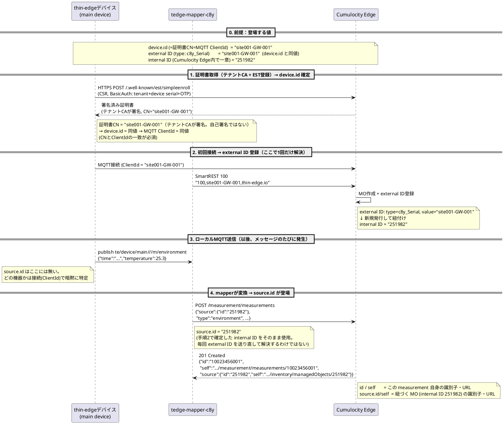

# thin-edge の device.id と Cumulocity Edge の source.id の対応（main device のみ）

> 対象は main device のみ（child device は対象外）。
> 参照元: [Cumulocity利用設計書_構成改訂版.md](../Cumulocity利用設計書_構成改訂版.md)

## 0. 前提：登場する値

| 項目 | 値（例） |
|---|---|
| `device.id`（＝証明書CN＝MQTT ClientId） | `site001-GW-001` |
| external ID（`type: c8y_Serial`） | `site001-GW-001`（device.id と同じ文字列） |
| internal ID（Cumulocity Edge 内で一意） | `251982`（設計書 §4.2.1 が挙げている例と同じ番号を流用） |

`site001-GW-001` という命名は適当な値ではなく、設計書の CK-1a 検査（[655-657行目](../Cumulocity利用設計書_構成改訂版.md:657)）が要求する main device external ID の正規表現 `^[a-z0-9]+-(ANLZ|GW)-.+$` に適合する形にしている。

## 1. 証明書取得（テナントCA + EST登録）→ device.id 確定

このプロジェクトの採用方式は「テナント CA + EST 登録」（[718-722行目](../Cumulocity利用設計書_構成改訂版.md:718)）。`tedge cert create` によるセルフ署名証明書は**開発・検証用のみ**（同724行目）で、本プロジェクトでは採用しない。

```bash
tedge config set c8y.url "$C8Y_URL"
tedge cert download c8y --device-id "$DEVICE_ID" --one-time-password "$OTP"
tedge connect c8y
```

`tedge cert download c8y` がデバイス上で CSR を生成し、Cumulocity Edge の EST エンドポイント（`/.well-known/est/simpleenroll`）にワンタイムパスワード付き BasicAuth で送信、**テナント CA が署名した証明書**を取得する（[791-794行目](../Cumulocity利用設計書_構成改訂版.md:791)）。

→ 証明書 CN = `$DEVICE_ID`（例: `site001-GW-001`） → `device.id` = 同値 → MQTT ClientId = 同値（CN と ClientId の一致が必須のため）。

有効期限が近づくと `tedge-cert-renewer@c8y` のタイマーが EST の `simplereenroll` で自動更新する（[803行目](../Cumulocity利用設計書_構成改訂版.md:803)）。

## 2. 初回接続 → external ID 登録（Cumulocity Edge 側）

thin-edge が Cumulocity Edge の MQTT ブローカーに接続すると、mapper が bridge topic `c8y/s/us` に SmartREST 100 を送る（[508-514行目](../Cumulocity利用設計書_構成改訂版.md:508)の仕様通り）:

```
100,site001-GW-001,thin-edge.io
```

Cumulocity Edge 側はこれを受けて（find-or-create、[3882行目](../Cumulocity利用設計書_構成改訂版.md:3882)）:

- MO を作成（`name: "site001-GW-001"`, `type: "thin-edge.io"`）
- external ID を登録：`type: c8y_Serial`, `externalId: "site001-GW-001"`
- 内部的に internal ID（例: `251982`）を新規発行し、上の external ID と紐付け

ここまでが「登録」のタイミングで、external ID ↔ internal ID の対応が**初回接続時に1回だけ**確定する。以降のメッセージのやり取りでは、この最初の接続と同じ MQTT セッション自体が「internal ID 解決済みの main device」として Cumulocity Edge 側にすでに認識されているため、メッセージごとに external ID を送って都度解決する、という処理は発生しない。

## 3. ローカル MQTT でのメッセージ送信（アプリ側視点）

アプリ（画像解析パイプライン等）は以下のように publish する。トピック構造は `te/device/main///m/<measurement-type>`（[1461行目](../Cumulocity利用設計書_構成改訂版.md:1461)）:

```
topic:   te/device/main///m/environment
payload: {
  "time": "2026-09-11T10:15:00+09:00",
  "temperature": 25.3
}
```

**ここには `source.id` はどこにも出てこない。** どのデバイスのデータかは、トピックの `device/main//` 部分だけで表現されている（[1436行目](../Cumulocity利用設計書_構成改訂版.md:1436)）。

## 4. mapper が変換 → source.id が登場する瞬間（修正版）

区別すべきは「mapper が Cumulocity Edge に送るリクエスト本体」と「Cumulocity Edge が作成後に返す・保存する結果」。

**① mapper → Cumulocity Edge（作成リクエスト。`POST /measurement/measurements` 相当）**

この時点ではまだ measurement 自体の ID は存在しないので、`id`/`self` は含まれない。含まれるのは紐づけ先の `source.id` だけ。

```json
{
  "time": "2026-09-11T10:15:00+09:00",
  "type": "environment",
  "source": { "id": "251982" },
  "environment": {
    "temperature": { "value": 25.3, "unit": "C" }
  }
}
```

**② Cumulocity Edge が作成後に返す・保存する結果（GET でも同じ形が見える）**

ここで初めて、Cumulocity Edge が**この measurement 自身に**新しい ID を採番して付与する。

```json
{
  "id": "10023456001",
  "self": "https://<domain>/measurement/measurements/10023456001",
  "source": {
    "id": "251982",
    "self": "https://<domain>/inventory/managedObjects/251982"
  },
  "time": "2026-09-11T10:15:00+09:00",
  "type": "environment",
  "environment": {
    "temperature": { "value": 25.3, "unit": "C" }
  }
}
```

- `id`（トップレベル）＝ この measurement 自身の ID（メッセージのID）
- `self`（トップレベル）＝ この measurement 自身への REST URL（自分のメッセージURL）
- `source.id` ＝ 紐づくデバイス（MO）の internal ID（＝ステップ2で確定した `251982`）
- `source.self` ＝ その MO 自身への REST URL。`source` オブジェクトの中にも `self` が付くのが Cumulocity API の一般的な形

つまり、1つの measurement JSON の中に「measurement 自身の id/self」と「source.id（＝デバイスの internal ID）とその self」という**2種類の「自分の ID／URL」が別々に存在**する。この2つを混同しないことが重要。

## まとめ：シーケンス図（PlantUML）

手順0〜4をすべて図中に含め、この図だけで各 ID の関連（device.id → external ID → internal ID → source.id、および measurement 自身の id/self との違い）が追えるようにしている。


